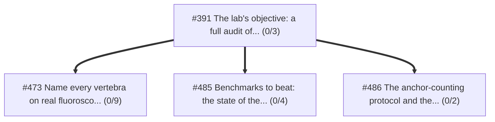
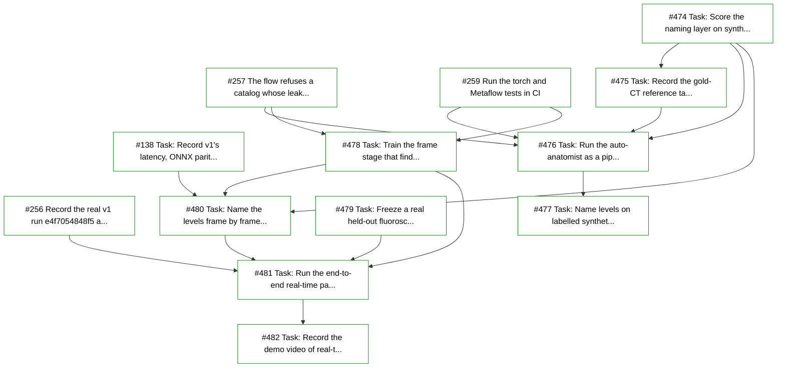
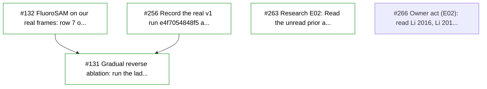
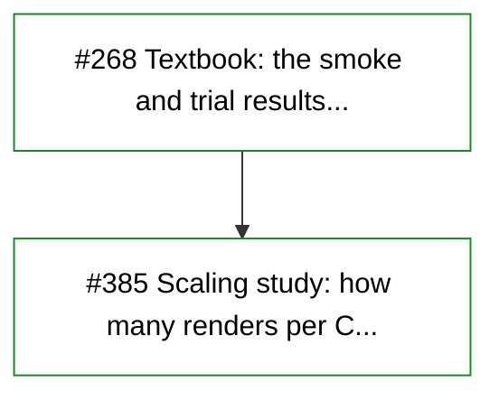
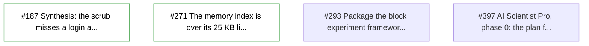

# Board

As of commit 995135a on main. Rewritten by .github/workflows/board.yml; do not edit by hand.

## Claims (open claude/<issue> branches and docs/agents/claims/<issue>.md)

| Issue | Branch | Worker | PR | Files it touches |
| --- | --- | --- | --- | --- |
| (not a claim) | claude/local-annotator-constructions | no claim file yet | #554 | docs/research/README.md, docs/research/annotator-landmarks/constructions.md, docs/research/annotator-landmarks/constructions.png, tests/test_annotator_landmarks.py, tools/annotator_landmarks.py |
| (not a claim) | claude/local-annotator-measures | no claim file yet | #555 | docs/memory/MEMORY.md, docs/memory/annotator-measures.md, docs/research/README.md, docs/research/annotator-landmarks/measures.md, tests/test_annotator_measures.py, tools/annotator_measures.py |
| (not a claim) | claude/local-annotator-registry | no claim file yet | #553 | docs/research/README.md, docs/research/annotator-landmarks/README.md, docs/research/annotator-landmarks/schemes.json, tests/test_annotator_schemes.py |
| (not a claim) | claude/local-cobra-varian | no claim file yet | #557 | data/choice/CHOICE.json, data/sources/cobra_varian.json, docs/research/README.md, docs/research/cobra-varian-arm.md, docs/research/datasets-inventory.md, docs/research/qa-loop-external/README.md, tests/test_cobra_varian_export.py, tools/cobra_varian_export.py, tools/realx_pairs.py |
| (not a claim) | claude/local-loopx-twin | no claim file yet | #558 | docs/memory/MEMORY.md, docs/memory/loopx-digital-twin.md, docs/research/README.md, docs/research/loopx-digital-twin.md, docs/research/loopx-digital-twin.png, docs/research/qa-loop-external/README.md, tests/test_qaloop.py, tools/loopx_twin.py, tools/realx_pairs.py |
| (not a claim) | claude/local-open-pairs | no claim file yet | #556 | docs/memory/MEMORY.md, docs/memory/open-paired-sets-on-the-grid.md, docs/research/README.md, docs/research/open-paired-fetch.md, grid/idc_headers.py, grid/open-pairs.sbatch, grid/series_select.py, tests/test_open_pairs.py |
| (not a claim) | claude/local-radiopaedia-paired | no claim file yet | #552 | data/choice/CHOICE.json, data/registry/radiopaedia_fluoro.json, data/registry/radiopaedia_xr.json, data/sources/radiopaedia.json, docs/memory/MEMORY.md, docs/memory/radiopaedia-by-hand.md, docs/research/README.md, docs/research/datasets-inventory.md, docs/research/radiopaedia-paired.md, grid/banks/radiopaedia_fluoro.json, grid/banks/radiopaedia_xr.json, tests/test_radiopaedia_import.py, tools/radiopaedia_import.py |
| (not a claim) | claude/not-strict | no claim file yet | (no pull request yet) | - |
| (not a claim) | claude/project-thread-31on5r | no claim file yet | (no pull request yet) | - |
| (not a claim) | claude/project-thread-3ulfan | no claim file yet | (no pull request yet) | - |
| (not a claim) | claude/project-thread-6uh345 | no claim file yet | (no pull request yet) | - |
| (not a claim) | claude/project-thread-7qoboa | no claim file yet | #416 | artifacts/_synthesis/work/out/toc-hand.json, docs/checkpoints/2026-10-27-cns-junction/README.md, docs/checkpoints/2026-10-27-cns-junction/review-findings.md, docs/memory/MEMORY.md, docs/memory/schwingcheck.md, docs/research/README.md, docs/research/schwingcheck.md, docs/textbook/36-schwingcheck-an-explainable-bayesian-check-on-vertebral-labels.md, docs/textbook/figures/36/measures-as-landmarks.json, docs/textbook/figures/36/measures-as-landmarks.svg, docs/textbook/figures/36/schwingcheck-pathways.json, docs/textbook/figures/36/schwingcheck-pathways.svg, docs/textbook/figures/36/schwingcheck-rule.json, docs/textbook/figures/36/schwingcheck-rule.svg, docs/textbook/figures/36/schwingnet-stages.json, docs/textbook/figures/36/schwingnet-stages.svg, docs/textbook/figures/36/segmentation-free-device.json, docs/textbook/figures/36/segmentation-free-device.svg, docs/textbook/rag/questions.json, tools/schwingcheck_figures.py, tools/schwingcheck_records.json |
| (not a claim) | claude/project-thread-bft0k4 | no claim file yet | #468 | docs/checkpoints/2026-10-29-flux-realism/HANDOFF.md, docs/memory/MEMORY.md, docs/memory/flux-realism-edit.md, docs/research/flux-realism/DEVIATIONS.md, docs/research/flux-realism/README.md, docs/research/flux-realism/letter-to-flexray-author.md, flows/realism.py, grid/gate.sh, grid/realism.sbatch, src/schwingnet/realism.py, tests/test_gate.py, tests/test_realism_flow.py, tests/test_realism_report.py, tests/test_realism_tools.py, tools/realism.py, tools/realism_report.py |
| (not a claim) | claude/project-thread-cdwl0r | no claim file yet | #420 | data/choice/CHOICE.json, data/corpus-tiers/sources.json, data/corpus-tiers/work/build.py.txt, data/corpus-tiers/work/critics.json, data/corpus-tiers/work/hand_rows.json, data/corpus-tiers/work/hsg-research.json, data/corpus-tiers/work/rows-verified.json, data/sources/bournemouth_cervical_qf.json, data/sources/bournemouth_lumbar_qf.json, data/sources/radiopaedia.json, docs/checkpoints/2026-10-27-corpus-tiers/HANDOFF.md, docs/memory/MEMORY.md, docs/memory/the-corpus-tiers.md, docs/research/README.md, docs/research/corpus-tiers/README.md, docs/research/datasets-inventory.md, docs/research/gold3-ct/README.md, grid/README.md, grid/census.sbatch, grid/gate.sh, tests/test_corpus_tiers.py, tests/test_gate.py, tools/corpus_tiers.py |
| (not a claim) | claude/project-thread-cstta6 | no claim file yet | (no pull request yet) | - |
| (not a claim) | claude/project-thread-iipo4r | no claim file yet | (no pull request yet) | - |
| (not a claim) | claude/project-thread-k5hy7k | no claim file yet | #530 | docs/checkpoints/2026-10-31-qa-loop/HANDOFF.md, docs/checkpoints/2026-10-31-qa-loop/gold-pr-body.md, docs/memory/MEMORY.md, docs/memory/the-qa-loop.md, docs/research/README.md, docs/research/qa-loop-gold/DEVIATIONS.md, docs/research/qa-loop-gold/PREREG.md, docs/research/qa-loop-gold/PREREG.md.sha256, docs/research/qa-loop-gold/README.md, docs/research/qa-loop/README.md, docs/research/spineps-fine-tuning-audit.md, flows/qaloop.py, flows/qaloop_gold.py, flows/registry.txt, grid/gate.sh, grid/qaloop.sbatch, grid/qaloop/qa_gold.json, grid/qaloop/qa_gold_smoke.json, grid/qaloop_gold.sbatch, tests/fakes/hpcworker, tests/test_gate.py, tests/test_gold_xray.py, tests/test_qaloop.py, tests/test_qaloop_report.py, tests/test_run_code.py, tools/gold_xray.py, tools/qaloop_gates.py, tools/qaloop_report.py, tools/qaloop_round.py, tools/run_code.py |
| (not a claim) | claude/project-thread-m7t92i | no claim file yet | (no pull request yet) | - |
| (not a claim) | claude/project-thread-qao1u7 | no claim file yet | (no pull request yet) | - |
| (not a claim) | claude/project-thread-t7h01z | no claim file yet | (no pull request yet) | - |
| (not a claim) | claude/project-thread-tn9lgv | no claim file yet | (no pull request yet) | - |
| (not a claim) | claude/project-thread-xiwixf | no claim file yet | (no pull request yet) | - |
| (not a claim) | claude/settings-app | no claim file yet | (no pull request yet) | - |
| (not a claim) | claude/settings-recheck | no claim file yet | (no pull request yet) | - |
| (not a claim) | claude/settings-variables | no claim file yet | (no pull request yet) | - |

## Open pull requests

| PR | Title | Branch | State (clean, behind, conflicting, blocked, unknown) | Last update |
| --- | --- | --- | --- | --- |
| #416 | Textbook chapter 36: the SchwingCheck white paper, with five diagrams | claude/project-thread-7qoboa | conflicting | 2026-11-02T05:04:20Z |
| #420 | Sort the corpus into the owner's gold and silver tiers (checkpoint draft) | claude/project-thread-cdwl0r | clean | 2026-11-02T05:04:21Z |
| #468 | Realism edit: FleXray's train-extra imports, an L40S, its own soft Dice and threshold; the handoff and the letter draft | claude/project-thread-bft0k4 | conflicting | 2026-11-02T05:04:21Z |
| #530 | Send the QA loop's links to galhp or gmsap, whichever frees first | claude/project-thread-k5hy7k | conflicting | 2026-11-02T05:04:22Z |
| #552 | Radiopaedia paired cases: a ct group, PAIRS.csv and how to save them by hand | claude/local-radiopaedia-paired | clean | 2026-11-02T05:04:23Z |
| #553 | Register the landmark schemes annotators mark, their 3-D counterparts and the sets the grid holds | claude/local-annotator-registry | clean | 2026-11-02T05:04:24Z |
| #554 | The annotators' landmarks as the CT engine's constructions, checked against DeepFluoro's person-placed points | claude/local-annotator-constructions | clean | 2026-11-02T05:04:24Z |
| #555 | Measure what the annotators' landmarks make, through a real X-ray, for the Bayes rule | claude/local-annotator-measures | blocked | 2026-11-02T05:27:42Z |
| #556 | Fetch the open paired TCIA sets as series lists, and the masked CT COLONOGRAPHY headers without pixels | claude/local-open-pairs | clean | 2026-11-02T05:04:26Z |
| #557 | Export COBRA2026's Varian cases and pair them as data beside the external arm | claude/local-cobra-varian | clean | 2026-11-02T05:10:17Z |
| #558 | Open the Loop-X digital-twin cadaver: its poses tested, its levels named, a four-frame gate-only arm | claude/local-loopx-twin | clean | 2026-11-02T05:11:17Z |

## Overlaps (files that more than one piece of open work changes; land the work in this order: a blocker first, then work marked ready, then the oldest)

| File | Open work, in the order it should land |
| --- | --- |
| data/choice/CHOICE.json | #420, #552, #557 |
| data/sources/radiopaedia.json | #420, #552 |
| docs/memory/MEMORY.md | #416, #420, #468, #530, #552, #556, #555, #558 |
| docs/research/README.md | #416, #420, #530, #552, #554, #553, #556, #557, #555, #558 |
| docs/research/datasets-inventory.md | #420, #552, #557 |
| docs/research/qa-loop-external/README.md | #557, #558 |
| grid/gate.sh | #420, #468, #530 |
| tests/test_gate.py | #420, #468, #530 |
| tests/test_qaloop.py | #530, #558 |
| tools/realx_pairs.py | #557, #558 |

## Queue (open issues labelled todo, unclaimed and given to no worker)

| Issue | Title | Labels |
| --- | --- | --- |
| #57 | A. Counting prior from CT at decode time | todo |
| #58 | B. Bank the unused rare-class renders (FluoroGen synth_rare, the synthetic L6 arm) | todo |
| #59 | C. AP and oblique renders with projected anchors, and an anchor head | todo |
| #60 | D. COBRA: label real projections from the planning CT; sweeps; real and simulated pairs (blocked by 1 open issue) | todo |
| #61 | E. Device and setting harmonisation that keeps shape | todo |
| #62 | F. Anomalies labelled on CT: readers' column calls as the prior | todo |
| #63 | G. X-ray annotation format v1: schema, converters, COCO keypoints export | todo |
| #64 | H. Anomaly screening detector over the unannotated X-rays | todo |
| #65 | I. Pseudo-labeller: teacher and student over the unannotated X-rays | todo |
| #66 | J. Covariate census: age, sex, pathology, device from headers, dataset files and supplements | todo |
| #67 | K. Multi-view 3D-aware pretraining on renders and COBRA rotations | todo |
| #68 | L. View translation: AP to lateral, structured first, tested on real pairs | todo |
| #69 | M. Physics renderer with randomisation, and its ablation against styled renders | todo |
| #70 | N. Rare anatomy made in 3D (L6, T13, sacralised L5 by editing segmented CTs) | todo |
| #72 | Grid gate words for the counting prior, the covariate census and the chain evaluation | todo |
| #127 | O: gold masks on the paired CT and X-ray sets, verified, projected and registered (blocked by 1 open issue) | todo |
| #131 | Gradual reverse ablation: run the ladder of benchmarks-to-beat.md section 4 on the same test persons, one component per rung (blocked by #132, #256) | todo |
| #132 | FluoroSAM on our real frames: row 7 of the reverse-ablation table, per structure and per level, from its released weights | todo |
| #135 | P: level naming from the lumbosacral gold to C2 by renders, physics noise, denoising and generative translation | todo |
| #138 | Task: Record v1's latency, ONNX parity and sweep once the grid jobs run | blocker, todo |
| #142 | Task: fill the Kaggle fracture bank recipe from the fetched archive | todo |
| #187 | Synthesis: the scrub misses a login after a relative path and the first name in capitals | todo |
| #256 | Record the real v1 run e4f7054848f5 and freeze its witness frames | blocker, todo |
| #257 | The flow refuses a catalog whose leak join has not passed | blocker, todo |
| #258 | Run the leak join over the real shards | todo |
| #259 | Run the torch and Metaflow tests in CI | blocker, todo |
| #261 | Patch tests/test_crowd_check.py for git's maintenance race (symphony-template#455) (blocked by 1 open issue) | todo |
| #263 | Research E02: Read the unread prior art on naming without registration | research, todo |
| #267 | Data input: the audit's findings that #260 leaves open | todo |
| #268 | Textbook: the smoke and trial results in the experiments panel, and the whole workflow as a chapter 35 figure | todo |
| #271 | The memory index is over its 25 KB limit, and nothing checks it | todo |
| #310 | Obtain every dataset not held yet: requests and online searches (Bern, CM Spine first) | todo |
| #315 | [P1] Obtain pittsburgh_swallow (blocked by 1 open issue) | priority:P1, todo |
| #316 | [P1] Obtain vanderbilt_tha_fluoro (blocked by 1 open issue) | priority:P1, todo |
| #317 | [P1] Obtain bournemouth_lumbar_qf (blocked by 1 open issue) | priority:P1, todo |
| #318 | [P1] Obtain bournemouth_cervical_qf (blocked by 1 open issue) | priority:P1, todo |
| #319 | [P1] Obtain huashan_intraop_lumbar (blocked by 1 open issue) | priority:P1, todo |
| #320 | [P1] Obtain nitw_2d3d_registration (blocked by 1 open issue) | priority:P1, todo |
| #321 | [P1] Obtain bern_myelography (blocked by 1 open issue) | priority:P1, todo |
| #322 | [P1] Obtain and classify the licence of cm_spine_garm (blocked by 1 open issue) | priority:P1, todo |
| #323 | [P1] Obtain jefferson_drg (blocked by 1 open issue) | priority:P1, todo |
| #324 | [P1] Obtain maastricht_cervical (blocked by 1 open issue) | priority:P1, todo |
| #325 | [P1] Obtain neurosurgical_focus_video (blocked by 1 open issue) | priority:P1, todo |
| #326 | [P1] Obtain procedure_guide (blocked by 1 open issue) | priority:P1, todo |
| #327 | [P1] Obtain radiopaedia (blocked by 1 open issue) | priority:P1, todo |
| #328 | [P1] Obtain and classify the licence of seattle_science_foundation (blocked by 1 open issue) | priority:P1, todo |
| #329 | [P1] Obtain and classify the licence of sx_stitch (blocked by 1 open issue) | priority:P1, todo |
| #330 | [P3] Obtain padchest (blocked by 1 open issue) | priority:P3, todo |
| #331 | [P3] Obtain mimic_cxr (blocked by 1 open issue) | priority:P3, todo |
| #332 | [P3] Obtain chexpert_plus (blocked by 1 open issue) | priority:P3, todo |
| #333 | [P3] Classify the licence of nih_chestxray14 | priority:P3, todo |
| #334 | [P3] Obtain and classify the licence of fraiwan_spine_xray | priority:P3, todo |
| #335 | [P3] Obtain and classify the licence of canine_thoracic_vhs (blocked by 1 open issue) | priority:P3, todo |
| #336 | [P3] Classify the licence of cathaction (blocked by 1 open issue) | priority:P3, todo |
| #337 | [P3] Obtain and classify the licence of cm_spine_drive_file (blocked by 1 open issue) | priority:P3, todo |
| #338 | [P3] Obtain and classify the licence of coronary_angiography (blocked by 1 open issue) | priority:P3, todo |
| #339 | [P3] Obtain and classify the licence of daradia_vertebroplasty (blocked by 1 open issue) | priority:P3, todo |
| #340 | [P3] Obtain and classify the licence of dmx_imaging (blocked by 1 open issue) | priority:P3, todo |
| #341 | [P3] Obtain and classify the licence of faubel_painsource (blocked by 1 open issue) | priority:P3, todo |
| #342 | [P3] Classify the licence of fluoro_video_clips | priority:P3, todo |
| #343 | [P2] Classify the licence of fluorogen_synth_rare | priority:P2, todo |
| #344 | [P3] Obtain and classify the licence of fracatlas (blocked by 1 open issue) | priority:P3, todo |
| #345 | [P3] Obtain guide3d (blocked by 1 open issue) | priority:P3, todo |
| #346 | [P2] Classify the licence of implant_ct_synthetic | priority:P2, todo |
| #347 | [P3] Obtain and classify the licence of kaggle_fracture_multiregion (blocked by 1 open issue) | priority:P3, todo |
| #348 | [P2] Obtain and classify the licence of kaggle_scoliosis_yolov5 (blocked by 1 open issue) | priority:P2, todo |
| #349 | [P3] Obtain and classify the licence of konica_ddr (blocked by 1 open issue) | priority:P3, todo |
| #350 | [P3] Obtain and classify the licence of mayfield_kyphoplasty (blocked by 1 open issue) | priority:P3, todo |
| #351 | [P3] Obtain and classify the licence of mendeley_ddh_hips (blocked by 1 open issue) | priority:P3, todo |
| #352 | [P2] Obtain mros_lateral_spine (blocked by 1 open issue) | priority:P2, todo |
| #353 | [P3] Obtain and classify the licence of mtfi_lumbar_coupling (blocked by 1 open issue) | priority:P3, todo |
| #354 | [P3] Obtain and classify the licence of open_i_chest (blocked by 1 open issue) | priority:P3, todo |
| #355 | [P3] Obtain and classify the licence of pediatric_iri (blocked by 1 open issue) | priority:P3, todo |
| #356 | [P2] Obtain sof_lateral_spine (blocked by 1 open issue) | priority:P2, todo |
| #357 | [P3] Classify the licence of spinal_ai2024 | priority:P3, todo |
| #358 | [P3] Obtain and classify the licence of tvgh_as_spine (blocked by 1 open issue) | priority:P3, todo |
| #359 | [P3] Obtain and classify the licence of tvgh_spinexr (blocked by 1 open issue) | priority:P3, todo |
| #360 | [P3] Obtain veriserum | priority:P3, todo |
| #361 | [P2] Obtain and classify the licence of vertxnet_nhanes2_labels (blocked by 1 open issue) | priority:P2, todo |
| #362 | [P3] Classify the licence of veterinary_pig_levelcheck | priority:P3, todo |
| #363 | [P3] Obtain and classify the licence of vfss2022 (blocked by 1 open issue) | priority:P3, todo |
| #364 | [P3] Obtain vindr_cxr (blocked by 1 open issue) | priority:P3, todo |
| #365 | [P3] Obtain vindr_pcxr (blocked by 1 open issue) | priority:P3, todo |
| #366 | [P3] Obtain idc_nlst (blocked by 1 open issue) | priority:P3, todo |
| #367 | [P3] Obtain idc_lidc_idri (blocked by 1 open issue) | priority:P3, todo |
| #368 | [P3] Obtain zenodo_unitochest | priority:P3, todo |
| #369 | [P3] Obtain zenodo_lumvbcanseg | priority:P3, todo |
| #370 | [P3] Obtain cobra_embargoed (blocked by 1 open issue) | priority:P3, todo |
| #371 | [P3] Obtain idc_prostate_anatomical_edge_cases (blocked by 1 open issue) | priority:P3, todo |
| #372 | [P3] Obtain zenodo_medpelvis3d | priority:P3, todo |
| #373 | [P3] Obtain zenodo_tmtv_benchmark | priority:P3, todo |
| #374 | [P3] Classify the licence of anomaly_harvest_b | priority:P3, todo |
| #375 | [P3] Obtain cads (blocked by 1 open issue) | priority:P3, todo |
| #376 | [P3] Obtain ct_rate (blocked by 1 open issue) | priority:P3, todo |
| #377 | [P3] Obtain hf_abdomenatlas2_0_mini (blocked by 1 open issue) | priority:P3, todo |
| #378 | [P3] Obtain magic_ct (blocked by 1 open issue) | priority:P3, todo |
| #379 | [P3] Classify the licence of pengwin_task2_xrays | priority:P3, todo |
| #380 | [P3] Obtain rsna_ratic (blocked by 1 open issue) | priority:P3, todo |
| #381 | [P3] Obtain scidb_enhance_pet_1_6k (blocked by 1 open issue) | priority:P3, todo |
| #382 | [P3] Obtain stanford_aimi_inspect (blocked by 1 open issue) | priority:P3, todo |
| #383 | [P3] Obtain stanford_aimi_merlin (blocked by 1 open issue) | priority:P3, todo |
| #384 | [P3] Classify the licence of verse_2d_projections | priority:P3, todo |
| #385 | Scaling study: how many renders per CT, and where any-angle accuracy breaks out (blocked by #268) | priority:P1, todo |
| #474 | Task: Score the naming layer on synthetic columns across all 106 reread measures | todo |
| #475 | Task: Record the gold-CT reference table counted from C2 (blocked by #474) | todo |
| #476 | Task: Run the auto-anatomist as a pipeline block on held-out gold persons (blocked by #257, #259, #474, #475) | todo |
| #477 | Task: Name levels on labelled synthetic fluoroscopy from the frame alone (blocked by #476) | todo |
| #478 | Task: Train the frame stage that finds each vertebral body, with no segmentation at inference (blocked by #257, #259) | todo |
| #479 | Task: Freeze a real held-out fluoroscopy test set | todo |
| #480 | Task: Name the levels frame by frame as a pan moves, within 97 ms (blocked by #138, #474, #478) | todo |
| #481 | Task: Run the end-to-end real-time path on an MP4 and report it (blocked by #256, #478, #479, #480) | todo |
| #482 | Task: Record the demo video of real-time naming on a fluoroscopic pan (blocked by #481) | todo |
| #531 | Handoff: grid dataset pruning | todo |

## Given to workers (open issues a worker's label names, not yet claimed)

| Issue | Title | Worker |
| --- | --- | --- |
| (none) |  |  |

## Blockers (open issues labelled blocker)

| Issue | Title | Labels |
| --- | --- | --- |
| #138 | Task: Record v1's latency, ONNX parity and sweep once the grid jobs run | blocker, todo |
| #256 | Record the real v1 run e4f7054848f5 and freeze its witness frames | blocker, todo |
| #257 | The flow refuses a catalog whose leak join has not passed | blocker, todo |
| #259 | Run the torch and Metaflow tests in CI | blocker, todo |

## Recently merged (the last 5)

| PR | Title | Branch | Merged |
| --- | --- | --- | --- |
| #551 | Check the DeepFluoro arm against the dataset's own annotations | claude/local-deepfluoro-annotations | 2026-11-02T02:46:26Z |
| #550 | Record the external smoke: it holds, and the larger real arm shows what the 13 persons hid | claude/local-qaloop-ext-smoke | 2026-11-02T01:56:41Z |
| #549 | Widen the anchor's outline with the lowest body, so a flat one never crashes the round | claude/local-qaloop-anchor-hull | 2026-11-02T01:28:56Z |
| #548 | Give the QA loop external real arms and the sacral anchor, as the kind qaloop_ext | claude/local-qaloop-ext | 2026-11-02T00:57:59Z |
| #547 | The QA loop's smoke holds on the real arm; the loop and the transformer plan are sent | claude/local-qaloop-smoke-record | 2026-11-01T22:40:05Z |

## Dependencies

Each open epic's tasks as GitHub's sub-issues and blocked-by relations hold them: an arrow runs from the issue that blocks to the issue it blocks, dotted once the blocker is closed; a node's shade is its state, and an epic's heading counts its closed tasks.

### Goals

### Epic #7: A better SchwingNet by 2 November (6/7)

### Epic #473: Name every vertebra on real fluoroscopy in real time, without segmentation, and record the demo (0/9)

### Epic #485: Benchmarks to beat: the state of the art measured on our held frames and full-spine panoramas (0/4)

### Epic #486: The anchor-counting protocol and the results explorer: renders at scale, the experiments panel, the workflow figure (0/2)

### Epic #487: How the research runs: AI Scientist Pro, the exportable framework, the synthesis and the memory index (0/4)

