# SchwingNet evaluation, every version

Source: the thread "SchwingNet witness frames and W&B", 2026-10-21, issue #12; the plan is docs/research/retraining-plan.md, section 4. Confidential, this repository only, read on GitHub by its members: nothing here is public until the provisional is filed. Written by `python3 tools/eval_page.py write` from the recorded runs under docs/research/v1-demo/runs/; the required check fails when this page is not what the runs give, so do not edit it by hand.

How to read it: every fraction is correct/n with its 95 percent Wilson interval. The validation part chose the checkpoint; the test part was read once, at the version boundary. The witness frames are the same real frames at every checkpoint, epoch 0 being the untrained network: validation frames are drawn by the trainer every epoch, test, transitional (L6) and sweep frames by the evaluator over every epoch's weights after training, and they choose nothing. A green box names the body right, a red box shows truth>prediction. Each strip below links to its animation over all epochs. A run made on the synthetic bank measures the workflow, not SchwingNet, and says so in its note.

## Every version

| run | started | catalog | epochs, best | validation at best | test, all levels | transitional (T13, L6) | test witness at best | latency median / p95 | W&B | change from the version before |
|---|---|---|---|---|---|---|---|---|---|---|
| [a767a466f5c1](#run-a767a466f5c1) | 2026-10-21T02:36 | 1 9051dd4f7b35 | 4, 2 | 542/546 = 0.993 (0.981 to 0.997) | 556/556 = 1.000 (0.993 to 1.000), 5 persons | not measured | not drawn | not measured | not logged (run made before W&B) | first version |
| [cd37124c487d](#run-cd37124c487d) | 2026-10-21T13:41 | 1 5adfe5ec5715 | 4, 4 | 470/472 = 0.996 (0.985 to 0.999) | 430/431 = 0.998 (0.987 to 1.000), 5 persons | not measured | 180/180 = 1.000 (0.979 to 1.000) | not measured | not pushed: no W&B key: not in WANDB_API_KEY, ~/.wandb/token.env or ~/.netrc | -0.002 (catalog 1 9051dd4f to 1 5adfe5ec) |

## Run cd37124c487d

Commit cf0d3f03d5d9, catalog 1 (5adfe5ec5715), level stage, seed 1, local mode. Files: [../v1-demo/runs/cd37124c487d](../v1-demo/runs/cd37124c487d).

Dry run on the synthetic bank (tools/synthetic_bank.py), 2026-10-21: it measures the workflow, not SchwingNet. 900 training-bank frames of 40 synthetic persons and 120 test frames of the five frozen test persons (case42, case121, case136, case134, case39), ingested and catalogued by tools/ingest.py and tools/catalog.py, 4 epochs from scratch on CPU. The synthetic levels run T11 to sacrum, so there is no L6 box and the transitional frames are frames of the L6 persons without one. What the witness frames show here is the point of them: epoch 1 names 85 of 93 validation witness bodies, epochs 2 and 3 fall to 38 and 41 while the loss keeps falling, and epoch 4 names all 93; the curve alone would hide which frames broke, the strips show it. W&B was written offline only, since the container holds no key and its proxy refuses api.wandb.ai.

### Over the epochs

| epoch | train loss | validation | validation witness frames |
|---|---|---|---|
| 0 | untrained | 2/472 = 0.004 (0.001 to 0.015) | 1/93 = 0.011 (0.002 to 0.058) |
| 1 | 0.2775 | 415/472 = 0.879 (0.847 to 0.906) | 85/93 = 0.914 (0.839 to 0.956) |
| 2 | 0.0217 | 186/472 = 0.394 (0.351 to 0.439) | 38/93 = 0.409 (0.314 to 0.510) |
| 3 | 0.0397 | 218/472 = 0.462 (0.417 to 0.507) | 41/93 = 0.441 (0.344 to 0.542) |
| 4 | 0.0149 | 470/472 = 0.996 (0.985 to 0.999) | 93/93 = 1.000 (0.960 to 1.000) |

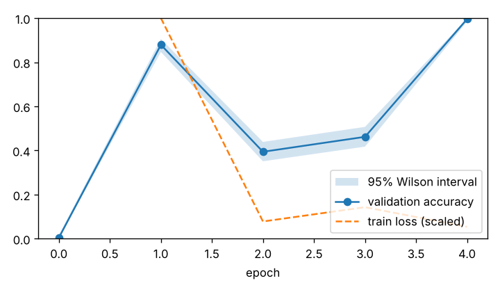

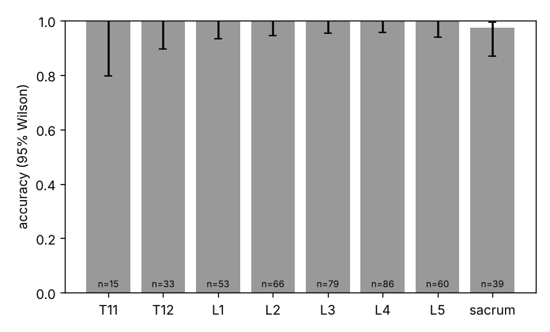

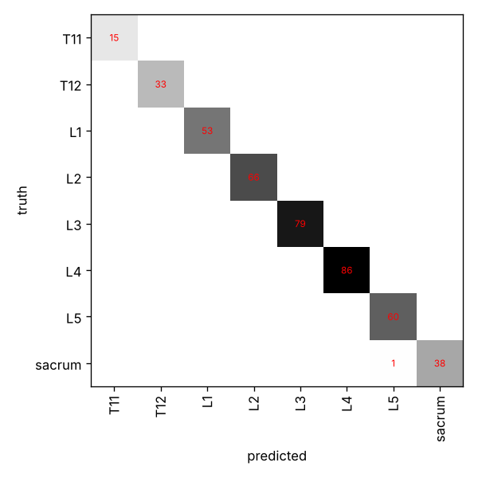

### Per level, on the test part

| stratum | test | persons |
|---|---|---|
| level L1 | 53/53 = 1.000 (0.932 to 1.000) | 5 |
| level L2 | 66/66 = 1.000 (0.945 to 1.000) | 5 |
| level L3 | 79/79 = 1.000 (0.954 to 1.000) | 5 |
| level L4 | 86/86 = 1.000 (0.957 to 1.000) | 5 |
| level L5 | 60/60 = 1.000 (0.940 to 1.000) | 5 |
| level T11 | 15/15 = 1.000 (0.796 to 1.000) | 5 |
| level T12 | 33/33 = 1.000 (0.896 to 1.000) | 5 |
| level sacrum | 38/39 = 0.974 (0.868 to 0.995) | 5 |

### Per source, on the test part

| stratum | test | persons |
|---|---|---|
| source carmlspine | 430/431 = 0.998 (0.987 to 1.000) | 5 |

### Test witness frames over the epochs (read at the version boundary)

| epoch | test | transitional | sweep |
|---|---|---|---|
| 0 | 1/91 = 0.011 (0.002 to 0.060) | 0/28 = 0.000 (0.000 to 0.121) | 0/61 = 0.000 (0.000 to 0.059) |
| 1 | 81/91 = 0.890 (0.809 to 0.939) | 27/28 = 0.964 (0.823 to 0.994) | 52/61 = 0.852 (0.743 to 0.920) |
| 2 | 36/91 = 0.396 (0.301 to 0.498) | 13/28 = 0.464 (0.295 to 0.642) | 24/61 = 0.393 (0.281 to 0.519) |
| 3 | 43/91 = 0.473 (0.373 to 0.574) | 10/28 = 0.357 (0.207 to 0.542) | 29/61 = 0.475 (0.355 to 0.598) |
| 4 | 91/91 = 1.000 (0.959 to 1.000) | 28/28 = 1.000 (0.879 to 1.000) | 61/61 = 1.000 (0.941 to 1.000) |

### The witness frames

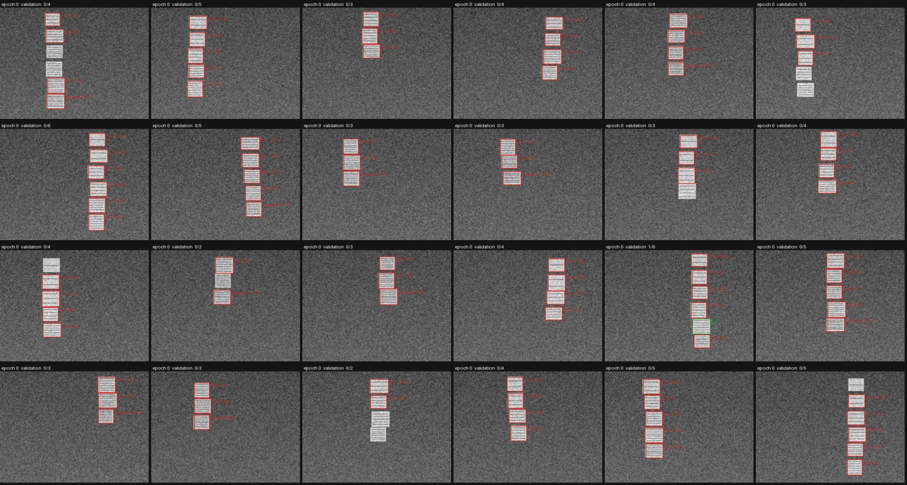
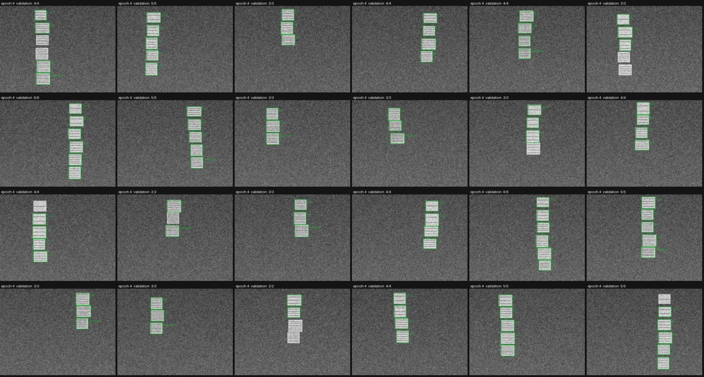
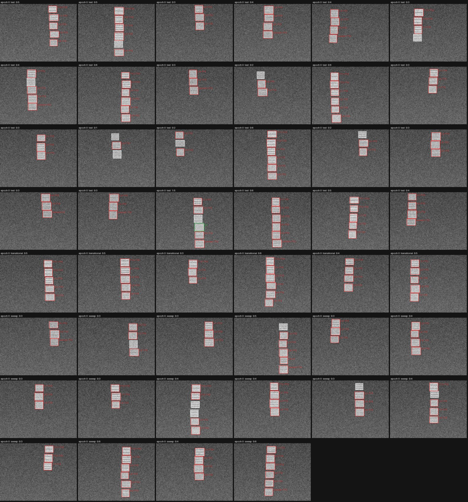
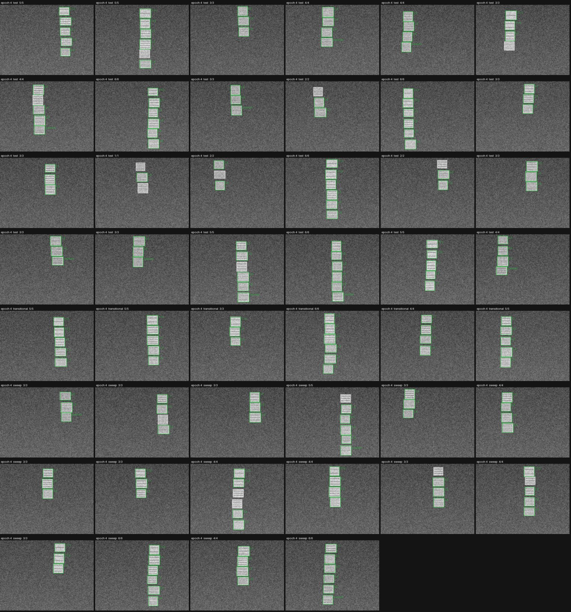

validation: 24 frames, strips over the epochs (each links to its animation)

[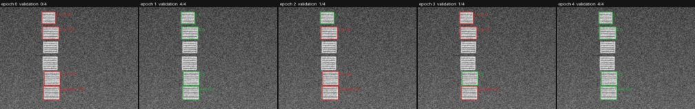](../v1-demo/runs/cd37124c487d/train/witness/frames/validation-00-15f305da/anim.gif)

[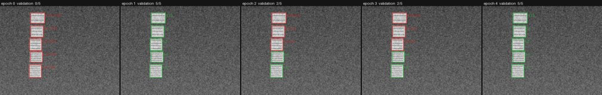](../v1-demo/runs/cd37124c487d/train/witness/frames/validation-01-9d69c1c1/anim.gif)

[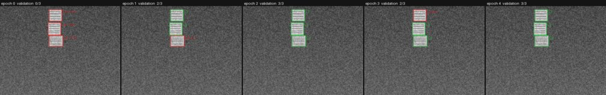](../v1-demo/runs/cd37124c487d/train/witness/frames/validation-02-81cb9000/anim.gif)

[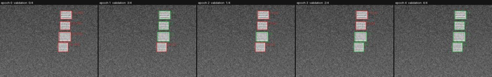](../v1-demo/runs/cd37124c487d/train/witness/frames/validation-03-9536c2ad/anim.gif)

[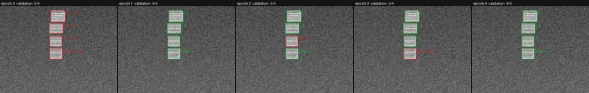](../v1-demo/runs/cd37124c487d/train/witness/frames/validation-04-a930d3af/anim.gif)

[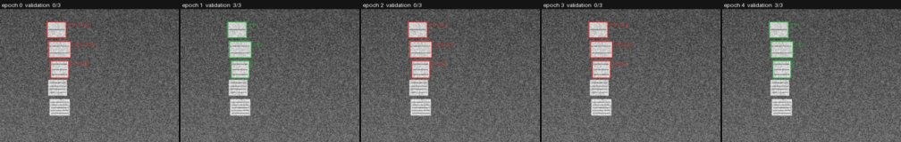](../v1-demo/runs/cd37124c487d/train/witness/frames/validation-05-faad6cc4/anim.gif)

[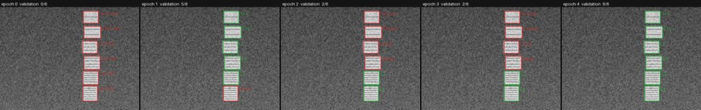](../v1-demo/runs/cd37124c487d/train/witness/frames/validation-06-98b939ce/anim.gif)

[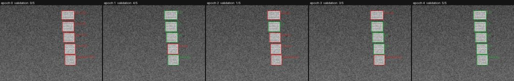](../v1-demo/runs/cd37124c487d/train/witness/frames/validation-07-06be9d74/anim.gif)

[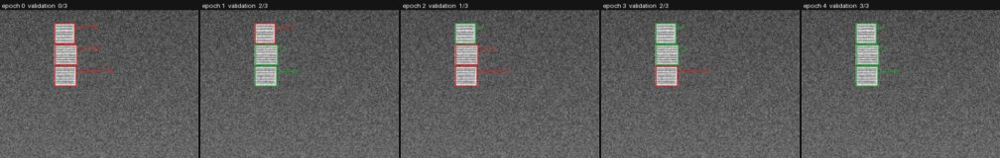](../v1-demo/runs/cd37124c487d/train/witness/frames/validation-08-e2a67efb/anim.gif)

[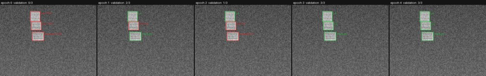](../v1-demo/runs/cd37124c487d/train/witness/frames/validation-09-8c2efc97/anim.gif)

[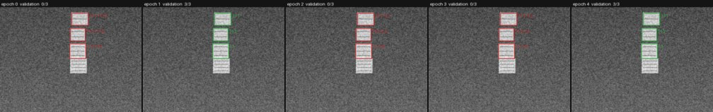](../v1-demo/runs/cd37124c487d/train/witness/frames/validation-10-ba5f76a9/anim.gif)

[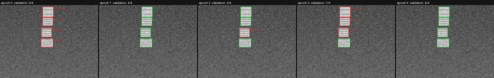](../v1-demo/runs/cd37124c487d/train/witness/frames/validation-11-2ded4246/anim.gif)

[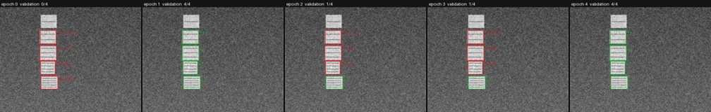](../v1-demo/runs/cd37124c487d/train/witness/frames/validation-12-276d7eb0/anim.gif)

[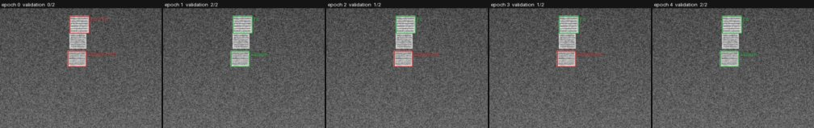](../v1-demo/runs/cd37124c487d/train/witness/frames/validation-13-ef00fe7b/anim.gif)

[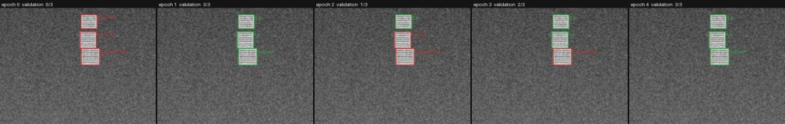](../v1-demo/runs/cd37124c487d/train/witness/frames/validation-14-9066c77d/anim.gif)

[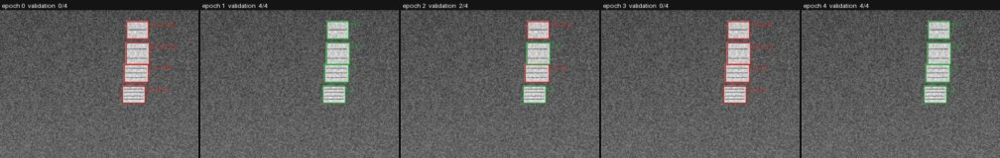](../v1-demo/runs/cd37124c487d/train/witness/frames/validation-15-eb137480/anim.gif)

[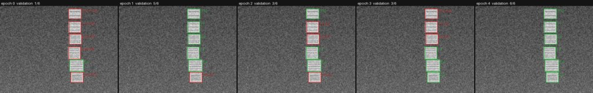](../v1-demo/runs/cd37124c487d/train/witness/frames/validation-16-a22fdab5/anim.gif)

[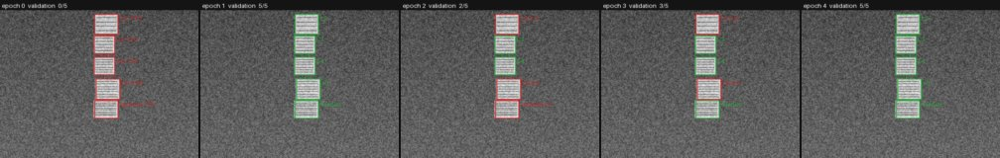](../v1-demo/runs/cd37124c487d/train/witness/frames/validation-17-5e48dccd/anim.gif)

[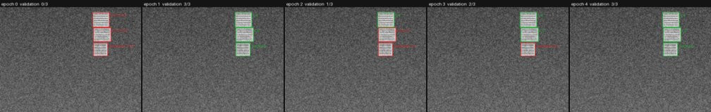](../v1-demo/runs/cd37124c487d/train/witness/frames/validation-18-68de831d/anim.gif)

[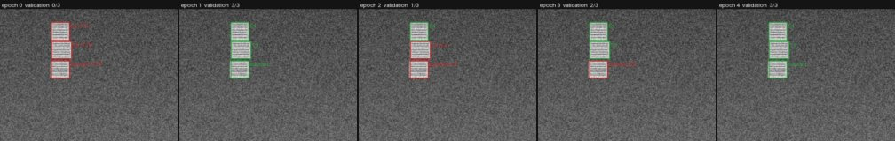](../v1-demo/runs/cd37124c487d/train/witness/frames/validation-19-6fede9f3/anim.gif)

[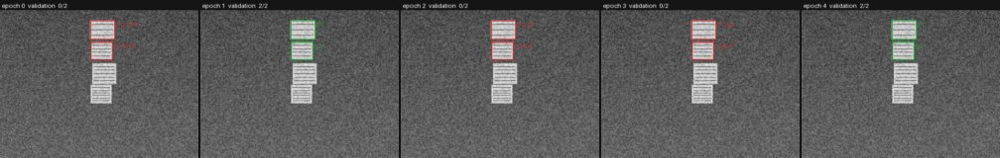](../v1-demo/runs/cd37124c487d/train/witness/frames/validation-20-0ac2ce52/anim.gif)

[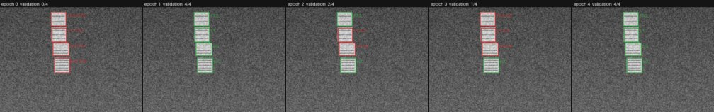](../v1-demo/runs/cd37124c487d/train/witness/frames/validation-21-307dc218/anim.gif)

[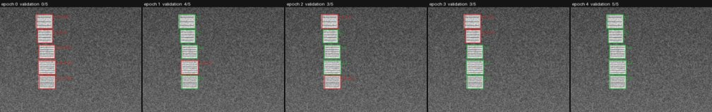](../v1-demo/runs/cd37124c487d/train/witness/frames/validation-22-61e86917/anim.gif)

[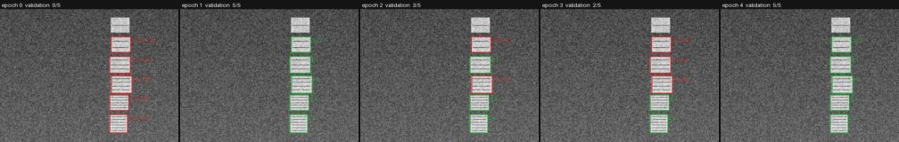](../v1-demo/runs/cd37124c487d/train/witness/frames/validation-23-244e3fb4/anim.gif)

test: 24 frames, strips over the epochs (each links to its animation)

[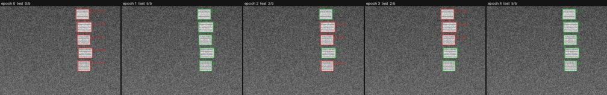](../v1-demo/runs/cd37124c487d/evaluate/witness/frames/test-24-c108baaf/anim.gif)

[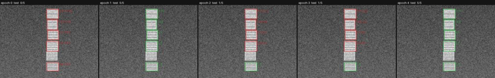](../v1-demo/runs/cd37124c487d/evaluate/witness/frames/test-25-eb0a8bda/anim.gif)

[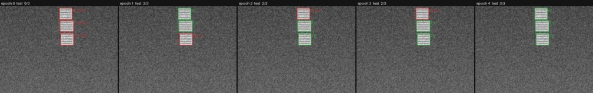](../v1-demo/runs/cd37124c487d/evaluate/witness/frames/test-26-ec0d1c3b/anim.gif)

[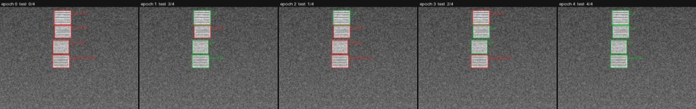](../v1-demo/runs/cd37124c487d/evaluate/witness/frames/test-27-e4a8f321/anim.gif)

[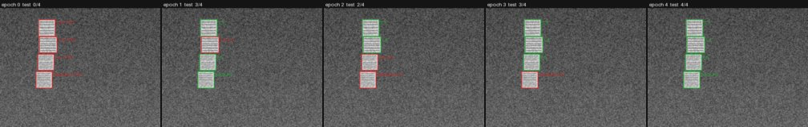](../v1-demo/runs/cd37124c487d/evaluate/witness/frames/test-28-1098079c/anim.gif)

[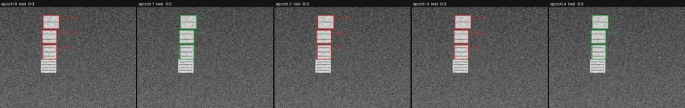](../v1-demo/runs/cd37124c487d/evaluate/witness/frames/test-29-0d910abf/anim.gif)

[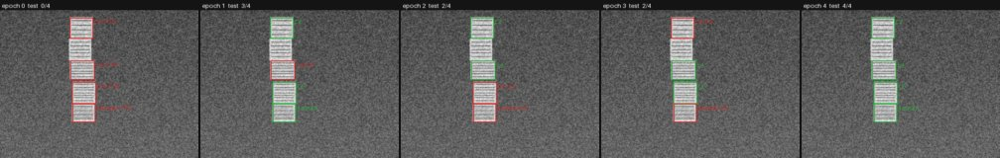](../v1-demo/runs/cd37124c487d/evaluate/witness/frames/test-30-3d9e4bc9/anim.gif)

[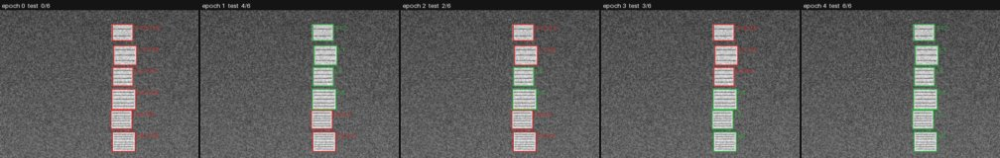](../v1-demo/runs/cd37124c487d/evaluate/witness/frames/test-31-412b80ed/anim.gif)

[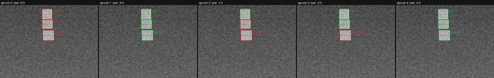](../v1-demo/runs/cd37124c487d/evaluate/witness/frames/test-32-1ebe52c9/anim.gif)

[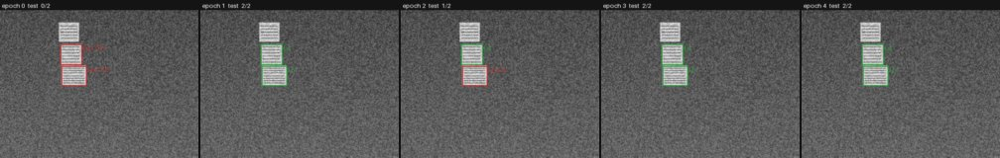](../v1-demo/runs/cd37124c487d/evaluate/witness/frames/test-33-a265ca26/anim.gif)

[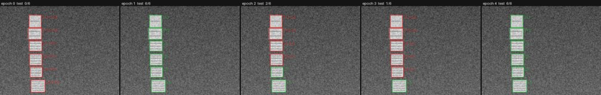](../v1-demo/runs/cd37124c487d/evaluate/witness/frames/test-34-e07e71a6/anim.gif)

[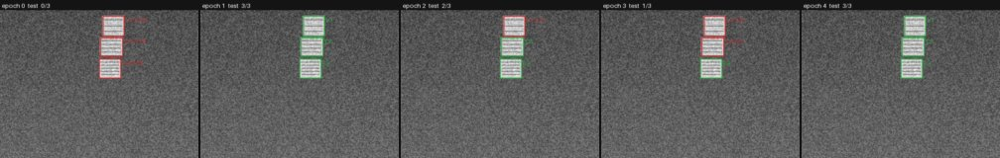](../v1-demo/runs/cd37124c487d/evaluate/witness/frames/test-35-04137797/anim.gif)

[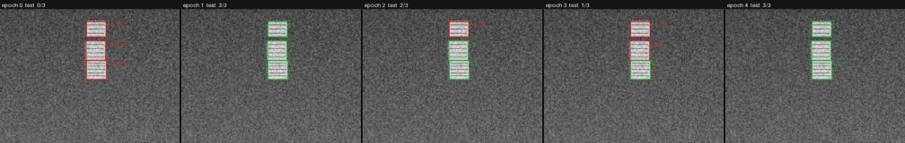](../v1-demo/runs/cd37124c487d/evaluate/witness/frames/test-36-be37073d/anim.gif)

[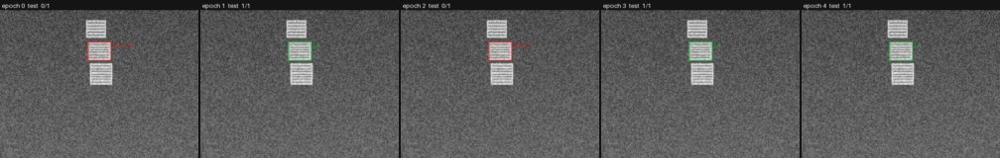](../v1-demo/runs/cd37124c487d/evaluate/witness/frames/test-37-92382588/anim.gif)

[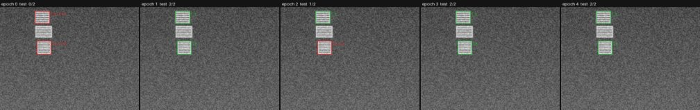](../v1-demo/runs/cd37124c487d/evaluate/witness/frames/test-38-f24482f2/anim.gif)

[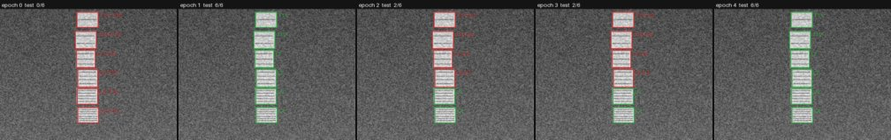](../v1-demo/runs/cd37124c487d/evaluate/witness/frames/test-39-3a580d47/anim.gif)

[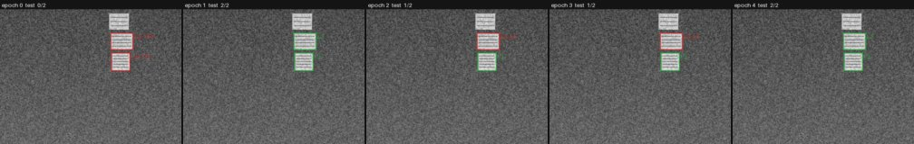](../v1-demo/runs/cd37124c487d/evaluate/witness/frames/test-40-829e8bd6/anim.gif)

[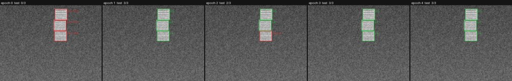](../v1-demo/runs/cd37124c487d/evaluate/witness/frames/test-41-72188b73/anim.gif)

[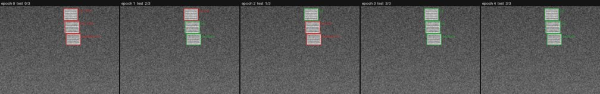](../v1-demo/runs/cd37124c487d/evaluate/witness/frames/test-42-fbc5de6f/anim.gif)

transitional: 6 frames, strips over the epochs (each links to its animation)

sweep: 16 frames, strips over the epochs (each links to its animation)

## Run a767a466f5c1

Commit 11546b7e534e, catalog 1 (9051dd4f7b35), level stage, seed 1, local mode. Files: [../v1-demo/runs/a767a466f5c1](../v1-demo/runs/a767a466f5c1).

### Over the epochs

| epoch | train loss | validation | validation witness frames |
|---|---|---|---|
| 1 | 0.1926 | 363/546 = 0.665 (0.624 to 0.703) | not drawn |
| 2 | 0.0065 | 542/546 = 0.993 (0.981 to 0.997) | not drawn |
| 3 | 0.0059 | 542/546 = 0.993 (0.981 to 0.997) | not drawn |
| 4 | 0.0043 | 542/546 = 0.993 (0.981 to 0.997) | not drawn |

### Per level, on the test part

| stratum | test | persons |
|---|---|---|
| level L1 | 73/73 = 1.000 (0.950 to 1.000) | 5 |
| level L2 | 82/82 = 1.000 (0.955 to 1.000) | 5 |
| level L3 | 101/101 = 1.000 (0.963 to 1.000) | 5 |
| level L4 | 105/105 = 1.000 (0.965 to 1.000) | 5 |
| level L5 | 79/79 = 1.000 (0.954 to 1.000) | 5 |
| level T11 | 24/24 = 1.000 (0.862 to 1.000) | 5 |
| level T12 | 44/44 = 1.000 (0.920 to 1.000) | 5 |
| level sacrum | 48/48 = 1.000 (0.926 to 1.000) | 5 |

### Per source, on the test part

| stratum | test | persons |
|---|---|---|
| source carmlspine | 556/556 = 1.000 (0.993 to 1.000) | 5 |

### Test witness frames over the epochs (read at the version boundary)

Not drawn in this run.

### The witness frames

No witness frames in this run (it was made before them).
