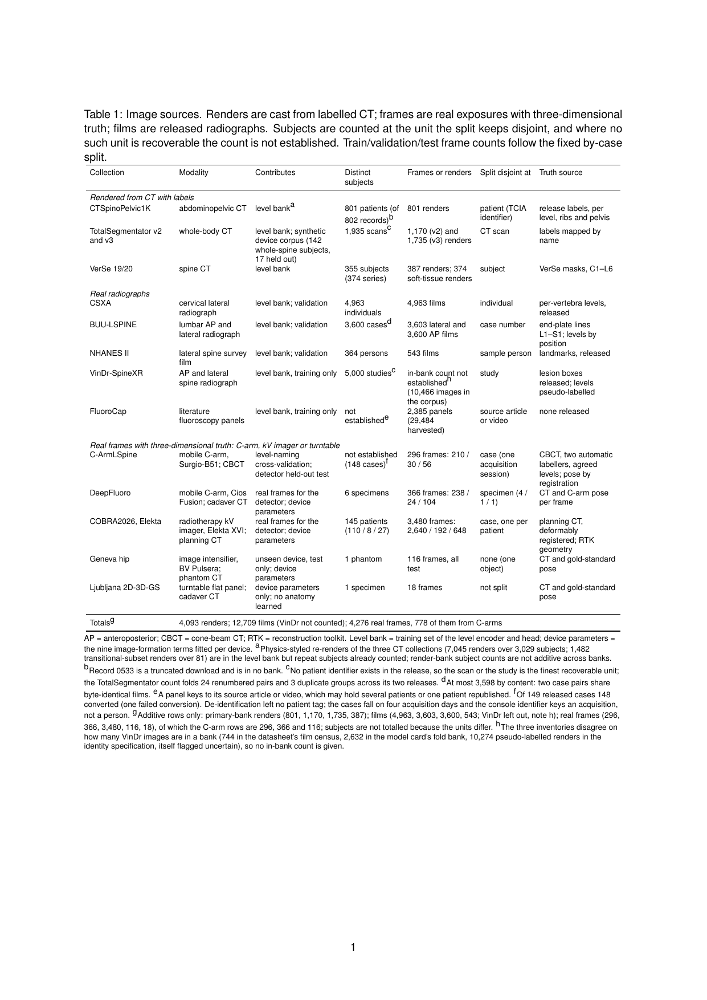
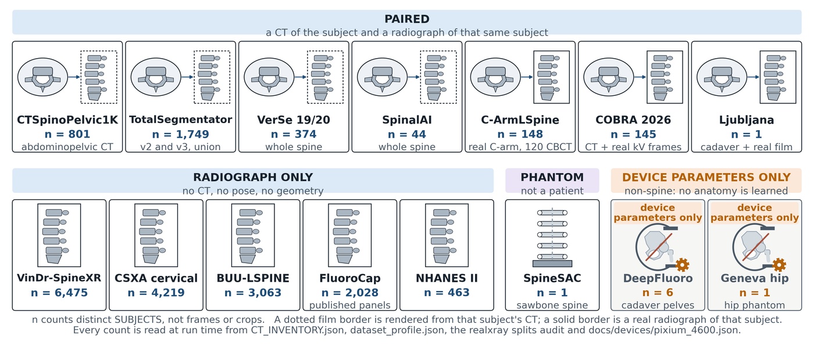

# 04 The registry and the holding: every source by reach

Label: schwingnet-internal. The holding, its counts and the agreements the records state are set out for the project's members only, with no method, grid path, login or person's name, and the page stays in this private repository.

This chapter gives a planner one record of what the project holds and how sure each count is: the registry under data/sources recounted on 24 October 2026, the data platform's manifest, how a source is obtained again and a copy checked, where the holding sits on the lab volume, its size beside the published studies, and which counts wait for a grid job. Where two records disagree, it gives both and says which the concept ledger settles, if either. The sets themselves are chapters 05 to 08, and their splits and licences [chapter 09](09-splits-leakage-and-licences.md).

## Which record answers which question

The project keeps several records of its data, and they differ in size because they count different things. The registry is one JSON record per source under [data/sources/](../../data/sources/), with a group, a reach word, a licence line, a status line, the file it was copied from and the counts that file states; tools/sources.py renders it as [docs/research/datasets-inventory.md](../../docs/research/datasets-inventory.md), and the check fails when the two disagree. HAVE, or held, is on the grid now; GET is public or available by request and not yet fetched; GATED is behind an agreement, an application or a login; EMBARGOED is released on a date; NONE has no public set; EXCLUDED is held or seen and set aside for a stated reason. The [SchwingNet Data Registry](../../artifacts/schwingnet-data-registry/) artifact renders those records as they stood on 20 October.

*Figure 4.1. The manuscript's corpus table as it fit the column on 22 September; the artifact lists three corrections being made to it. Source: [record](figures/04/table-1-the-corpus.json).*

The second record is the data platform's manifest in spinesurg-ct-nnunet, a card per source saying how it was acquired, from where, with which checks, and how to fetch it again. Its report is the [Imaging data holding: manifest, migration and index](../../artifacts/imaging-data-holding-manifest-migration-and-index-fqmtjs/) artifact of 8 October, and its cards are copied byte for byte into [data/reproduce/](../../data/reproduce/README.md). It cards the 144 collections of the anomaly harvest one by one where the registry folds them into one record, so the clash between its 212 and the registry's 111 is ruled refuted: each figure is right for its own record set ([programme contradictions](../../artifacts/_synthesis/contradictions/programme-direction-handoffs-and-onboarding.md), row 3).

The [Fluoroscopy Data Atlas](../../artifacts/fluoroscopy-data-atlas/) of 17 October is the wider catalog: 217 datasets, 189 from the project's records and 28 found only on the web, 16 request letters, and in its data 52 held, 16 with a letter drafted and 149 not held. It is where to find a set nobody has fetched and the text of a letter, but not whether the letter went: request state belongs to spine-datasets, the private repository through which unheld sets are obtained with collaborators. The [SchwingNet grid pipeline](../../artifacts/schwingnet-grid-pipeline/) board of 21 October counts its 86 records, 81 copied from SchwingNet and 5 intraoperative sets added, as 52 to do, 26 requested, 5 granted, 1 fetching, 1 fetched and 1 refused, and the contradictions say to carry request state from there ([datasets contradictions](../../artifacts/_synthesis/contradictions/datasets-holdings-and-licences.md), row 33).

The clusters page makes the registry, the atlas and the two reports of 8 October, the holding and the [State of the literature: datasets held, missing, size and power](../../artifacts/state-of-the-literature-datasets-held-missing-size-and-power-8hg1ay/), the canonical record of the datasets question ([clusters](../../artifacts/_synthesis/clusters.md)). The working rule follows: ask the registry what a source is and whether it is held, the manifest how it was obtained and how a copy is checked, spine-datasets whether a request is out, the atlas what else exists, and the census of 22 October what is actually on the volume, which has moved ahead of the records.

## The registry recounted

The plan asked for the reach words to be recounted from the records, since the artifact's tally is its exporter's. On 24 October the registry holds 111 records, with the totals the inventory page prints.

| Group | HAVE | GET | GATED | EMBARGOED | NONE | EXCLUDED | All |
| --- | --- | --- | --- | --- | --- | --- | --- |
| Real intraoperative fluoroscopy, stills | 5 | 3 | 0 | 0 | 2 | 1 | 11 |
| Video and cine | 3 | 21 | 1 | 0 | 0 | 0 | 25 |
| Real projections with a registered CT | 4 | 0 | 0 | 1 | 0 | 0 | 5 |
| Plain films | 9 | 11 | 7 | 0 | 0 | 2 | 29 |
| CT collections and their renders | 8 | 24 | 7 | 0 | 0 | 0 | 39 |
| Future directions | 0 | 2 | 0 | 0 | 0 | 0 | 2 |
| All | 29 | 61 | 15 | 1 | 2 | 3 | 111 |

The 70 X-ray records, the first four groups, are 21 held, 35 to get, 8 gated, 1 embargoed, 2 none and 3 excluded; the 39 CT records are 8 held, 24 to get and 7 gated. Eighty-eight records carry counts, each copied from its record file.

The [registry artifact's](../../artifacts/schwingnet-data-registry/) 60 records of 20 October, 24 held, 22 to get, 10 gated, 1 embargoed, 1 none and 2 excluded, are a record, not a final value: the contradictions rule that tally superseded by the 111 the board counted the next day (row 32; programme row 4). Fifty-one records have been added since and none removed: 27 found by the sweep of 21 October, mostly X-ray sets the project had missed, 22 CT sets the data platform had planned to fetch, and two others. Three of the 60 changed reach. Balgrist's ex-vivo lumbar set went to none when its holders answered on 21 October that it is licensed to a startup. DysphagiaBank went to held, 87 files and 19 GB, as the contradictions asked (row 37). VinDr-SpineXR went to held: it is covered since 29 September 2026 by WSU IRB HPR 2026-330, the supplement to determination 2026-269, and its 8,389 training and 2,077 test DICOM are on the volume ([docs/memory/vindr-is-covered-by-hpr-2026-330.md](../../docs/memory/vindr-is-covered-by-hpr-2026-330.md)). The board of 21 October gave 63 to get and 27 held; the two held records whose status lines date their holding to 21 and 22 October, the Aariz cephalograms and the IPCAI 2025 set, are the only held records with no manifest card and very probably the two that moved since, though no record says so.

### Where the records lag the volume

The census of 22 October shows the reach words lagging the volume, so 29 held is a floor. Its manifest lists data, in folders named for the registry's own ids and sized in the census's binary units (below), for nine sets the registry still calls to get: STOIC2021's training CTs (2,000 volumes, 246.1 GB), CathAction (52.3 GB of archives), KUB-StoneX (6,810 images, 51.5 GB), NIH ChestX-ray14 (42.0 GB of archives), PENGWIN's Task 2 projections (32.6 GB), the spine metastasis CT set (17.4 GB), VerSe's 2-D projections (4.1 GB), Open-i (1.3 GB) and the Kaggle scoliosis set (225.2 MB), with folders of 32.1 KB or less holding no image for three more and for the gated VinDr-PCXR ([docs/research/data-manifest/MANIFEST.md](../../docs/research/data-manifest/MANIFEST.md)). A folder is not a checked copy, so a reach word should move to held only from the fetch record, and a planner should read the census and the fetch logs beside the registry.

## The holding by evidence tier

The owner sorted the evidence into tiers on 27 October 2026, and this section lists the holding by them. A person is gold when one study shows the whole spine, so that a level named in it can be checked by counting from C2 to the sacrum, and silver when it shows less. Within each span there are four tiers:

- 1 is a CT and a real X-ray of the same person, with a person's annotation of the vertebrae on at least one of them.
- 2 is the same pair with no annotation.
- 3 is one modality alone, with a person's annotation.
- 4 is one modality alone, with none.

The person is the unit, counted once at the best tier any of their studies reaches. A mask, point, corner or level name that a person drew, checked or refined counts as a person's annotation, and a machine's labels never raise a tier. A DRR is not an X-ray here, edited by Flux or not. A pair is gold only when both images are whole, so a whole CT beside real C-arm frames is gold 3 or 4 alone and silver 1 or 2 as a pair.

The counts below come from the corpus-tiers sort ([SchwingNet pull request #420](https://github.com/OpenSpineConsortium/SchwingNet/pull/420), a draft at commit 828fb90), whose table gives every source the records know a row, 310 in all. Persons are counted once across sources. Where a source sits in several rows, as TotalSegmentator's two releases or VerSe's copies do, the rows add to more than the persons.

| Tier | Persons held | Where they come from | How sure |
| --- | --- | --- | --- |
| Gold 1 | 0 | no held whole-spine CT has a real radiograph of the same person | counted |
| Gold 2 | 0 | as gold 1 | counted |
| Gold 3 | 159 | TotalSegmentator 142, VerSe 17 | counted from the release masks |
| Gold 4 | about 2,090 | FDG-PET-CT-Lesions 865 to 900, CADS about 390, the Imaging Data Commons collections about 320, IEEE DataPort's standing lateral films 236, VSD full-body about 90, deep-PSMA about 70, Quadra 48, the TMTV benchmark 48 | FDG-PET-CT-Lesions counted from ENHANCE.PET's masks of the autoPET studies, taken to include the 900 held CTs, one a person, though no mask has been matched to its CT yet; the rest estimated from whole-body fields until their masks are read |
| Silver 1 | 1 | the Ljubljana 2D/3D gold standard | counted |
| Silver 2 | 848 | COBRA 692, C-ArmLSpine 149, DeepFluoro 6, the Killeen cadaver 1 | counted; every pair partial |
| Silver 3 | about 13,840 | partial films and CTs a person annotated: CSXA 4,963, BUU-LSPINE 3,598, TotalSegmentator's partial spines 1,583, Aariz 1,000, CTSpinoPelvic1K 784, AASCE 609, VerSe's partial spines 338 | mostly counted |
| Silver 4 | about 210,600 | partial films and CTs with no annotation, the chest film collections the largest | mostly counted |

Gold 3 rests on two readings. TotalSegmentator's 142 are the v3 subjects whose release masks hold C2 to L5 and the sacrum, each with at least 200 voxels, and no metal. They may become 156 once the 14 the level or metal rule dropped are read. Its masks are model output refined by hand, which counts as a person's annotation. If the owner reads them as machine labels, the 142 move to gold 4. VerSe's 17 run from C1 or C2 into the lower lumbar spine with the lumbosacral junction in the field. VerSe labels no sacrum, so a look at each field on the grid has still to confirm it.

No held person is gold 1 or gold 2. So no claim that checks a name on a real radiograph against a count from C2 has a held gold person to stand on. Claims on CT alone have 159 annotated whole spines and about 1,850 unannotated ones, gold 4 less IEEE DataPort's 236 films.

### ENHANCE.PET 1.6k, the largest gold 3 source not yet held

ENHANCE.PET 1.6k is a set of whole-body and total-body FDG PET/CT studies. Each study carries a vertebra mask that names every body from C1 to L6 and the sacrum, with no T13. The public bucket enhance-pet-1-6k holds 1,597 studies: 1,014 from the autoPET challenge, 384 from Leipzig and 199 from Careggi. Its 86 UC Davis studies are in Science Data Bank only, which is why the paper counts 1,683. The vertebra masks take 381,439,888 bytes, read from the bucket's listing on 27 October 2026.

MOOSE drew the masks first. Then a medical student verified and corrected each scan, a second student reviewed the first, and a radiology resident and a nuclear medicine resident reviewed both, by the paper's Methods (Ferrara and colleagues, Scientific Data 2026). Checked and refined by people, these masks are a person's annotation under the rule above, as TotalSegmentator's are. Every study whose field runs from C2 to the sacrum is therefore gold 3. The tiers sort calls them machine output, and its row for the set needs that correction.

The masks were read on the owner's word of 27 October 2026, in a cloud container and not on the grid. The rule is TotalSegmentator's: C2 and the sacrum each present with at least 200 voxels, and every level between them. The owner widened it that day to keep the 40 studies that lack only an L5 label. By that rule 1,557 of the 1,597 studies are whole: 979 of autoPET's, 379 of Leipzig's and all 199 of Careggi's. Of the rest, 37 have no C2 in the field, and 3 were left out for a skipped or scrambled label. At the owner's word those three were repaired, two by renaming the readers' labels as the ribs direct and one with MOOSE's own model, which makes 1,560 whole; they are kept as a test of correcting a segmentation and stay at gold 4 until a person checks them. Of the whole ones, 1,517 name every level from C2 to L5, 68 name an L6, and 39 have L4 directly above the sacrum. In each of the 39 the L4 label touches the sacrum label, which it never does across a labelled L5 in 100 controls, so no body without a label lies between. One more, 0529, names the body below L4 as L6 with no L5, a skipped label.

The rib masks show what the unusual lumbar counts are. Of the 39 named with four lumbar bodies, 24 have twelve rib pairs, the lowest on T12 (six of them read on one side only): an L5 counted into the sacrum or a column one body short, which the ribs cannot tell apart. Of the 67 L6 spines below an L5, 51 have twelve rib pairs and 14 have thirteen, the thirteenth on the body named L1, and in those 14 the ribs alone cannot say whether the extra body sits at the thoracolumbar or the lumbosacral junction. Three of the unusual counts are labelling errors, a skipped L5 and runs of labels one level off that the ribs expose, and two more need the CT to settle them. A level name in these masks therefore needs the ribs read beside it ([docs/research/enhance-pet-gold-tier-3.md](../../docs/research/enhance-pet-gold-tier-3.md)).

The autoPET studies are 900 persons, and their CTs are already held as FDG-PET-CT-Lesions. Its 979 whole studies are 865 to 900 persons, more than the 720 the tiers sort guessed, and that count now stands in gold 4 above. ENHANCE.PET's masks of those scans would move them to gold 3 with no new CT, once the masks are copied beside the held CTs on the grid, which waits for the owner's word, and each mask is matched to its held study by the shape and affine its NIfTI carries, which has not been tried. Leipzig's and Careggi's 578 whole studies are not held, and the study table gives no person id for them; their CTs, with the repaired three, take 45.2 GB. So the set gives at most 1,478 gold 3 persons, at least 865 of them autoPET's.

Since 27 October the gold 3 CT persons are kept as one dataset of their own, at the owner's ask: ENHANCE.PET's 1,557 whole studies, VerSe's 17 and TotalSegmentator's 142, in one read-only, versioned index built from the committed records with no grid job, with the anomaly classes and their intervals and the checks of each study's masks. Agreement between the names and the ribs, two masks the same readers checked, is not a read of the CT, so no anomaly there is a reader's yet; TotalSegmentator's rows and VerSe's sacrum wait for the grid ([docs/research/gold3-ct/README.md](../../docs/research/gold3-ct/README.md)).

## What exists for each task, and how far the project reaches it

### Intraoperative fluoroscopy and cine

Fluoroscopy is the target domain and the thinnest part of the holding. Five of the 11 still-frame records are held. C-ArmLSpine is the one real intraoperative human set with a volume: 149 lumbar cases from one mobile C-arm, 299 spot frames and 149 CBCT volumes of the same device, 3 cases with an L6, under CC BY 4.0, its level truth read by no person. DeepFluoro holds 6 cadaver specimens, 366 frames with their CTs and a vendor deposit of 2,659 frames and 19 CTs, 116.26 GB in all. The Geneva hip phantom gives 116 frames from a device no model saw, Ljubljana 18 frames of one cadaver with CT and pose under a read-only licence, and FluoroCap 29,500 panels harvested from the literature, a panel count the ledger marks current, its size unsettled (below) ([ledger, row 132](../../artifacts/_synthesis/concepts.md#row-132-number-of-fluorocap-panel-images)); [chapter 08](08-fluorocap-as-a-dataset.md) treats that corpus.

*Figure 4.2. Row (e) of the superseded Figure 1: paired CT and X-ray sets, radiograph-only sets, phantoms, and the non-spine C-arm data that contributes device settings only. Source: [record](figures/04/corpus-as-pictograms.json).*

Three still-frame records are to get: LUMOS, diagnostic radiography of 803 patients with 1,620 lumbar films and 280 CTs, open on Zenodo; SX-Stitch (Li 2024), whose request was drafted and never sent and whose paper says it has no data to share; and the one Google Drive file the old download code fetched for CM Spine and called intraoperative, which downloaded empty and has never been identified. Two are none: Balgrist, refused, and the gap the registry keeps as its own line, that no public set of real cervical or thoracic C-arm frames with named levels exists. SpineSAC is excluded: sawbone phantoms on five or six C-arms with registration truth, no vertebra labels and no licence stated.

What matters most is missing, the literature page says: labelled real operating-room frames from living patients. Every such set it names is request-only or unreleased: the LevelCheck cohort (178 CTs, 398 radiographs), a Vanderbilt series of 146 patients, a Huashan series of 140, a PUMCH series of 43 and SX-Stitch's 1,032 frames. By 21 October the board records that the LevelCheck cohort's holders had been asked, with no reply yet; [chapter 05](05-real-fluoroscopy-and-c-arm-sets.md) takes these sets one by one.

Of the 25 cine records three are held: C-ArmLSpine's two CBCT sweeps of 602 projections, DysphagiaBank, and the public fluoroscopy clips gathered on the grid. Twenty-one are to get, from swallow studies and myelography to coronary angiography. Radiopaedia is gated: the owner has signed its licence, which waits for the site's countersignature, and its cases are never fetched by script (row 35).

### Projections with a registered CT

Four of the five records with real projections and a CT of the same subject are COBRA2026's: all its projections, its Elekta cases, its Varian cases and its embargoed cases. Its 692 public cases hold 375,618 projections, 467 Elekta and 225 Varian, under CC BY-NC 4.0, and 175 more (52 validation, 123 test) are embargoed until 1 March 2032, so that 692 and 175 make the release's 867 (row 74); how many Elekta cases sit in a frame bank is open (below). The fifth, the IPCAI 2025 set (Flepp 2025), 5 specimens, 50 X-rays and 5 CTs in 6.7 GB, proved on reading to be the distal femur, so it names no vertebral level and the registry keeps it as a registration benchmark. The census README counts nine paired sets by the owner's count of 22 October, and a tenth found that evening, a cadaver of arXiv 2412.08020 with 80 frames registered to 4 CTs from mid-femur to T2, the one real C-arm pair above L1, with a fetch of its own now written ([docs/research/data-manifest/README.md](../../docs/research/data-manifest/README.md)).

### Plain radiographs

Nine of the 29 film records are held, five with level or landmark truth: CSXA's 4,963 lateral cervical films under an open licence; BUU-LSPINE's 3,603 lateral and 3,600 AP lumbar films, under an end-user agreement that forbids redistribution, as the holding report and the research directions page give it, its patient count open (below); NHANES II's 543 landmarked films of 364 persons; AASCE's 609 labelled whole-spine films with 98 challenge-test films, current in the ledger ([ledger, row 26](../../artifacts/_synthesis/concepts.md#row-26-aasceboostnet-labelled-film-count)); and the Aariz benchmark's 1,000 cephalograms from seven devices. The other four are NHANES II's films without landmarks, VinDr-SpineXR's 10,466 images in 5,000 studies with lesion boxes and no levels, 236 lateral films from IEEE DataPort, and Spinal-AI2024's 20,000 machine-generated films of 44 synthetic identities, whose levels the registry calls assumed and whose licence it does not record. The literature page's 9,108 labelled real films are the level banks' films, not the sum of these sets: the contradictions read them, from the programme handoff, as CSXA's 4,963, BUU-LSPINE's 3,603 laterals and NHANES II's 543, which make 9,109, though the page also names AASCE and Mendeley among its sources, and they say to quote 9,108 only with that set named ([verification contradictions](../../artifacts/_synthesis/contradictions/verification-benches-overnight-audits-and-or-readiness.md), row 59).

Seven film records are gated, most of them large chest collections: CheXpert Plus (224,316 radiographs), MIMIC-CXR (377,110), PadChest (160,868), ReXGradient-160K, VinDr-CXR (18,000), VinDr-PCXR (9,125, its agreement on file and its first fetch ending with no file) and TVGH-SpineXR, never requested. Eleven are to get, the MrOS and SOF lateral spine films among them. Two are excluded: the Mendeley spondylolisthesis set, which the registry says adds no new person, a reading the contradictions say holds only after a recount (row 22), and Roboflow's relabels of VinDr-SpineXR, which redistribute those images outside their agreement. [Chapter 06](06-plain-film-corpora.md) holds the film corpora.

### CT collections

Eight of the 39 CT records are held: CTSpine1K, CTPelvic1K and RibFrac in one record (1,005, 172 and 660); CTSpinoPelvic1K, the project's own release v11 of 802 CTs under CC BY-NC-SA 4.0; TotalSegmentator v2 and v3 under CC BY 4.0; VerSe 19 and 20, 374 series, which its record puts at 355 subjects, a count the contradictions leave to VerSe's subject list ([level-naming contradictions](../../artifacts/_synthesis/contradictions/level-naming-and-counting.md), row 28); the RSNA 2022 cervical fracture CTs, 2,019 studies; the anomaly harvest; and two sets the project made, the synthetic hardware CTs and the FluoroGen renders (12,929). The harvest is one record standing for the manifest's 144 family B collections, whose counts the registry copies from the family B card, so one claim and not two measurements (row 44).

Seven CT records are gated. CADS and CT-RATE were granted on 21 October and neither is fetched; CT-RATE is 21.3 TB and waits for the owner's word on how much of the volume it may take. RSNA RATIC's presigned link expires on 28 October 2026 at 02:38 UTC (row 36). MAGIC-CT and the Stanford AIMI INSPECT and Merlin collections are unsigned. Twenty-four are to get, mostly tier-2 collections of the Imaging Data Commons and Zenodo sets, among them the full NLST, which the fetch chain sizes at 11.1 TB, not the 2.3 TB its card said ([docs/memory/the-xray-fetch-chain.md](../../docs/memory/the-xray-fetch-chain.md)). The tier-1 acquisition, the CT fetched to find transitional spines, is about 16,900 CTs on disk of 18,873 listed, read by no person (row 43); with CTSpinoPelvic1K, TotalSegmentator v2, COBRA2026's planning CTs and RibFrac, the literature page counts about 20,280 CTs on disk of the 21,622 its census lists and about 11,770 people whose lumbosacral junction can be counted; [chapter 07](07-ct-collections-their-labels-and-the-border-variants.md) takes the collections in turn. The two future records, a canine thoracic radiograph set and a pig lower-limb CT, CBCT and planar set (Goswami 2020), are both to get.

## The manifest in five families

The holding report counts the manifest on 8 October as 212 sources: family A, the CT releases with their nnU-Net datasets and render banks, 31 cards with 30 on disk; family B, the anomaly-harvest CT, 144 with 56 on disk, 23 planned, 7 gated and 58 excluded; family C, real X-ray and fluoroscopy with 3-D truth or pose, 12, all on disk; family D, plain-film and harvested 2-D corpora, 24 with 17 on disk; and family E, the disk map, 1. Over the 116 on disk, a source counting under each modality it holds, 80 hold CT, 19 synthetic renders, 14 plain film, 9 fluoroscopy and 4 angiographic fluoroscopy, which shows how far the holding leans to CT.

The repository's copy, taken from the source repository at commit bf1432f on 20 October and stamped as generated on 8 October, holds 211 cards ([data/reproduce/sources.json](../../data/reproduce/sources.json)): family A has 30, of which 26 say on disk and four say partial, unknown or held only on Hugging Face, and the other families match the report. The onboarding of 13 October and the inventory page also read 211. Which family A card the report counted and the copy lacks is not recorded. The report rests on the platform's DATA_MANIFEST.md and sources.yaml, the copy is its sources.json, and the programme contradictions call 212 against 211 cannot-tell, to be settled by DATA_MANIFEST.md as spine-program held it on 13 October (row 5). Carry 211 as the copy's count and 212 as the report's, each with its date.

[data/reproduce/map.json](../../data/reproduce/map.json) joins the two records. On 24 October it gives 82 registry records held by 84 manifest cards, the anomaly harvest standing for all of family B, and 28 records with no card, each with its reason: 24 were found by the sweep of 21 October, after the manifest was generated, and four are older. Of the 29 held records, 26 have a card, one is the harvest and two, Aariz and IPCAI, have none. The memory fact on data/reproduce still describes the map of 20 October, 60 records with four lacking a card, and is stale ([docs/memory/the-dataset-is-obtained-again-from-data-reproduce.md](../../docs/memory/the-dataset-is-obtained-again-from-data-reproduce.md)).

## Obtaining a source again and checking the copy

The re-acquisition driver, data/reproduce/reacquire/reacquire.py, reads each card's route and checks. It is a dry run unless told otherwise, and `--grid <id>` prints one source's exact commands and checks; on the grid it runs from the source repository's own clone, whose tools the rebuild routes call, and it refuses the login node. On 20 October, in the source repository and offline, the driver listed 211 sources, printed a dry run of 2,171 lines with exit status 0 and passed its 28 tests in 29 s; those tests cover the planning side against local stand-ins and are not copied here, and the three files copied are byte-identical with the source, their SHA-256 kept in SHA256SUMS ([data/reproduce/README.md](../../data/reproduce/README.md)). By 8 October, the holding report says, no live route had been run from the driver itself, only from the tools it wraps. [docs/research/datasets-reproduce.md](../../docs/research/datasets-reproduce.md) gives every record's cards, acquisition, links, fetch command and checks.

The routes include the Imaging Data Commons, TCIA, Hugging Face, Zenodo, Google Drive and plain HTTP. A copy lands only when it passes its card's checks: an archive's checksum, a hash over the list of unpacked files with file and byte counts, a DICOM series' instance count, or a NIfTI volume opened and read. Size alone is never the test, because one CTSpinoPelvic1K volume once arrived truncated at a plausible size. A gated source only prints its manual steps.

The newer X-ray chain fetches a list of sets with each file's sha256 written beside the landing, then banks, ingests and rebuilds the catalog with its split check, and the platform fetch sends one job per manifest source not on the grid. Both obey the owner's size rule of 23 October: a fetch reads its exact size before a byte lands and is refused whole when it would pass the volume's quota after what running fetches still owe, with no floor and no margin ([docs/memory/the-size-rule.md](../../docs/memory/the-size-rule.md)). Issue #158 shows why the checks matter more than a job's exit: three fetches of 23 October ended COMPLETED having fetched nothing, and such a run now fails. Who re-acquires a source is settled: every grid job and fetch waits for the owner's word and the number of jobs, and a gated set's manual steps fall to the owner, who holds the grants ([chapter 23](23-who-may-do-what.md)).

## Where the holding sits on the volume

The plan asks where each source lives; the answer is a layout, since this book copies no path. Each held source has a folder on the lab's Ceph volume named by its lowercase id, so the data root lists sources alphabetically, with role folders and a README.yaml giving what it is, where it came from, its licence and its annotation status; code stays on the home volume ([docs/research/data-catalog.md](../../docs/research/data-catalog.md)). A record's grid path names its folder, and the inventory checks a folder by listing it, never by reading a header, because one C-ArmLSpine case carries a real patient identifier in its headers. VinDr-SpineXR and BUU-LSPINE, with every bank holding their pixels, are copied owner-only, a choice the holding report leaves with the owner.

The records do not yet locate all they hold. Seventeen held records name their folder, FluoroCap's on the home volume; twelve name none, among them CSXA, BUU-LSPINE, both NHANES II records, VerSe, TotalSegmentator and CTSpinoPelvic1K. The census found most of the twelve in data-root folders no record names, listed as unmapped, a gap the [research synthesis](../../docs/research/state-of-knowledge.md) notes for TotalSegmentator. It found too a data-root folder of FluoroCap panels nearly the size of the home copy the registry names (203.9 against 201.9 in the census's units), while the registry of 20 October still put FluoroCap on home, so its batch had not cut over by then as far as the registry shows (row 63).

The move to Ceph is recorded as it stood on 8 October. Each batch is copied, verified path by path with a sample hashed on both sides, cut over with a link left at the old path, finalized, which deletes the home copy, only after a second comparison, and published. The pilot verified DeepFluoro's H5 release that morning, 76 files and 5.27 GB hashed equal at 59.6 MB/s. The batch table has B00, B02 and B08 cut over, B01 and B03 done, B06 and B14 verified, six more queued or waiting, and B13, 627 GB of results, left to the owner; the [programme handoff](../../artifacts/handoff-schwingnet-ctspinopelvic1k-and-the-imaging-programme-rbcdmf/) of the same day lists B00 to B03, B06, B08 and B14 as cut over, a step ahead of the table for B06 and B14. No later table exists, and the contradictions say to carry this one (row 63). The census of 22 October suggests the copies went on, since it finds data-root folders for the sets of B04, B05, B07 and B09, the plain-film corpora, XRSpinoPelvic1K, TotalSegmentator and FluoroCap, which were only queued or waiting that day; but a folder is not a verified copy, and no record says which batch has been verified, cut over or finalized since. As the [research directions](../../artifacts/research-directions-from-the-data-holding-kcyckb/) page puts it, a path after migration is a target, not a state.

Three measurements of the volume exist, each of something different. The holding report's walk of Ceph, finished on 8 October, found 7.7 TB of apparent bytes in 5.66 million files, more than the 6 TB df-ceph gave the day before, a gap the report puts down to allocated against apparent bytes; its largest imaging folders, COBRA2026's 809 GB among them, made 4,131 GB. The report puts the walk's output in an inventory folder on the volume, which the census lists as unmapped, 34 files and 7.2 MB, unread, and no repository file holds it, so the walk's totals cannot be checked here. Its folder sizes can: converted to decimal units, the census finds AbdomenAtlas 3.0 Mini, FDG-PET-CT-Lesions, PANORAMA and the anomaly harvest within half a gigabyte of the walk's 571, 394, 194 and 326 GB, and COBRA2026's two groups make its 809 GB, so the walk very probably counted in decimal units and those folders barely changed. The census of 22 October walked the roots the records name and the data root's folders and found 140 groups, 7,008,826 files and 7.3 TB. Its file counts are not source counts, since every file under a root counts, crops and renders among them, which is why BUU-LSPINE's folder holds 19,754 image files for 7,203 films; and its sizes are binary units printed as GB and TB, since [tools/sample_index.py](../../tools/sample_index.py) divides by 1024 at each step, so its 7.3 TB is about 8.0 TB in decimal units. The quota readout of 24 October, which counts the whole volume and not only the data root, read 17,102.81 GB used and 4,887.42 GB free of 21,990.23 GB, which is 20 TiB; [chapter 22](22-quotas-cost-and-the-budget-of-a-run.md) treats it as a budget.

## The holding beside the published studies

The literature page compares sizes as this holding's n over each study's n. The comparison is of size alone; a fair comparison of accuracy is [chapter 19](19-what-a-valid-comparison-needs.md), and readiness for the operating room [chapter 20](20-readiness-for-the-operating-room.md).

| Task | Comparable study and its n | This holding's n | Ratio | Verdict |
| --- | --- | --- | --- | --- |
| Radiograph level identification | VertXNet (Chen 2024) 1,183 images; Kim 2024 150 films; BUU-LSPINE (Klinwichit 2023) 7,200 films | 9,108 level-bank films | 7.7; 61; 1.3 | larger |
| C-arm naming | VDVM (Zhang 2023) 31 test images; MVMS (Huang 2022) 100 O-arm films of 13 cadavers | 296 frames of 148 cases | 9.6; 3.0 | larger test, one device, no readers |
| C-arm detection | Spine Vision (Rao 2024) 578 images from 3 C-arms, test 20 | 778 frames from 3 C-arms, held-out-device test 56 | 1.35 | comparable |
| Registration | LevelCheck (De Silva 2016) 398 radiographs, 178 CTs | 296 frames of 148 cases | 0.74 | smaller |
| Human readers | Manbachi 2018, 62 radiographs read by 5 surgeons | no reader study | none | smaller |
| 2-D transitional films | Kwak 2025, 3,116 films with 1,941 LSTV, test 195 | 147 real positives; 128 anomalous test films | 0.08; 0.66 | smaller |
| CT labelling with anomalies | VerSe (Sekuboyina 2021) 355 patients; VERIDAH (Moller 2026) 1,536 CTs; TotalSegmentator (Wasserthal 2023) 1,204 CTs | 802 CTSpinoPelvic1K records | 2.3; 0.52; 0.67 | comparable |
| Prevalence | Paik 2013 8,280; Hanhivaara 2020 3,855; Doo 2020 1,340 | 1,113 CT spines with both junction flags | 0.13; 0.29; 0.83 | smaller, and not a prevalence sample |

On films the holding is larger than every comparable study, and on C-arm naming larger but on one device with no reader; it is comparable on C-arm detection and CT labelling and smaller for the rest. Four cautions travel with the table. The C-arm ratios count images, not people, and the patient counts behind VDVM, Rao 2024 and SX-Stitch are unknown. The 296 frames of 148 cases are the bank before a repair; the release has 149 cases, and whether they are 149, 148 or 120 people is cannot-tell (row 2). The 802 CTSpinoPelvic1K records count 801 persons by the September recount, though whether they are 801 or 802 people waits for the release's person key ([level-naming contradictions](../../artifacts/_synthesis/contradictions/level-naming-and-counting.md), rows 28 and 29; programme row 15), and the 1,113 CT spines are those 802 records and 311 VerSe series (row 28 there), one a colonography cohort aged 50 and over and the other enriched by design, so no prevalence sample. And the power the page derives rests on planning accuracies of 95 to 99 percent that no transitional measurement yet supports.

## Counts the records do not agree on

Two figures the ledger has settled are current: FluoroCap's 29,500 panels and AASCE's 609 labelled and 98 challenge films. COBRA's 692 public and 175 embargoed cases are the records' own counts, consistent in every text the ledger checks (row 74), and VinDr-SpineXR's determination is settled by the memory fact. The rest are open, and none below is a current value.

COBRA's size is cannot-tell, to be given only with its method (row 0): the atlas has 771.1 GB at fetch verification and 754 GB by du on 25 September, the registry 808.615 GB, the holding report 771 GB on its card and 809 GB in its walk, and the census of 22 October 718.1 for the projections' folder with a bank group of 35.0 beside it. The arithmetic suggests two scopes, each in two units: 771.1 GB is 718.1 GiB, the projections' folder, and 808.615 GB is 753.1 GiB, the folder with its bank, which a du of 754 in binary units also gives. That is an inference; the byte count the contradictions ask for has not been made. The Elekta exports are 145 in a bank by the registry and the atlas's notes, or 150 on the atlas's annotation line; the datasets contradictions carry 145 (row 1), but the ledger leaves both open ([ledger, row 129](../../artifacts/_synthesis/concepts.md#row-129-number-of-cobra2026-casesexports)).

C-ArmLSpine's size is cannot-tell (row 3). The registry's 86.834 GB comes with the path of the whole folder, which also holds the project's derived level names and poses, and no page says what it counts; the atlas gives a 15.58 GB archive unpacking to 23.3 GB in 59,609 files, which the census confirms as 59,609 DICOM in 21.7 GiB beside a 74.8 GiB group the release shares with its sweeps. The registry's figure matches neither, and the contradictions say to carry the atlas's for re-acquisition. FluoroCap's size is unsettled as well: its record and the ledger's dataset counts give 316 GB, which the holding report gives both for FluoroCap and for its batch with FluoroGen, while the census measured the folder the record names at 201.9 in its binary units, about 217 GB, so 316 GB is not that folder's size now and no record says what it counted. The public clips show the same kind of gap: their record's 262.801 GB matches the walk's 263 GB for the folder that holds them, against 222.4 for the clips' own root at the census, about 239 GB, and no record reconciles either.

NHANES II's unannotated count is cannot-tell (row 9): the registry says 16,531, and the atlas 17,073 TIFFs on disk with 543 landmarked in a separate set, which leaves 16,530. The 16,234 that the ledger reads from the record as a differing film count is the record's size of a derived label directory of the platform, the same as the NPY files the census finds beside the TIFFs ([ledger](../../artifacts/_synthesis/concepts.md#nhanes-ii-unannotated-films-nhanes2_unannotated)). The contradictions carry 17,073 on disk and 543 landmarked. Mendeley's set is 714 jpg by the atlas and by the registry, which gives that as the zip's count, and 716 by the September pages. The contradictions' follow-up finds that the atlas never says it recounts the handoff, so 714 is the atlas's with 716 beside it, unreconciled until the zip and the handoff's export are counted (row 21); the census finds 714 JPEG files among 717 images, and the ledger leaves 714 and 716 open ([ledger, row 20](../../artifacts/_synthesis/concepts.md#row-20-mendeley-spondylolisthesis-lateral-lumbar-image-count)). BUU-LSPINE's patients are 3,600 in the release, the atlas and the registry, the count the datasets contradictions carry (rows 14 and 17), while the literature page also reads 3,600 films from 1,200 patients, and the ledger leaves the count open ([ledger, row 23](../../artifacts/_synthesis/concepts.md#row-23-buu-lspine-patient-count)).

TotalSegmentator v3 is cannot-tell (row 28): 1,935 scans in the registry, 1,939 subjects in the holding report and 1,936 image files at the census, which the ledger notes as differing ([ledger](../../artifacts/_synthesis/concepts.md#totalsegmentator-v2-and-v3-totalsegmentator)). The repository's manifest card gives both units, "1,939 subject dirs (1,935 distinct scans)", and the programme contradictions say to give the two with those units until the release's own metadata is counted (programme row 21); the census's 1,936 counts image files. The research directions page finds 1,118 v3 CTs byte-identical to v2, so the two releases hold far fewer distinct volumes than their sum.

Two smaller disagreements remain. SpineSAC is 637 frames inside 5,490 files in the atlas and 5,490 frames in the registry (row 31). VinDr-SpineXR's access is restricted, a registered user signing the agreement, in the handoff's quotation of PhysioNet, and credentialed in the registry's licence line and the memory fact; the contradictions carry the handoff's wording until PhysioNet's page is read again (row 11).

## What the 3 September handoff alone still holds

The [Spine X-ray Data Handoff](../../artifacts/spine-x-ray-data-handoff-bddbdd/) of 3 September is superseded by the holding report, and its counts are a record, not a final value: 6,073 vertebra instances from NHANES II, Mendeley and BUU-LSPINE, and a grid state that day of 77 BUU files, no CSXA images and the IEEE set behind a subscription, since replaced by CSXA's 4,963 films, the full BUU-LSPINE release and the 236 IEEE films (rows 17 and 65). It alone keeps access specifics that matter to anyone obtaining these sets again.

The first BUU download from Google Drive stopped at 77 files, which the handoff puts down to gdown's folder mode at about 50 files a folder, to be carried as observed and not as documented (row 55); its workarounds were the single-file zip of the 2,000-pair subset, per-file ids, or rclone, which has no folder cap. The 400-pair subset, 800 images, sat on the owner's PC that day, never ingested; the full release is now on the grid and the registry lists a 400 sample with it, so whether the PC copy still matters the records do not say. CSXA's images sat behind Science Data Bank's JavaScript interface and a login, several guessed endpoints failed (row 18), and the way in the handoff gave was a download by hand from a logged-in browser. The VinDr correction is the restricted access above. The handoff also keeps CM Spine's 208 intraoperative lumbar AP images, whose Drive download was refused, the note that Kaggle's "Lumbar Coordinate Pretraining" set, often cited as X-ray, is RSNA 2024 MRI, and a reading of the Mendeley set as 208 Honduran and 508 BUU films, to be recounted (rows 21 and 22).

## What stays empty until a grid job runs

The registry's counts are copied from the files it names; the sample-level `measured` field, which a grid job fills, is empty in all 111 records. The board of 21 October recorded no job run. The census has run since, but it wrote aggregates to MANIFEST.md and not into the records, so the counts stay empty until the registry is rendered again and its measured fields fill (row 62).

The catalog is empty the same way. Its source entries under [data/registry/](../../data/registry/README.md), 24 against the board's 22, list no ingested shard, and [docs/research/data-catalog.md](../../docs/research/data-catalog.md) records that nothing it built touched the grid: the first ingest, C-ArmLSpine's 299 spot frames and two sweeps, waits for the owner's word and the number of jobs, as does the catalog's first build there. The fetch lists of 21 October were 15 open X-ray sets (131 GB where stated), three credentialed sets and 25 CT platform sets (1,489 GB as summed), with 5 of 20 bank recipes ready and CT-RATE's 21.3 TB off by the owner's decision. Some have landed since, as the census shows, but the registry will say so only once its records are corrected from the fetch records. Until then every sample-level figure, catalog version and checked fetch waits for a grid job, in the order [chapter 28](28-the-ranked-experiment-backlog.md) ranks and the owner chooses.

## What we know

On 24 October the registry held 111 records, 29 held, 61 to get, 15 gated, 1 embargoed, 2 none and 3 excluded, 70 of them X-ray and 39 CT. The registry artifact's 60 are a superseded rendering; since then 51 records were added, Balgrist was refused, and DysphagiaBank and VinDr-SpineXR, covered by WSU IRB HPR 2026-330 since 29 September 2026, became held. The manifest's 212 of 8 October and the registry's 111 count different record sets, and the repository's copy holds 211 cards. A copy is accepted on checksums, file lists, DICOM counts or an opened volume, never on size, and a fetch is sized first and refused whole if it would overfill the quota. FluoroCap's 29,500 panels and AASCE's 609 and 98 films are current in the ledger, and COBRA's 692 public and 175 embargoed cases agree in every record. The holding is larger than the comparable studies on films and on C-arm naming, the latter on one device with no reader, comparable on C-arm detection and CT labelling, and smaller elsewhere. In decimal units the census's sizes for five folders match the 8 October walk's. No sample-level count is filled and no real frame is in the catalog. By the owner's tiers of 27 October, no held person is gold 1 or gold 2, gold 3 is 159 persons (TotalSegmentator 142, VerSe 17), silver 2 is 848 and silver 1 is one. ENHANCE.PET 1.6k's vertebra masks were verified and corrected by people, so each of its whole studies is gold 3: 1,557 of its 1,597 studies are whole, autoPET's 979 of them 865 to 900 persons whose CTs are held. Its rib masks show that 14 of its 68 L6 spines carry a thirteenth rib and that 3 of its 107 unusual lumbar counts are labelling errors, with 2 more open.

## What we do not know

The record has not settled the sizes of COBRA, C-ArmLSpine, FluoroCap and the clips, the people behind C-ArmLSpine's 149 sessions and CTSpinoPelvic1K's 802 records, COBRA's banked Elekta cases, NHANES II's unannotated count, Mendeley's 714 or 716, BUU-LSPINE's patients or TotalSegmentator's v3 count. It does not say which family A card separates 212 from 211, which step each batch has reached since 8 October, whether FluoroCap's data-root copy was cut over, which of the to-get sets the census found landed whole, or which folder holds each of the twelve held records that name none. The walk's output is in no repository file, so its 7.7 TB and 5.66 million files cannot be checked or reconciled with the census's 8.0 TB or the quota's 17.1 TB, which count other scopes. The patient counts behind the C-arm studies are unknown, and whether the 400-pair copy on the owner's PC is the grid's 400 sample is not recorded. The gold 4 counts are estimates from whole-body fields, not masks read. Whether ENHANCE.PET's autoPET masks can be matched to the held FDG-PET-CT-Lesions CTs is not known, nor how many persons stand behind Leipzig's and Careggi's 578 whole studies, nor whether a short lumbar spine with twelve ribs holds an L5 in its sacrum, nor whether the owner reads TotalSegmentator's refined masks as a person's.

## What would change our mind

A rendering of the registry that fills its `measured` fields would turn copied counts into measured ones, and reach words corrected from the fetch records would raise the 29 held. A du by subfolder of the COBRA2026, C-ArmLSpine, FluoroCap and clips folders would settle those sizes, and the TotalSegmentator v3 release's metadata, counted by scan and by subject, that figure. DATA_MANIFEST.md as it stood on 13 October would show which card separates 212 from 211, a batch status read on the grid would replace the table of 8 October, and the walk's output, read in its folder, would let its totals be checked. A person-level key for C-ArmLSpine would say whether 149, 148 or 120 people stand behind it and one for CTSpinoPelvic1K whether 801 or 802, a count of NHANES II films with no landmark entry would settle 16,531, and a file count of Mendeley's zip would settle 714 against 716. A labelled real intraoperative set from living patients, the LevelCheck cohort first, would change the size comparison where it now counts against the holding. A copy of ENHANCE.PET's masks to the grid and a match of each autoPET mask to its held CT would move 865 to 900 persons from gold 4 to gold 3, a reader looking at the sacrum of the 24 short lumbar spines with twelve ribs would say which hold an L5, and a census of the held masks would turn the other gold 4 estimates into counts.

## Provenance

| Statement | Source | Grade |
| --- | --- | --- |
| By the owner's tiers of 27 October 2026, no held person is gold 1 or 2; gold 3 is 159 persons (TotalSegmentator 142, which may become 156, and VerSe 17); gold 4 about 1,929, FDG-PET-CT-Lesions about 720 of them; silver 1 one; silver 2 848; silver 3 about 13,840; silver 4 about 210,600 | [SchwingNet pull request #420](https://github.com/OpenSpineConsortium/SchwingNet/pull/420), data/corpus-tiers/sources.json and docs/research/corpus-tiers/README.md at commit 828fb90 | Reported |
| With FDG-PET-CT-Lesions counted from ENHANCE.PET's masks, 865 to 900 persons in place of the sort's 720, gold 4 is 2,074 to 2,109, about 2,090; on CT alone, IEEE DataPort's 236 films set aside, about 1,850 | the row above and the autoPET persons row below; [docs/research/enhance-pet-gold-tier-3.md](../../docs/research/enhance-pet-gold-tier-3.md) | Inferred |
| The bucket enhance-pet-1-6k holds 1,597 studies (autoPET 1,014, Leipzig 384, Careggi 199), 1,597 vertebra masks in 381,439,888 bytes naming C1 to L6 and the sacrum, with no T13; UC Davis's 86 are not in it | the bucket's listing, CT-details.xlsx and labels.json, read on 27 October 2026; [the registry page](https://registry.opendata.aws/enhance-pet-1-6k/) | Measured |
| Of ENHANCE.PET's 1,597 studies, 1,557 are whole from C2 to the sacrum (autoPET 979, Leipzig 379, Careggi 199), 37 have no C2 and 3 left out for a label error were repaired, 1,560 whole in all; 1,517 name every level from C2 to L5, 39 have L4 above the sacrum and 68 name an L6 | the 1,597 vertebra masks, read in a cloud container on 27 October 2026; bordercall's holdings/count_enhance_pet.py; [docs/research/enhance-pet-gold-tier-3.md](../../docs/research/enhance-pet-gold-tier-3.md) | Measured |
| By the rib masks, the lowest rib meets its own vertebra in all 99 of 100 controls where it touches the spine; of the 39 named with four lumbar bodies 24 have twelve rib pairs on T12, six of them read on one side only, and of the 67 L6 spines 51 have twelve and 14 a thirteenth rib on the body named L1 | the 1,597 rib masks, read in a cloud container on 27 October 2026, by a contact tally run by two separate scripts that agree on all 420 sides; [docs/research/enhance-pet-gold-tier-3.md](../../docs/research/enhance-pet-gold-tier-3.md) | Measured |
| Three of the 107 unusual lumbar counts are labelling errors: 0529 skips L5, 0245 sits one label high and 0603 carries a split piece of T6; two more are open: in 0005 the right ribs sit one label high and the left do not, which a left first rib missing from the rib mask or a right cervical rib would explain, and in 1336 every rib sits one label low, which a rib mask without its first ribs or a body named T1 that bears no rib would explain, either way a column of 25 bodies | the rib and vertebra tallies of the row above, read beside each other; [docs/research/enhance-pet-gold-tier-3.md](../../docs/research/enhance-pet-gold-tier-3.md) | Inferred |
| ENHANCE.PET's masks were drawn by MOOSE, then verified and corrected by a medical student, reviewed by a second and by a radiology and a nuclear medicine resident, so they are a person's annotation under the tiers' rule | Ferrara D et al., Scientific Data 2026, [doi:10.1038/s41597-026-07218-y](https://doi.org/10.1038/s41597-026-07218-y) | Reported |
| ENHANCE.PET's autoPET studies are FDG-PET-CT-Lesions, 1,014 studies of 900 persons, whose CTs the holding has; a mask can be matched to its held CT by shape and affine | Gatidis S et al., Scientific Data 2022;9:601; [docs/research/data-manifest/MANIFEST.md](../../docs/research/data-manifest/MANIFEST.md) | Inferred |
| AutoPET's 979 whole studies are 865 to 900 persons: its 1,014 studies are 900 persons, so at most 114 repeat a person, and 35 of the 1,014 are not whole | the 1,597 vertebra masks and CT-details.xlsx, read on 27 October 2026; Gatidis S et al., Scientific Data 2022;9:601; [docs/research/enhance-pet-gold-tier-3.md](../../docs/research/enhance-pet-gold-tier-3.md) | Inferred |
| The registry held 111 records on 24 October 2026: 29 held, 61 to get, 15 gated, 1 embargoed, 2 none and 3 excluded; by group 11 stills, 25 cine, 5 projections with a CT, 29 films, 39 CT and 2 future; 88 carry counts and none has `measured` filled | [data/sources/](../../data/sources/); [docs/research/datasets-inventory.md](../../docs/research/datasets-inventory.md) | Measured |
| The registry artifact's 60 records of 20 October (24 held, 22 to get, 10 gated, 1 embargoed, 1 none, 2 excluded) are a record, not a final value; the board counted 111 on 21 October with 63 to get and 27 held | [SchwingNet Data Registry](../../artifacts/schwingnet-data-registry/) ([claude.ai](https://claude.ai/artifact/L4pJez6yLFzaX8x5jiA3JL)); [SchwingNet grid pipeline](../../artifacts/schwingnet-grid-pipeline/) ([claude.ai](https://claude.ai/artifact/UMnwCkV9SQm2kokkCXWUKA)); [datasets contradictions](../../artifacts/_synthesis/contradictions/datasets-holdings-and-licences.md) row 32 | Reported |
| Fifty-one records were added after 20 October and none removed, 27 of them found by the sweep of 21 October; three of the 60 changed reach: Balgrist to none, DysphagiaBank to held, VinDr-SpineXR to held | [data/sources/](../../data/sources/) and [data/reproduce/map.json](../../data/reproduce/map.json) against [SchwingNet Data Registry](../../artifacts/schwingnet-data-registry/) ([claude.ai](https://claude.ai/artifact/L4pJez6yLFzaX8x5jiA3JL)) | Measured |
| The Aariz and IPCAI 2025 records are the two that moved from to get to held after 21 October | [data/sources/](../../data/sources/); [data/reproduce/map.json](../../data/reproduce/map.json) | Inferred |
| Nine sets the registry calls to get had data in folders named for them at the census of 22 October, STOIC2021's 246.1 GB the largest, and four more had folders of 32.1 KB or less with no image | [docs/research/data-manifest/MANIFEST.md](../../docs/research/data-manifest/MANIFEST.md); [data/sources/](../../data/sources/) | Measured |
| VinDr-SpineXR is covered since 29 September 2026 by WSU IRB HPR 2026-330, the supplement to 2026-269, and its 8,389 training and 2,077 test DICOM are on the volume | [docs/memory/vindr-is-covered-by-hpr-2026-330.md](../../docs/memory/vindr-is-covered-by-hpr-2026-330.md) | Reported |
| The atlas lists 217 datasets (189 from the records, 28 from the web) and 16 letters, with 52 held, 16 requested and 149 not held; spine-datasets held 86 records on 21 October, 81 copied and 5 added: 52 to do, 26 requested, 5 granted, 1 fetching, 1 fetched, 1 refused | [Fluoroscopy Data Atlas](../../artifacts/fluoroscopy-data-atlas/) ([claude.ai](https://claude.ai/artifact/8YNXyLYbthsLjqEbFxQph2)); [SchwingNet grid pipeline](../../artifacts/schwingnet-grid-pipeline/) ([claude.ai](https://claude.ai/artifact/UMnwCkV9SQm2kokkCXWUKA)); [datasets contradictions](../../artifacts/_synthesis/contradictions/datasets-holdings-and-licences.md) row 33 | Reported |
| The manifest's 212 and the registry's 111 count different record sets, the manifest carding the 144 family B collections one by one | [programme contradictions](../../artifacts/_synthesis/contradictions/programme-direction-handoffs-and-onboarding.md) row 3 | Inferred |
| C-ArmLSpine has 149 cases, 299 spot frames and 149 CBCT volumes, 3 with an L6, under CC BY 4.0, with no human-read levels; no public set of real cervical or thoracic C-arm frames with named levels exists | [docs/research/datasets-inventory.md](../../docs/research/datasets-inventory.md); [State of the literature](../../artifacts/state-of-the-literature-datasets-held-missing-size-and-power-8hg1ay/) ([claude.ai](https://claude.ai/artifact/8Hg1AyjzCf7VhCjPAQw8sY)) | Reported |
| Labelled real intraoperative frames from living patients are request-only or unreleased: LevelCheck 178 CTs and 398 radiographs, Vanderbilt 146, Huashan 140, PUMCH 43, SX-Stitch 1,032 frames | [State of the literature](../../artifacts/state-of-the-literature-datasets-held-missing-size-and-power-8hg1ay/) ([claude.ai](https://claude.ai/artifact/8Hg1AyjzCf7VhCjPAQw8sY)); [SchwingNet grid pipeline](../../artifacts/schwingnet-grid-pipeline/) ([claude.ai](https://claude.ai/artifact/UMnwCkV9SQm2kokkCXWUKA)) | Reported |
| COBRA2026 holds 692 public cases and 375,618 projections, 467 Elekta and 225 Varian, with 175 embargoed to 1 March 2032, 867 in all | [Fluoroscopy Data Atlas](../../artifacts/fluoroscopy-data-atlas/) ([claude.ai](https://claude.ai/artifact/8YNXyLYbthsLjqEbFxQph2)); [data/sources/](../../data/sources/); [datasets contradictions](../../artifacts/_synthesis/contradictions/datasets-holdings-and-licences.md) row 74 | Reported |
| The IPCAI 2025 set is the distal femur, names no vertebral level and is kept as a registration benchmark | [data/sources/ipcai2025_xray_ct.json](../../data/sources/ipcai2025_xray_ct.json) | Reported |
| The 9,108 labelled real films are the level banks' films, which the contradictions read from the programme handoff as CSXA's 4,963, BUU-LSPINE's 3,603 laterals and NHANES II's 543, 9,109 in sum | [State of the literature](../../artifacts/state-of-the-literature-datasets-held-missing-size-and-power-8hg1ay/) ([claude.ai](https://claude.ai/artifact/8Hg1AyjzCf7VhCjPAQw8sY)); [Handoff of 8 October](../../artifacts/handoff-schwingnet-ctspinopelvic1k-and-the-imaging-programme-rbcdmf/) ([claude.ai](https://claude.ai/artifact/RBCDMF1YwL93MmeJTkv3oa)); [verification contradictions](../../artifacts/_synthesis/contradictions/verification-benches-overnight-audits-and-or-readiness.md) row 59 | Inferred |
| CADS and CT-RATE were granted on 21 October and are unfetched, CT-RATE being 21.3 TB; RATIC's link expires on 28 October 2026 at 02:38 UTC; MAGIC-CT, INSPECT and Merlin are unsigned; the full NLST is 11.1 TB by its series sizes, not the 2.3 TB its card said | [data/sources/](../../data/sources/); [SchwingNet grid pipeline](../../artifacts/schwingnet-grid-pipeline/) ([claude.ai](https://claude.ai/artifact/UMnwCkV9SQm2kokkCXWUKA)); [datasets contradictions](../../artifacts/_synthesis/contradictions/datasets-holdings-and-licences.md) row 36; [docs/memory/the-xray-fetch-chain.md](../../docs/memory/the-xray-fetch-chain.md) | Reported |
| The tier-1 acquisition is about 16,900 CTs on disk of 18,873 listed, read by no person; with CTSpinoPelvic1K, TotalSegmentator v2, COBRA2026 and RibFrac the literature page counts about 20,280 of 21,622 CTs and about 11,770 countable people | [Imaging data holding](../../artifacts/imaging-data-holding-manifest-migration-and-index-fqmtjs/) ([claude.ai](https://claude.ai/artifact/FQMtjsD8h2ummECc2TVBmw)); [State of the literature](../../artifacts/state-of-the-literature-datasets-held-missing-size-and-power-8hg1ay/) ([claude.ai](https://claude.ai/artifact/8Hg1AyjzCf7VhCjPAQw8sY)); [datasets contradictions](../../artifacts/_synthesis/contradictions/datasets-holdings-and-licences.md) row 43 | Reported |
| The manifest of 8 October has 212 sources (A 31, B 144, C 12, D 24, E 1), 116 on disk, 23 planned, 7 gated and 58 excluded, and 80 of the 116 on disk hold CT | [Imaging data holding](../../artifacts/imaging-data-holding-manifest-migration-and-index-fqmtjs/) ([claude.ai](https://claude.ai/artifact/FQMtjsD8h2ummECc2TVBmw)) | Reported |
| The repository's copy of the manifest holds 211 cards, family A 30, with 112 marked on disk outright | [data/reproduce/sources.json](../../data/reproduce/sources.json) | Measured |
| The map joins 82 registry records to 84 cards and the harvest to family B and leaves 28 without a card, 24 of them from the sweep of 21 October; the memory fact's 60 records and four without a card are stale | [data/reproduce/map.json](../../data/reproduce/map.json); [docs/memory/the-dataset-is-obtained-again-from-data-reproduce.md](../../docs/memory/the-dataset-is-obtained-again-from-data-reproduce.md) | Measured |
| On 20 October, in the source repository and offline, the driver listed 211 sources, printed a dry run of 2,171 lines with exit status 0 and passed 28 planning-side tests in 29 s, which are not copied; the three copies are byte-identical with the source, their SHA-256 in SHA256SUMS; by 8 October no live route had run from the driver itself | [data/reproduce/README.md](../../data/reproduce/README.md); [Imaging data holding](../../artifacts/imaging-data-holding-manifest-migration-and-index-fqmtjs/) ([claude.ai](https://claude.ai/artifact/FQMtjsD8h2ummECc2TVBmw)) | Reported |
| A copy lands only when its checksum, file-list hash, DICOM count or opened NIfTI passes; size alone is never the test | [Imaging data holding](../../artifacts/imaging-data-holding-manifest-migration-and-index-fqmtjs/) ([claude.ai](https://claude.ai/artifact/FQMtjsD8h2ummECc2TVBmw)); [docs/research/datasets-reproduce.md](../../docs/research/datasets-reproduce.md) | Reported |
| Every fetch reads its exact size first and is refused whole if it would pass the quota after what running fetches owe, and three fetches of 23 October ended COMPLETED with nothing fetched (issue #158) | [docs/memory/the-size-rule.md](../../docs/memory/the-size-rule.md); [docs/memory/the-xray-fetch-chain.md](../../docs/memory/the-xray-fetch-chain.md) | Reported |
| Each held source has its own folder by id with role folders and a README.yaml, and VinDr-SpineXR and BUU-LSPINE are copied owner-only | [Imaging data holding](../../artifacts/imaging-data-holding-manifest-migration-and-index-fqmtjs/) ([claude.ai](https://claude.ai/artifact/FQMtjsD8h2ummECc2TVBmw)); [docs/research/data-catalog.md](../../docs/research/data-catalog.md) | Reported |
| Twelve of the 29 held records name no folder, FluoroCap names one on home, and the census lists TotalSegmentator's release folders among its unmapped folders | [data/sources/](../../data/sources/); [docs/research/data-manifest/MANIFEST.md](../../docs/research/data-manifest/MANIFEST.md); [docs/research/state-of-knowledge.md](../../docs/research/state-of-knowledge.md) | Measured |
| On 8 October the pilot batch verified 76 files and 5.27 GB at 59.6 MB/s and the batch table stood as given; no later batch table exists, and a path after migration is a target, not a state | [Imaging data holding](../../artifacts/imaging-data-holding-manifest-migration-and-index-fqmtjs/) ([claude.ai](https://claude.ai/artifact/FQMtjsD8h2ummECc2TVBmw)); [Handoff of 8 October](../../artifacts/handoff-schwingnet-ctspinopelvic1k-and-the-imaging-programme-rbcdmf/) ([claude.ai](https://claude.ai/artifact/RBCDMF1YwL93MmeJTkv3oa)); [Research directions](../../artifacts/research-directions-from-the-data-holding-kcyckb/) ([claude.ai](https://claude.ai/artifact/KCyCkBtrHXGYQVM6LtpnK8)) | Reported |
| The census of 22 October finds data-root folders for the sets of B04, B05, B07 and B09, queued or waiting on 8 October, and a data-root FluoroCap folder while the registry of 20 October still names home; no record says which batch has been verified, cut over or finalized since | [docs/research/data-manifest/MANIFEST.md](../../docs/research/data-manifest/MANIFEST.md); [Imaging data holding](../../artifacts/imaging-data-holding-manifest-migration-and-index-fqmtjs/) ([claude.ai](https://claude.ai/artifact/FQMtjsD8h2ummECc2TVBmw)); [datasets contradictions](../../artifacts/_synthesis/contradictions/datasets-holdings-and-licences.md) row 63 | Inferred |
| The Ceph walk of 8 October found 7.7 TB of apparent bytes in 5.66 million files; the report puts its output in an inventory folder on the volume, which the census lists as unmapped and unread, and no repository file holds it | [Imaging data holding](../../artifacts/imaging-data-holding-manifest-migration-and-index-fqmtjs/) ([claude.ai](https://claude.ai/artifact/FQMtjsD8h2ummECc2TVBmw)); [docs/research/data-manifest/MANIFEST.md](../../docs/research/data-manifest/MANIFEST.md) | Reported |
| Converted to decimal units, the census's sizes for AbdomenAtlas 3.0 Mini, FDG-PET-CT-Lesions, PANORAMA and the anomaly harvest fall within half a gigabyte of the walk's 571, 394, 194 and 326 GB, and COBRA2026's two groups make its 809 GB, so the walk very probably counted in decimal units | [Imaging data holding](../../artifacts/imaging-data-holding-manifest-migration-and-index-fqmtjs/) ([claude.ai](https://claude.ai/artifact/FQMtjsD8h2ummECc2TVBmw)); [docs/research/data-manifest/MANIFEST.md](../../docs/research/data-manifest/MANIFEST.md); [tools/sample_index.py](../../tools/sample_index.py) | Inferred |
| The census of 22 October found 140 groups, 7,008,826 files and 7.3 TB, its sizes in binary units printed as GB and TB | [docs/research/data-manifest/MANIFEST.md](../../docs/research/data-manifest/MANIFEST.md); [tools/sample_index.py](../../tools/sample_index.py) | Measured |
| The quota readout of 24 October read 17,102.81 GB used and 4,887.42 GB free of 21,990.23 GB, which is 20 TiB | [docs/memory/the-size-rule.md](../../docs/memory/the-size-rule.md) | Reported |
| The size ratios by task are those of the table (films 7.7, 61 and 1.3; C-arm naming 9.6 and 3.0; detection 1.35; registration 0.74; 2-D transitional films 0.08 and 0.66; CT 2.3, 0.52 and 0.67; prevalence 0.13, 0.29 and 0.83) | [State of the literature](../../artifacts/state-of-the-literature-datasets-held-missing-size-and-power-8hg1ay/) ([claude.ai](https://claude.ai/artifact/8Hg1AyjzCf7VhCjPAQw8sY)) | Reported |
| The holding is larger on films and on C-arm naming, the latter on one device with no reader, comparable on C-arm detection and CT labelling, and smaller for registration, readers, transitional films and prevalence | [State of the literature](../../artifacts/state-of-the-literature-datasets-held-missing-size-and-power-8hg1ay/) ([claude.ai](https://claude.ai/artifact/8Hg1AyjzCf7VhCjPAQw8sY)) | Inferred |
| FluoroCap's 29,500 panels and AASCE's 609 labelled films with 98 challenge films are current in the ledger | [concept ledger](../../artifacts/_synthesis/concepts.md) rows 132 and 26 | Reported |
| COBRA's sizes fit two scopes in two units, 771.1 GB (718.1 GiB) for the projections' folder and about 809 GB (753 to 754 GiB) with the bank; the record has not settled it | [Fluoroscopy Data Atlas](../../artifacts/fluoroscopy-data-atlas/) ([claude.ai](https://claude.ai/artifact/8YNXyLYbthsLjqEbFxQph2)); [docs/research/data-manifest/MANIFEST.md](../../docs/research/data-manifest/MANIFEST.md); [datasets contradictions](../../artifacts/_synthesis/contradictions/datasets-holdings-and-licences.md) row 0 | Inferred |
| C-ArmLSpine's size (86.834 GB against 23.3 GB unpacked in 59,609 files), FluoroCap's (316 GB in its record against about 217 GB at the census), the clips' (262.801 GB in their record and 263 GB in the walk for the folder that holds them, against about 239 GB at the census) and the people behind C-ArmLSpine's 149 sessions are unsettled | [datasets contradictions](../../artifacts/_synthesis/contradictions/datasets-holdings-and-licences.md) rows 2 and 3; [data/sources/fluorocap.json](../../data/sources/fluorocap.json); [data/sources/fluoro_video_clips.json](../../data/sources/fluoro_video_clips.json); [Imaging data holding](../../artifacts/imaging-data-holding-manifest-migration-and-index-fqmtjs/) ([claude.ai](https://claude.ai/artifact/FQMtjsD8h2ummECc2TVBmw)); [docs/research/data-manifest/MANIFEST.md](../../docs/research/data-manifest/MANIFEST.md) | Unverified |
| Which family A card separates 212 from 211, whether CTSpinoPelvic1K's 802 records are 801 or 802 people, COBRA's 145 or 150 banked Elekta cases, NHANES II's 16,531, Mendeley's 714 or 716, BUU-LSPINE's 3,600 or 1,200 patients and TotalSegmentator v3's 1,935, 1,939 or 1,936 are unsettled; the manifest card reads 1,939 subject directories holding 1,935 distinct scans | [programme contradictions](../../artifacts/_synthesis/contradictions/programme-direction-handoffs-and-onboarding.md) rows 5, 15 and 21; [datasets contradictions](../../artifacts/_synthesis/contradictions/datasets-holdings-and-licences.md) rows 1, 9, 14, 21 and 28; [level-naming contradictions](../../artifacts/_synthesis/contradictions/level-naming-and-counting.md) rows 28 and 29; [concept ledger](../../artifacts/_synthesis/concepts.md) rows 20, 23 and 129; [data/reproduce/sources.json](../../data/reproduce/sources.json) | Unverified |
| VinDr-SpineXR's access mode is restricted in the handoff's quotation and credentialed in the registry's licence line and the memory fact | [datasets contradictions](../../artifacts/_synthesis/contradictions/datasets-holdings-and-licences.md) row 11; [data/sources/vindr_spinexr.json](../../data/sources/vindr_spinexr.json); [docs/memory/vindr-is-covered-by-hpr-2026-330.md](../../docs/memory/vindr-is-covered-by-hpr-2026-330.md) | Unverified |
| The 3 September handoff's 6,073 instances, its 77-file download, its 800 un-ingested BUU images, CSXA behind a JavaScript login and its VinDr correction are a record, not a final value | [Spine X-ray Data Handoff](../../artifacts/spine-x-ray-data-handoff-bddbdd/) ([claude.ai](https://claude.ai/artifact/BdBDdkFn4HQVV3fmbJcqfP)); [datasets contradictions](../../artifacts/_synthesis/contradictions/datasets-holdings-and-licences.md) rows 17, 55 and 65 | Reported |
| The catalog's 24 source entries list no ingested shard | [data/registry/](../../data/registry/) | Measured |
| The board of 21 October counted 22 catalog entries with no shard; the first ingest of a real frame waits for the owner's word and the number of jobs; the fetch lists of 21 October were 15 open X-ray sets (131 GB where stated), three credentialed sets and 25 CT platform sets (1,489 GB), with 5 of 20 bank recipes ready and CT-RATE off | [docs/research/data-catalog.md](../../docs/research/data-catalog.md); [SchwingNet grid pipeline](../../artifacts/schwingnet-grid-pipeline/) ([claude.ai](https://claude.ai/artifact/UMnwCkV9SQm2kokkCXWUKA)) | Reported |
