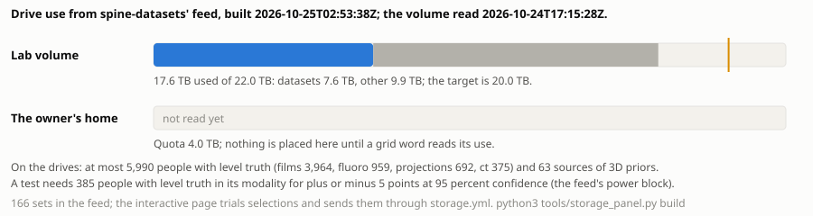

# 22 Quotas, cost and the budget of a run

Label: schwingnet-internal. This chapter is for the project's members and stays in this private repository; it prices runs, fetches and seats, names each method only by what it is for, and leaves how any stage works to Part III.

This chapter prices an experiment in the units the project actually counts, so that a planner can say, before asking the owner for a word, what a proposed run will spend and which limit it will meet first. It settles five things. What one training, one evaluation and one fetch cost in allocation, hours and bytes, and how few of those figures are measurements rather than limits. Which quotas bind: the grid's partitions and the lab volume's quota, the Claude subscription's five-hour and seven-day windows, GitHub's Actions minutes, and people's hours; and what happens at each limit. What the owner must approve before anything spends, and in what words. What the seed grant would pay for, and which of its figures and of the hospital-side cost model are assumptions. And what a student's own accounts cost. Symphony's own price ladder belongs to Part S and is referenced from [chapter 29](29-symphony-the-protocol-its-guarantees-its-comparison-and-its-cost.md), not restated here; how a run starts and waits on the grid is [chapter 21](21-the-grid-how-a-run-starts-waits-and-finishes.md).

## The units, and how few of them are measured

Six ledgers meet in a SchwingNet experiment. The grid spends allocation, in GPU-hours on the GPU partitions and core-hours on the preemptible CPU partition. The lab volume spends bytes against a fixed quota. Claude spends the subscription's usage windows. GitHub spends Actions minutes on a private repository. People spend hours, reading CTs and drawing boxes. And money, which the project almost never spends directly, appears only in the seed grant's budget and in each person's own Claude seat.

The plainest finding of this chapter is that the record holds almost no measured cost on the grid. The [SchwingNet grid pipeline](../../artifacts/schwingnet-grid-pipeline/) page of 21 October, canonical for programme direction, closes by saying that "every grid number above is a limit or a stated size, not a measurement", and chapter 21 reaches the same verdict three days later: the wall times in the job graph are what each script asks Slurm for, the fetch sizes are what a source's page states, and no record gives a queue wait, the grid duration of an ingest or of a version 1 run, or the GPU-hours any run spent. A planner therefore prices a run today from bounds, from the two local dry runs, and from a handful of grid jobs that did run, and must label every figure as one of those three.

## What one run costs

### The run ledger: the dry runs

The run ledger, [docs/research/v1-demo/LEDGER.md](../../docs/research/v1-demo/LEDGER.md), is the one place a run's cost is written by the code that ran it: each step is one job, timed by the runner in local mode or read from sacct on the grid, with seconds, GPUs, preemptions and exit code, and the ledger row sums them ([docs/research/v1-demo/README.md](../../docs/research/v1-demo/README.md)). It holds two rows, both local dry runs of 21 October on the synthetic bank, which measures the workflow and not the model. Run a767a466f5c1 spent 0.04 hours of wall time and 0.00 GPU-hours in three jobs; its record gives the split check 1 second, the training 146 seconds on four CPU cores and the evaluation 8 seconds ([RUN.json](../../docs/research/v1-demo/runs/a767a466f5c1/RUN.json)). Run cd37124c487d spent 0.03 hours in three jobs, the training 99 seconds and the evaluation 19 seconds ([RUN.json](../../docs/research/v1-demo/runs/cd37124c487d/RUN.json)). The same records show what the steps asked for: 4.0 hours for training and 1.0 for evaluation, against a few minutes used. These are measured, and they say one useful thing about cost: the bookkeeping, the split check and the evaluation are cheap, and nearly everything a real run spends will be the training job.

### Version 1 on the grid: three bounds and one unsourced figure

What version 1 will spend on the grid is bounded, not known, and the record gives three different bounds. The demo note's grid plan is one job of at most 24 hours on one GPU, which trains and evaluates inside that job, so at most 24 GPU-hours; the flow's own Slurm mode would instead submit two jobs of 4 and 1 hours, at most 5 GPU-hours, but the grid's planned run does not use that mode ([docs/research/v1-demo/README.md](../../docs/research/v1-demo/README.md); [chapter 21](21-the-grid-how-a-run-starts-waits-and-finishes.md)). The retraining plan's schedule gives a third, per stage, for a version 1 of three stages: 8 hours for the detector, 14 for the encoder and 10 for the head, each after the owner's word and number ([docs/research/retraining-plan.md](../../docs/research/retraining-plan.md), section 9). The demo's version 1 trains one stage only, so these are bounds on different runs.

Several research notes carry a fourth figure, "the v1 run's 6 GPU-hour bound", and cite the retraining plan for it. The plan says no such thing, and [docs/research/state-of-knowledge.md](../../docs/research/state-of-knowledge.md) (section 3, item 1) records the disagreement and leaves it as the owner's to set: until the owner gives the word and the number, a cost estimate that builds on 6 GPU-hours builds on nothing written. This chapter does not quote it as a value. A planner who must put a number on version 1 should give the 24-hour job bound, say that it is a wall-time limit and not a cost, and ask the owner for the number.

### Evaluation, latency and the leak checks

The evaluation runs inside the version 1 job on the gate's path, so it has no separate grid cost. Latency, which [chapter 20](20-readiness-for-the-operating-room.md) treats as a result, is priced in [docs/research/latency-and-sweep/README.md](../../docs/research/latency-and-sweep/README.md): for one model version with the one recorded sweep, two GPU jobs and one CPU job, at most 3 GPU-hours requested and 1.5 more for each further sweep, with expected use "well under 1 GPU-hour", since the export and parity take seconds and the timed frames under a minute on a CPU. The one grid job run for it so far, a probe of the disk, took 13 seconds. The expected figure is an estimate from container timings, so it is Inferred until the first grid run writes its sacct line.

The leak checks are priced the same way, from rates measured in a cloud container and scaled up ([grid/README.md](../../grid/README.md)). Per 10,000 frames the fingerprint step costs from 0.8 core-minutes for small 8-bit frames to 55 core-minutes for large 16-bit ones; a set the size of NIH ChestX-ray14 is about 76 core-minutes, a MIMIC-sized shard about 2,100 core-minutes, some 4.5 hours on 8 cores; and the join is sized at 8 cores, 32 GB and 12 hours. The README states what is not measured: a node's rate, the volume's read rate and the candidate rate of real films. What the checks are for, and the rule they enforce, is [chapter 9](09-splits-leakage-and-licences.md)'s.

### The one large grid run with recorded durations

The census of 22 October, which indexed every held file, is the first grid run whose durations the repository tables ([docs/research/data-manifest/README.md](../../docs/research/data-manifest/README.md)): a scan array of 64 tasks of 8 to 97 minutes each, a merge of 5 hours 9 minutes, and a manifest step of 4 hours 56 minutes. The merge wrote its database and then failed in its report on an empty key, fixed in issue #114. It is the best guide the record holds to how long a CPU pass over the whole holding takes, and it is CPU time on the preemptible partition, not GPU allocation.

### Estimate before you submit

[The Lab Recipe](../../artifacts/the-lab-recipe-1t2gvp/) of 27 September, canonical for programme direction, gives the rule a planner applies to all of the above: estimate before you submit, as per-item cost times items divided by parallelism plus queue wait; write the job ids and the expected finish into the journal and the checkpoint; then stop. Its grid rule 14 adds a pre-registered decision gate between a timing run and a production array, written for cost control on the 21,622-CT census, and its gap table records that the gate for the pelvis work was written and pre-stated but had never yet produced its decision file. [Research directions from the data holding](../../artifacts/research-directions-from-the-data-holding-kcyckb/) applies the same discipline at the level of a programme: each of its ranked projects names its "smallest experiment that changes a decision", such as a one-hour laptop run and a two-hour, fifty-record smoke test on the CPU partition before the full 802-volume pass. The pattern is a timing run first, a written estimate second, and the owner's number third.

## The grid allocation and what it has taught

### Partitions and the second worker

The recipe's grid rule 6 fixes where jobs go: CPU work on the preemptible requeue partition, GPU work on the three GPU partitions with the gpu QoS, which those partitions alone accept. Chapter 21 says how a job reaches them. The record gives the allocation itself in no unit: no artifact or repository file read here states a GPU-hour or core-hour quota for the lab's account, a fair-share figure, or what happens when one is exhausted. What the records do state is that allocation is the owner's and is spent only on the owner's word. The [Grid and cloud Claude workers: review](https://claude.ai/artifact/L7nL3xkYzoitmWf4ab8ARN) of 21 October found one Claude worker online on the grid and wrote that "nothing has started a second worker yet, since that spends allocation"; its list of what is not measured adds that two or more grid workers have never run at once, "since that spends allocation and waits on your word and a number". How long a start takes and how long a job waits in each partition's queue are on the same list. A worker on the grid is a Slurm job that holds its node for as long as it runs, so a planner counts a Claude worker's job against the allocation like any other job; which partition and whether a GPU it holds, the review does not say.

### The H200, the 16 GB V100 and the five folds

The one first-hand account of what grid allocation costs when a plan meets the hardware is the [OpenSpine Board](../../artifacts/openspine-board-t3gfds/) of 11 September. The clusters mark it superseded by the Spine Program Decisions page for its method items, but its grid job list is its own, and that list holds three lessons no later page repeats. A CT fold training ran alone on an H200 at about 910 seconds an epoch, resumed from its last checkpoint at epoch 50. Another fold, which looked like a data-loading failure, had in fact been handed a 16 GB V100 instead of an H200, and a plan built for about 100 GB of GPU memory died in its first forward pass. And five folds started in parallel slowed each other: the first to land staged its data to the node's fast disk and the rest fell back to the network filesystem, so they were stopped deliberately. A fourth line records a download chain that resubmitted itself every five minutes indefinitely, with 17,073 of 17,075 files already down and two permanently dead, which the board cancelled.

The lessons are about cost as much as about reliability. A GPU partition may hand a job a smaller card than the plan assumed, so a job must check what it was given before it spends anything, which is the recipe's GPU self-test before the first case (rule 8). Parallel jobs that share staging and storage do not divide wall time by their number, so a fold study's cost is not the cost of one fold times five run at once. And a job that resubmits itself must have a stop, or it spends allocation forever on nothing. These are records of September for a model outside SchwingNet's version 1, not measurements of version 1, and the per-epoch figure is a record, not a final value.

### The incidents the recipe paid for

The recipe introduces its fourteen grid rules with the sentence "Each one was paid for", and several of the incidents are costs. Home at 97 percent of its quota led to 260 GB being deleted, after which about 90 scripts read an empty held-out set (rule 5). An 8-hour limit made a whole chain of dependent jobs unsatisfiable (rule 3). Three container jobs were lost in a row, to a missing command, a missing starter and a bad bind (rule 7). And dozens of smoke tests on the login node, shared by about 95 users, led to the rule that the login node runs only submission and inspection commands (rule 1). Chapter 21 gives the full table; for pricing, the lesson is that a lost job costs its allocation and the person-hours to find out why, so the recipe's refusals of empty or missing inputs are themselves a cost control.

## Bytes: the lab volume and what a fetch spends

### The quota and the size rule

The lab volume is a CephFS volume under a quota of 20 TiB, which the size rule reads as 21,990 GB; home is a separate, smaller volume for code and the checkout ([chapter 21](21-the-grid-how-a-run-starts-waits-and-finishes.md)). The binding rule for bytes is the owner's of 23 October, issue #160, as [docs/memory/the-size-rule.md](../../docs/memory/the-size-rule.md) states it: every fetch reads its exact size from its source before it downloads a byte, and is refused whole when it would pass the volume's quota after what the running fetches still owe, with no floor and no margin. A source whose size cannot be read is refused, and three download routes with no size reader are refused until issue #163. A quota above the volume, the group's 40 TiB, is counted too since issue #190, and the least room on the path binds. The first status reading after issue #181, at 00:25 UTC on 24 October, gave 17,102.81 GB used and 4,887.42 GB free of 21,990.23 GB, with no room admitted at that moment, since the quota above was not yet counted; a reading of 01:18 UTC found the group's folder holding the same bytes, so the volume's own quota binds. That is a dated reading, not a final value, and it says that a planner has under 5 TB of room for everything not yet fetched.

The pipeline page of 21 October gives an older rule: each fetch chain refused to submit when the sizes it states exceed the volume's free space minus 5 TB. The programme contradictions page found nothing contradicting that margin on 21 October ([the programme contradictions](../../artifacts/_synthesis/contradictions/programme-direction-handoffs-and-onboarding.md), row 56), but the repository's later word overrides it: the size rule removed the 5 TB floor on 23 October, and the margin survives only in a fetch sent before the rule. The pipeline page's margin is a record, not a final value.

### What the fetches cost

The fetch list is priced in stated sizes. The pipeline page of 21 October gives 15 open X-ray sets at 131 GB where a size is stated, ten of them stating none; three credentialed X-ray sets, VinDr-CXR at 180 GB, VinDr-PCXR at 30 GB and MIMIC-CXR-JPG at 570 GB; and 25 CT platform sets at 1,489 GB as the script sums them, four stating none. The grid README now gives VinDr-PCXR as 34.1 GB, and that later figure holds ([grid/README.md](../../grid/README.md)). Beyond these sit the lines that run only by name. CT-RATE, 21.3 TB, is off by the owner's decision of 21 October and is never submitted without the owner's own number of terabytes; at that size it is more than four times the room left on 24 October, so it cannot fit as the volume stands. The full NLST is 11.1 TB by its index's series sizes, not the 2.3 TB its card gave ([docs/memory/the-xray-fetch-chain.md](../../docs/memory/the-xray-fetch-chain.md)), which is more than twice the room left on 24 October.

Time is priced by a guess. The README's estimate of one hour per 20 GB is labelled "a guess until the first log says otherwise", and the job graph's wall-time limits, four days for an X-ray fetch and four days for each CT platform fetch, are limits. One fetch's cost includes its failures: three platform fetches ended COMPLETED with nothing fetched on 23 October because a helper read its include pattern as a glob, and one set came down whole, 6.2 GB still zipped, held another anatomy and was taken out of the registry the same day (chapter 21). Deletion is the other side of the ledger. Nothing fetched is deleted except a download zip whose every file sits unpacked beside it, and that only on the owner's word, as for RSPECT's 534 GB zip on 23 October ([grid/README.md](../../grid/README.md)).

The planning consequence is direct. The datasets still to be fetched sum to more than the room left, so a planner who adds a set to an experiment must say which held set it displaces or what the owner will decide about the quota, and the size rule will refuse the fetch otherwise. What each set is for, and its licence, is Part II's ([chapter 4](04-the-registry-and-the-holding.md); [chapter 9](09-splits-leakage-and-licences.md)).

### The storage panel

*Figure 22.1. The lab volume's and the owner's home's use as spine-datasets' feed read them, and every set the feed knows with the choices that build a selection under the target; the interactive figure trials combinations and asks for the changes only through a request pull request. Source: [record](figures/22/storage.json).*

Since 24 October the bytes ledger has an instrument of its own. spine-datasets, the private repository where the unheld sets are sought ([chapter 4](04-the-registry-and-the-holding.md)), writes a feed, PLAN.json on its branch storage-feed, whenever a record changes, after each request its workflow opens, and once a day: the owner's target of 20 TB, 20,000 GB against the volume's quota of 21,990 GB; the volume's quota and use, the datasets' bytes apart from everything else, with the time the grid read it; the home's quota of 4 TB and its use, null until a grid word reads it; the open request pull requests; and one entry per set with its size, measured once frozen, else stated by its source, else unknown, its licence class, its state and the sets it shares patients or series with. Figure 22.1 is that feed laid out from a snapshot committed beside it, which the site refreshes before each build with the App's read token, keeping the committed one when the feed cannot be read, and which the required check holds the page to ([tools/storage_panel.py](../../tools/storage_panel.py)). The snapshot of 24 October, built at 20:52 UTC from a reading of the volume at 17:15 UTC, gave 17,553 GB used of 21,990 GB, 7,626 GB of it datasets and 9,927 GB other files, the home not yet read and no request pending: 450 GB more than the 00:25 UTC reading above, both dated readings and neither final, and the page shows each reading's age beside it.

What the panel does is what the previous section did by hand. Each held set can be kept, removed or moved between the lab volume and the home; each set the feed marks fetchable can be added and placed on either; a set the feed cannot fetch yet has no control and says why. As the choices change, the page sums the volume's and the home's use after them against the target and each quota, notes any two kept sets the feed says share patients or series, and writes the selection in the planner's grammar: a minus sign removes a set, a plus sign adds one, and an id with @home or @lab places it. It says what the planner's check would refuse, so no selection is sent only to be turned back: a set with no measured size, since the size rule reads every set's exact size before a byte lands ([docs/memory/the-size-rule.md](../../docs/memory/the-size-rule.md)); any move to the home while its use is unread, which is why the home's controls are greyed in the snapshot shown; and a total over the target, the volume's quota or the home's. One test runs the Python and the page's script on one feed and holds them equal.

What the panel cannot do is as deliberate. Apply asks the page's host to dispatch one workflow, storage.yml on spine-datasets, with the selection as its input; that run checks the selection again and only opens a request pull request, and nothing is fetched, moved or deleted until the owner merges it, after which the size rule still reads each set's exact size at fetch time. Where no host answers, as on the members-only site, the page shows the workflow's link and the selection to paste into it, and Refresh then only says which snapshot it shows. So the rule of the previous section stands with a number: 17,553 GB in use leaves about 2,400 GB under the target and 4,400 GB to the quota, and a planner whose set does not fit chooses on the page which held set gives way, or goes to the home once its use is read, and sends the owner a request, not a fetch.

## The Claude subscription: windows, accounts and credits

### Two windows, counted per account

Claude Code on a Pro or Max plan draws on the same usage pool as the apps: a rolling five-hour window and a weekly limit ([docs/setup/tiers.md](../../docs/setup/tiers.md)). The [Claude Code on a Slurm + Apptainer Cluster](https://claude.ai/artifact/7dBJwcSiDjUFrAKSJfFhEF) playbook of 3 October adds the point that matters for the grid: "Subscription limits apply to the account, not to the node, so eight parallel sessions on eight nodes draw down one budget eight times faster." It reports weekly caps, one for all models and one for Opus-class models, introduced in August 2025 to curb continuous background use, and it describes consumption as tokens per turn times turns, so an agent loop that re-reads a large log drains the window faster than a chat does. Its sizing advice is one job of about four hours per five-hour window, chained to start after the reset, with turns and context capped and no fan-out of subagents in batch work.

The workers review ranks the shared window seventh among its weak points: several workers on one Claude account share its five-hour window and stall together. The grid contradictions page refutes the reading of that claim as unsourced, since the Symphony and Beethoven taxonomy spec sources it and records the weekly limit reached on 15 October ([the grid contradictions](../../artifacts/_synthesis/contradictions/grid-workstation-and-claude-worker-operations.md), row 39). The Lab Recipe records the same cost from the other side: on 24 September agents that polled the queue burned a session limit four times in one day while the grid did the work, which is why a session submits, estimates, checkpoints and stops, and never polls beyond about ten minutes.

How much of a window a SchwingNet run takes is not measured. The token pool reads each slot's five-hour and seven-day use from the rate-limit events of runs and from one-word probes, and a probe spends one word of the window it reads, so the probes run only when a person asks, never on a schedule ([docs/memory/the-token-pool.md](../../docs/memory/the-token-pool.md); [docs/research/claude-token-pool.md](../../docs/research/claude-token-pool.md)). The profiling tool counts what a session spent, call by call, from its transcript ([docs/memory/profiling-sessions.md](../../docs/memory/profiling-sessions.md)). Neither has been read here for a SchwingNet run, so a planner has instruments but no figures.

### One person, one account, and the owner's decision

The playbook's compliance envelope holds that one person's subscription authenticates only that person's sessions and that nothing is done to multiply or evade the plan's limits: "One account per user, no account rotation, no pooled tokens", and if a workload needs more than one subscription's window, "it is a workload for an API key". The record contradicts that envelope on one point, and both contradictions pages confirm it: the Symphony handoff of 13 October records the owner's decision to coordinate several of the owner's own accounts, and the workers review describes cloud workers on a token pool ([the grid contradictions](../../artifacts/_synthesis/contradictions/grid-workstation-and-claude-worker-operations.md), row 2; [the programme contradictions](../../artifacts/_synthesis/contradictions/programme-direction-handoffs-and-onboarding.md), row 44). The decision is the owner's, for the owner's own accounts, and it is not this chapter's subject. For SchwingNet the practical rule is narrower: each student runs on their own account, the grid worker runs on the account the owner signed in, and the pool and its accounts are Part S's subject ([chapter 31](31-claude-workers-on-the-grid-and-the-labs-machines.md)). This chapter had no network and did not check Anthropic's current plan limits or terms against their published pages, which the plan owes.

### Usage credits are never used

The playbook calls "extra usage" credits, which continue past a cap at pay-as-you-go rates, "the sanctioned overflow path". For this project they are not a path at all. Usage credits are never used, and no grid job, Claude run or training starts without the owner's word and the number of jobs; these are the owner's standing rules, in [CLAUDE.md](../../CLAUDE.md) and [docs/project.md](../../docs/project.md), and [chapter 1](01-the-goal-and-the-constraints.md) states them. At a window's limit a run therefore stops and waits for the reset; the playbook's own design turns a usage-limit error into a resubmission after five hours rather than a retry loop, and that is the behaviour a SchwingNet job inherits. The monthly API credits bundled with some plans are spendable only on the API side and never extend Claude Code's limits ([docs/setup/tiers.md](../../docs/setup/tiers.md)), so they change nothing here either.

The one standing word the owner has given for Claude is the synthesis reads that keep this book's record current: ten runs a day unless a repository variable says otherwise, fifty at most, and a variable that stops them, on the one subscription token the project keeps ([docs/project.md](../../docs/project.md)). The workers review adds that Claude in Actions runs at most ten times a day per repository. Each of those runs draws on the same account's windows as anything else that account does.

## GitHub minutes

SchwingNet is a private repository, and on a private repository Actions minutes on GitHub's standard runners are metered beyond a monthly quota: 2,000 minutes on GitHub Free and 3,000 on Pro and Team, then $0.006 a minute for a Linux two-core runner, while with no payment method stored GitHub stops use at the quota instead of billing ([docs/setup/free-or-paid.md](../../docs/setup/free-or-paid.md)). Self-hosted runners, which is what the grid's runner chain is, use no included minutes. Which plan the organisation holds is not stated in any file read here, so the quota that binds this repository is unrecorded. What spends the minutes is the required check, the board, the metrics and the synthesis workflow's looks, all deterministic; the template's own measure is about a minute per pull request event for the check and about 120 minutes a month for the board's six-hourly fallback, figures from the Dollar-per-Feature Ladder and not measured for this repository. The free-or-paid page read GitHub's prices on 13 October and marks Pro's and Team's $4 as a price of 2020 that may no longer hold. The full price ladder, with Symphony's argument for it, is [chapter 29](29-symphony-the-protocol-its-guarantees-its-comparison-and-its-cost.md)'s and the [Dollar-per-Feature Ladder](https://claude.ai/artifact/9Ymg61SPUZTqaNBCbzGHMx)'s.

## People's accounts, keys and hours

### What a student brings

The [spine-program student onboarding](../../artifacts/spine-program-student-onboarding/) of 13 October, canonical for programme direction, lists five things a student needs and what each costs. A GitHub account with write access, from the owner's invitation, is free. A Claude Pro or Max seat is the student's own, at about US$20 a month for Pro, paid by the student, since Claude Code is not in the free plan. A Wayne State grid account comes from the university's IT office, naming the owner as sponsor, in about two business days, free. The grid's one-time sign-in code and the Beethoven invitation with the owner's approval on the lab volume's access list are free. The onboarding's rule that a student asks for the grid account first, since it takes longest, is the only scheduling cost it names. Each student's sessions run on that student's own account and window, so adding a student adds a window rather than sharing one; the grid jobs a student submits run under the student's grid account.

### What the harvest's keys cost

The [FluoroCap Access Setup](../../artifacts/fluorocap-access-setup-jlvkft/) of 14 September prices the harvest's credentials, and almost all of them cost nothing but limits. The NCBI key raises E-utilities from three requests a second to ten, which triples the speed of a refetch that resolves 2,900 figures; the YouTube Data API gives 10,000 units a day, about 100 searches; Google's programmable search gives 100 free queries a day; the Springer, Elsevier, Flickr, Reddit and PatentsView keys are free, and Elsevier's entitlement to closed articles comes from the institution. The page rules one route not worth buying: X's API at $100 a month for seven-day search, which cannot reach the historical posts that hold the images. Its costs are the ones that are not money: the page states that every publisher licence forbids systematic downloading, and the closed-journal refetch was paced to about 600 figures at one request every three seconds per host, so the binding cost of that route is time. What FluoroCap is, and what it may be used for, is [chapter 8](08-fluorocap-as-a-dataset.md)'s.

### Reader-hours

People's hours are the project's scarcest budget, and Research directions prices them. The whole-cohort Castellvi read of 802 CTs at 3 to 5 minutes a case is about 40 to 67 reader-hours, with 33 graded against the 71 to 142 positives expected; the adjudication of 1,052 flagged CTs is 50 to 90 reader-hours per stage. The seed grant prices its own annotation at 200 hours for $4,800. These are estimates; [chapter 17](17-benches-and-human-reads.md) holds the reads themselves.

## What the seed grant pays for

The [AIDaS Seed Grant Proposal](../../artifacts/aidas-seed-grant-proposal/), canonical for the operating-room study, asks $20,000 for 1 January to 31 December 2027. The call, as the artifact reads it, lists four allowable categories: graduate student support, computing cost, invited collaborator travel, and data management and storage. Hardware purchase is not listed, so the artifact puts the NVIDIA items under computing cost and says the phantom and the cadaver fee fall outside the listed categories. Its eight lines are a workstation GPU at $6,500, an edge computing kit at $2,000, a lossless frame grabber at $700, a lumbar spine phantom at $3,000, one cadaver session at $2,000, 200 hours of student annotation at $4,800, encrypted storage at $500 and one collaborator visit at $500. [Chapter 20](20-readiness-for-the-operating-room.md) tables them with the study they fund.

Most of the budget is assumption, and the artifact says so. Every amount is "an estimate against list prices or stated ranges" with quotes to precede the award; lines 1 to 5 hang on the funder's ruling on what is allowable; the annotation rate is an assumed $24 an hour with the university's rate and fringe to confirm; the cadaver fee is "within the typical $1,000-3,000" and to confirm with the programme; the phantom line falls to zero if a loan unit is found, releasing the money to annotation; and if any of lines 1 to 5 is ruled not allowable it moves to annotation and storage with the total unchanged. The OR-study contradictions page confirms that the fifteen-business-day lead time for the radiation-safety paperwork has no source on any of the three pages that state it (row 42) and that the cadaver fee is marked to confirm (row 47) ([the OR-study contradictions](../../artifacts/_synthesis/contradictions/the-case-for-the-or-study-proposal-seed-grant-and-irb-protoc.md)). This chapter had no network and did not check the call's allowable costs against the funder's announcement, which the plan owes.

The artifact is a draft, and a later record changes the budget, so the draft's eight lines and its $20,000 total are a record, not a final value. A checkpoint note of 18 October records the final version at $19,987 of the $20,000 cap, with a line that would repay $1,500 of the owner's Claude subscription costs once an academic appointment begins, and lists the allowability of four lines, that one among them, as still waiting on the owner ([docs/checkpoints/2026-10-19/topic-memories/aidas-grant.md](../../docs/checkpoints/2026-10-19/topic-memories/aidas-grant.md)). That line is the one place the record proposes that money pay for Claude, and it would pay a subscription, not usage credits. Whether the proposal was submitted is not settled: the repository's research index records, from a note in another repository not read here, that it went to the funder on 16 October, the checkpoint note two days later still lists sending it as the owner's, and the OR-study page cannot tell (row 57). The retrospective protocol calls the application planned, with notification on 16 December 2026 (row 26). So the grant is a request; until it is awarded, nothing in an experiment's plan may count on its money.

The cost case on the hospital's side is a model with its assumptions labelled, and a planner who quotes it must keep the labels. The [Level Counting Visual Abstract](../../artifacts/level-counting-visual-abstract/) models a hospital of 300 to 1,000 spine cases a year. Its operating-room minutes rest on two small non-randomised thoracic series, which the page itself calls "the weakest input here", at a 2014 cost of $34 to $37 a minute multiplied by 1.35 to reach 2026, a factor the OR-study page finds unsourced (row 13). Its navigation figure of $1.5 million over seven years plus 10 percent service is "an assumption, not a source". And the $1,750 to $1,950 a fiducial placement is the operating-room time of the placement visit, not the price of the fiducial, as the grant derives it (row 14). The abstract's own reading is the right one: "the dollars are operating-room minutes; the never event is a harm and a reputation, not a line item." [Chapter 1](01-the-goal-and-the-constraints.md) carries the case in full.

## What must be approved before anything spends

The rule is short and has no exceptions in the current record: no grid job, Claude run, training or fetch starts without the owner's word and the number of jobs ([CLAUDE.md](../../CLAUDE.md); [docs/project.md](../../docs/project.md)). A note that quoted the owner on 21 October as saying grid jobs need no number was superseded, and the project instructions of 23 October added fetches to the rule (state-of-knowledge, section 3, item 3). The retraining plan applies it step by step: each step of its order of work gets its own word and number when it is ready, and nothing is submitted before.

Several approvals carry their own words. CT-RATE needs the owner's number of terabytes, not only a go. A second grid worker needs the owner's word and a number, since it spends allocation. A zip is deleted on the owner's word for that zip. A credentialed set is fetched only by its own fetch word once its access is in place, which is the owner's step. The synthesis reads hold a standing word and a number, ten a day up to fifty, which a variable can stop. Usage credits are not on the list because no word enables them. A planner's request to the owner should therefore state the step, the number of jobs, the partition, each job's wall-time limit and what it bounds in GPU-hours, the bytes any fetch will land against the room the status word last showed, and whether a Claude worker will run beside it.

## What we know

The run ledger records the only measured costs of the new workflow: two local dry runs on synthetic frames at 0.03 and 0.04 hours of wall time and no GPU time, almost all of it training. Version 1's grid cost is bounded at 24 GPU-hours for the gate's one job, with a 5 GPU-hour bound for a mode the gate does not use and per-stage hours in the retraining plan for a three-stage version; the 6 GPU-hours several notes cite has no written source and is the owner's to set. Latency is bounded at 3 GPU-hours requested per model version and expected under one. The census is the one large grid run with recorded durations. The lab volume's quota is 20 TiB, under 5 TB of it was free on 24 October, and the size rule refuses whole any fetch that would overflow it, with no margin since 23 October. Since 24 October spine-datasets' feed gives the volume's, the home's and every set's bytes, and Figure 22.1 trials a selection under the 20 TB target and sends it only as a request pull request. Claude usage is counted per account in a five-hour and a weekly window, several workers on one account share them, and usage credits are never used. A student pays for their own Claude seat, about $20 a month, and nothing else. The seed grant's draft asks $20,000, mostly in estimates, a record, not a final value; the final version recorded later sits at $19,987, and whether it was submitted is unsettled.

## What we do not know

No record gives the lab's grid allocation in any unit, a queue wait on any partition, the GPU-hours any SchwingNet run spent on the grid, or the wall time of an ingest, a catalog build or a version 1 run there. How much of a Claude window a SchwingNet session or grid worker spends has not been read from the pool or the profiler. Which GitHub plan the organisation holds, and so which minutes quota binds, is unrecorded. Whether the seed grant was submitted and with which lines is unsettled, and the award is unknown until December. The cadaver fee, the radiation-safety lead time and the hardware quotes have no source. Anthropic's current limits and terms, the funder's allowable costs and GitHub's current prices were not checked, since this chapter had no network.

## What would change our mind

A first ledger row from the grid, with sacct's seconds, GPUs and preemptions, would replace every bound in this chapter with a measurement for that step, and would show whether the 24-hour job is generous or tight. A statement of the lab's allocation from the university, or a fair-share reading, would turn "the owner's allocation" into a number a planner can divide. A pool or profiler reading for a SchwingNet run would price Claude in window percent. A change to the volume's quota, or the owner's decision on CT-RATE or the full NLST, would change which fetches can fit at all. A grid word reading the home's use would open its 4 TB to the panel's placements. And a submission record and an award letter for the seed grant would turn its budget from a request into money an experiment may plan on.

## Provenance

| Statement | Source | Grade |
| --- | --- | --- |
| Every grid number on the pipeline page is a limit or a stated size, not a measurement | [schwingnet-grid-pipeline](../../artifacts/schwingnet-grid-pipeline/) ([claude.ai](https://claude.ai/artifact/UMnwCkV9SQm2kokkCXWUKA)) | Reported |
| No record gives a queue wait or the grid duration or GPU-hours of an ingest, catalog build or version 1 run | [chapter 21](21-the-grid-how-a-run-starts-waits-and-finishes.md); [docs/research/v1-demo/LEDGER.md](../../docs/research/v1-demo/LEDGER.md) | Inferred |
| Dry run a767a466f5c1: 0.04 h wall, 0.00 GPU h, 3 jobs; split check 1 s, training 146 s on 4 CPU cores, evaluation 8 s; 4.0 h and 1.0 h requested | [docs/research/v1-demo/runs/a767a466f5c1/RUN.json](../../docs/research/v1-demo/runs/a767a466f5c1/RUN.json); [docs/research/v1-demo/LEDGER.md](../../docs/research/v1-demo/LEDGER.md) | Measured |
| Dry run cd37124c487d: 0.03 h wall, 3 jobs; training 99 s, evaluation 19 s | [docs/research/v1-demo/runs/cd37124c487d/RUN.json](../../docs/research/v1-demo/runs/cd37124c487d/RUN.json) | Measured |
| The gate's version 1 job is at most 24 hours on one GPU, so at most 24 GPU-hours; the flow's Slurm mode would be at most 5 | [docs/research/v1-demo/README.md](../../docs/research/v1-demo/README.md) | Reported |
| The retraining plan gives 8 h detector, 14 h encoder, 10 h head, each after the owner's word and number | [docs/research/retraining-plan.md](../../docs/research/retraining-plan.md) | Reported |
| The 6 GPU-hour bound has no written source and is the owner's to set; the figure itself is not quoted | [docs/research/state-of-knowledge.md](../../docs/research/state-of-knowledge.md) | Reported |
| Latency per model version: at most 3 GPU-hours requested, 1.5 more per sweep, expected under 1 GPU-hour; the probe took 13 s | [docs/research/latency-and-sweep/README.md](../../docs/research/latency-and-sweep/README.md) | Inferred |
| Leak-check cost: 0.8 to 55 core-minutes per 10,000 frames; about 2,100 core-minutes for a MIMIC-sized shard; join sized at 8 cores, 32 GB, 12 h | [grid/README.md](../../grid/README.md) | Inferred |
| Census: 64 scan tasks of 8 to 97 minutes, merge 5 h 9 min (then failed in its report, fixed in #114), manifest 4 h 56 min | [docs/research/data-manifest/README.md](../../docs/research/data-manifest/README.md) | Measured |
| Estimate before submitting; a decision gate between a timing run and a production array | [the-lab-recipe-1t2gvp](../../artifacts/the-lab-recipe-1t2gvp/) ([claude.ai](https://claude.ai/artifact/1T2gVPMkKhzU2J4TryUDRG)) | Reported |
| Each project names its smallest decision-changing experiment, such as a one-hour run and a two-hour, fifty-record smoke test | [research-directions-from-the-data-holding-kcyckb](../../artifacts/research-directions-from-the-data-holding-kcyckb/) ([claude.ai](https://claude.ai/artifact/KCyCkBtrHXGYQVM6LtpnK8)) | Reported |
| No second grid worker had started, since that spends allocation and waits on the owner's word and a number; queue waits unmeasured | [Grid and cloud Claude workers: review](https://claude.ai/artifact/L7nL3xkYzoitmWf4ab8ARN) | Reported |
| No record read states the lab's allocation in any unit | this chapter's reading of [docs/setup/grid.md](../../docs/setup/grid.md) and the artifacts above | Inferred |
| An H200 fold ran about 910 s an epoch; a fold handed a 16 GB V100 died on its first forward pass; five parallel folds slowed each other; a download chain resubmitted itself every five minutes | [openspine-board-t3gfds](../../artifacts/openspine-board-t3gfds/) ([claude.ai](https://claude.ai/artifact/T3GfDSZpBYiLRC2166iu8o)) | Reported |
| The grid rules were each paid for: home at 97 percent, 260 GB deleted, about 90 scripts read an empty held-out set | [the-lab-recipe-1t2gvp](../../artifacts/the-lab-recipe-1t2gvp/) ([claude.ai](https://claude.ai/artifact/1T2gVPMkKhzU2J4TryUDRG)) | Reported |
| The size rule: exact size before a byte, refused whole, no floor; a quota above counts | [docs/memory/the-size-rule.md](../../docs/memory/the-size-rule.md) | Reported |
| Volume on 24 October 00:25 UTC: 17,102.81 GB used, 4,887.42 GB free of 21,990.23 GB; the volume's own quota binds (01:18 UTC) | [docs/memory/the-size-rule.md](../../docs/memory/the-size-rule.md) | Reported |
| The feed's reading of 17:15 UTC on 24 October: 17,553 GB used of 21,990 GB, 7,626 GB datasets and 9,927 GB other; 166 sets; the home not read; no request pending; the target 20 TB and the home's quota 4 TB | [Figure 22.1's record](figures/22/storage.json); [the snapshot of the feed](figures/22/storage-plan.json) | Reported |
| The panel refuses in words what the planner's check refuses (no measured size, a move to the unread home, over the target, over a quota) and dispatches only storage.yml, whose run opens a request pull request the owner merges | [tools/storage_panel.py](../../tools/storage_panel.py); [docs/research/storage-panel.md](../../docs/research/storage-panel.md); [storage.yml](https://github.com/OpenSpineConsortium/spine-datasets/actions/workflows/storage.yml) | Inferred |
| The pipeline page's 5 TB margin is superseded by the size rule | [the programme contradictions](../../artifacts/_synthesis/contradictions/programme-direction-handoffs-and-onboarding.md); [docs/memory/the-size-rule.md](../../docs/memory/the-size-rule.md) | Reported |
| Stated fetch sizes: 131 GB open X-ray where stated, 570 GB MIMIC-CXR-JPG, 180 GB VinDr-CXR, 1,489 GB CT platform; VinDr-PCXR now 34.1 GB | [schwingnet-grid-pipeline](../../artifacts/schwingnet-grid-pipeline/) ([claude.ai](https://claude.ai/artifact/UMnwCkV9SQm2kokkCXWUKA)); [grid/README.md](../../grid/README.md) | Reported |
| CT-RATE 21.3 TB off by the owner's decision; full NLST 11.1 TB | [schwingnet-grid-pipeline](../../artifacts/schwingnet-grid-pipeline/) ([claude.ai](https://claude.ai/artifact/UMnwCkV9SQm2kokkCXWUKA)); [docs/memory/the-xray-fetch-chain.md](../../docs/memory/the-xray-fetch-chain.md) | Reported |
| One hour per 20 GB is labelled a guess; the fetch wall times are limits | [grid/README.md](../../grid/README.md) | Reported |
| Limits apply per account, not per node; five-hour and weekly windows; size jobs to the window | [Claude Code on a Slurm + Apptainer Cluster](https://claude.ai/artifact/7dBJwcSiDjUFrAKSJfFhEF); [docs/setup/tiers.md](../../docs/setup/tiers.md) | Reported |
| Several workers on one account share its window; the weekly limit was reached on 15 October | [the grid contradictions](../../artifacts/_synthesis/contradictions/grid-workstation-and-claude-worker-operations.md) | Reported |
| Polling agents burned a session limit four times in one day | [the-lab-recipe-1t2gvp](../../artifacts/the-lab-recipe-1t2gvp/) ([claude.ai](https://claude.ai/artifact/1T2gVPMkKhzU2J4TryUDRG)) | Reported |
| The playbook's one-account envelope and the owner's decision to coordinate the owner's own accounts conflict | [the grid contradictions](../../artifacts/_synthesis/contradictions/grid-workstation-and-claude-worker-operations.md); [the programme contradictions](../../artifacts/_synthesis/contradictions/programme-direction-handoffs-and-onboarding.md) | Reported |
| Usage credits are never used; nothing runs without the owner's word and the number of jobs | [CLAUDE.md](../../CLAUDE.md); [docs/project.md](../../docs/project.md) | Reported |
| The synthesis reads: ten a day, fifty at most, on the one kept token | [docs/project.md](../../docs/project.md) | Reported |
| A probe spends one word of the window, so probes run only on request | [docs/memory/the-token-pool.md](../../docs/memory/the-token-pool.md) | Reported |
| Private-repository minutes: 2,000 Free, 3,000 Pro and Team, then metered; no payment method stops use at the quota | [docs/setup/free-or-paid.md](../../docs/setup/free-or-paid.md) | Reported |
| A student pays about $20 a month for Pro; the grid account, GitHub and Beethoven are free | [spine-program-student-onboarding](../../artifacts/spine-program-student-onboarding/) ([claude.ai](https://claude.ai/artifact/XXQGQczdaQ7rj83znFbiQL)) | Reported |
| The harvest's keys are free with limits; X's API at $100 a month is not worth buying; the closed-journal refetch was paced to about 600 figures | [fluorocap-access-setup-jlvkft](../../artifacts/fluorocap-access-setup-jlvkft/) ([claude.ai](https://claude.ai/artifact/JLVkFTK3RUFrrLJs4bUEJn)) | Reported |
| The Castellvi read is 40 to 67 reader-hours; the adjudication 50 to 90 per stage (estimates) | [research-directions-from-the-data-holding-kcyckb](../../artifacts/research-directions-from-the-data-holding-kcyckb/) ([claude.ai](https://claude.ai/artifact/KCyCkBtrHXGYQVM6LtpnK8)) | Reported |
| The draft grant asks $20,000 in eight lines, all estimates, lines 1 to 5 open to an allowability ruling, annotation at an assumed $24 an hour; a record, not a final value | [aidas-seed-grant-proposal](../../artifacts/aidas-seed-grant-proposal/) ([claude.ai](https://claude.ai/artifact/UwoqsEAjFPcUJVDutVpFHx)) | Reported |
| The fifteen-day lead time has no source; the cadaver fee is marked to confirm | [the OR-study contradictions](../../artifacts/_synthesis/contradictions/the-case-for-the-or-study-proposal-seed-grant-and-irb-protoc.md) | Reported |
| The final version is $19,987 with a line repaying $1,500 of Claude subscriptions; allowability waits | [docs/checkpoints/2026-10-19/topic-memories/aidas-grant.md](../../docs/checkpoints/2026-10-19/topic-memories/aidas-grant.md) | Reported |
| Submission is unsettled; notification 16 December 2026 | [the OR-study contradictions](../../artifacts/_synthesis/contradictions/the-case-for-the-or-study-proposal-seed-grant-and-irb-protoc.md); [docs/research/README.md](../../docs/research/README.md) | Unverified |
| The hospital-side model's minutes, inflator and navigation cost are labelled assumptions or unsourced | [level-counting-visual-abstract](../../artifacts/level-counting-visual-abstract/) ([claude.ai](https://claude.ai/artifact/CwxKcL5qQt2Pv37u56ndst)); [the OR-study contradictions](../../artifacts/_synthesis/contradictions/the-case-for-the-or-study-proposal-seed-grant-and-irb-protoc.md) | Inferred |
| Symphony's price ladder is Part S's | [the Dollar-per-Feature Ladder](https://claude.ai/artifact/9Ymg61SPUZTqaNBCbzGHMx) | Reported |
