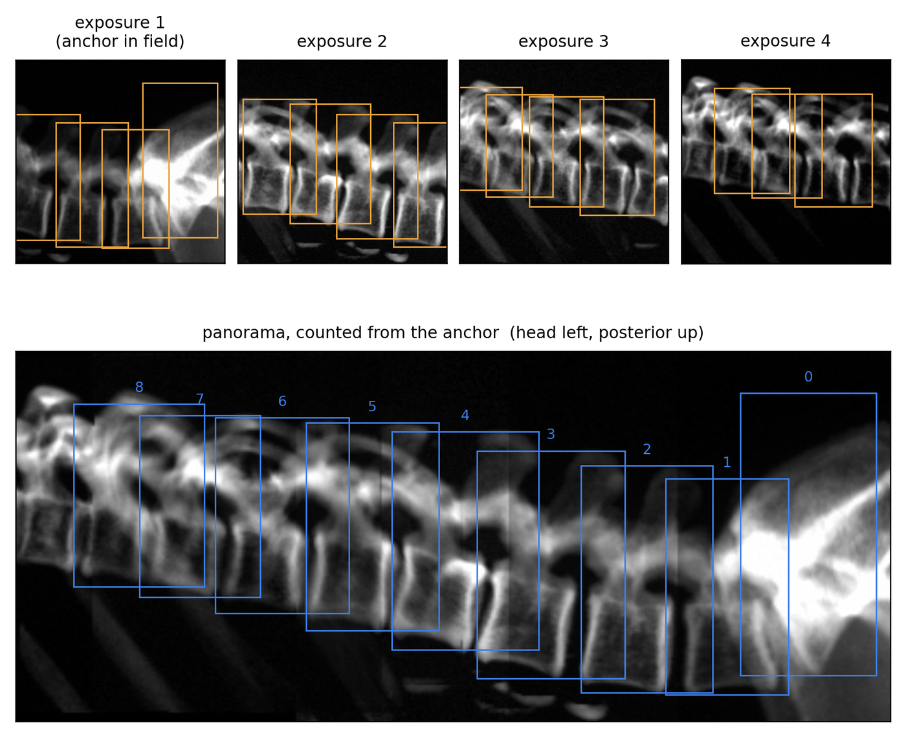
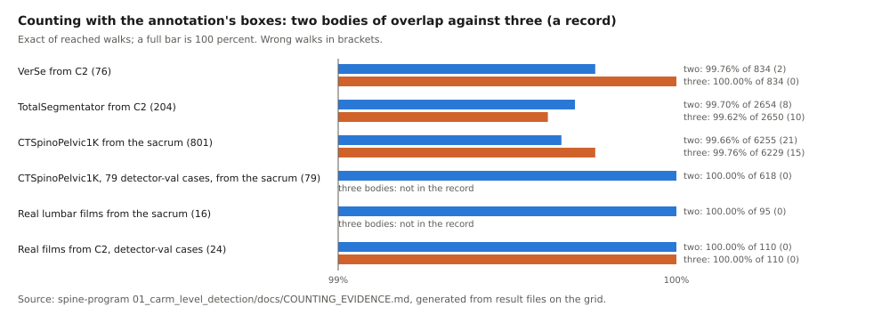
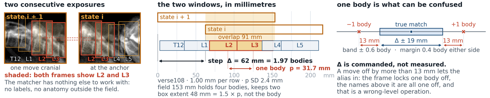
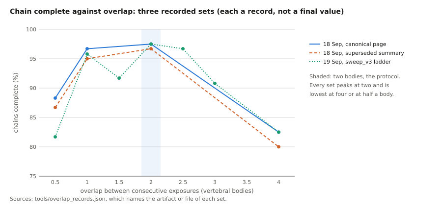
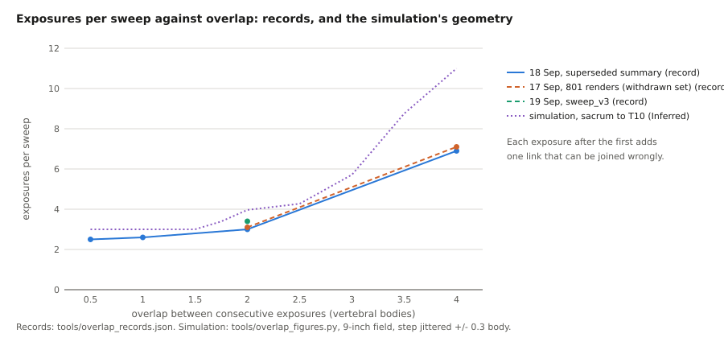
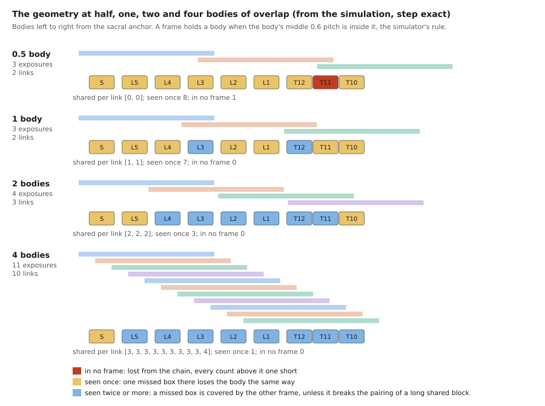
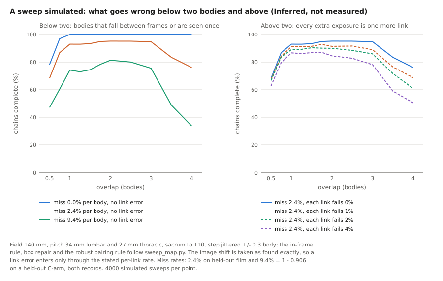

# 34 The optimal overlap

Label: confidential-method. Results may be shown, mechanism may not, until the provisional is filed; this chapter stays in this private repository and is copied nowhere.

This chapter holds one piece of the owner's work and nothing else: the finding that a sweep of overlapping C-arm exposures should leave two vertebral bodies of each frame in the next. It settles four things for a planner. First, what reached 100 percent at two bodies, on which generated pans, rendered how and scored with which boxes, so that the owner's figure is carried exactly as the record supports it. Second, why two, in the sources' own words and then in figures: the recorded curves, the geometry at half, one, two and four bodies, and a small simulation, written for this chapter, that shows what breaks below two and what breaks above. Third, which overlap figures are settled and which are records only. Fourth, a pre-registered plan to test the overlap where it has never been tested, on a real or synthetic video pan and on full-spine radiographs, with normal and anomalous columns. [Chapter 10](10-counting-from-an-anchor-along-a-sweep.md) holds the counting line as a whole; this chapter does not repeat it beyond what the overlap needs.

## The protocol in one paragraph

The radiographer puts the anchor at the edge of the first field, the sacrum when sweeping up and C2 when sweeping down, exposes, and moves the C-arm toward the target by one field minus two vertebral bodies, so that two bodies of the previous image stay in view; then exposes again, until the target is in the field ([Naming Vertebrae Without CT](../../artifacts/naming-vertebrae-without-ct-hjy4vc/); [Counting Levels Under Fluoroscopy](../../artifacts/counting-levels-under-fluoroscopy/)). One field size is kept throughout. The step is commanded and not measured: nothing in the line reads where the C-arm went, so the overlap is the only thing that ties one frame to the next. Consecutive frames are matched by normalised cross-correlation searched near the commanded step; the bodies they share follow from the shift; the frames become one chain of bodies, and the target is the k-th node from the anchor.

The radiographer's version of the protocol, written for the technologist at the C-arm, is spine-program's [SWEEP_PROTOCOL.md](https://github.com/OpenSpineConsortium/spine-program/blob/main/01_carm_level_detection/docs/SWEEP_PROTOCOL.md). On a 9-inch intensifier, a field of about 14 cm at the spine, two bodies of overlap means a move of about 7 cm with four lumbar bodies in view; on a 12-inch intensifier about 12 cm; on a collimated 10 cm field about 3 cm. It adds a rule found on 19 September and missing from the September pages: the last move is a full move or none, since a final frame that moves less than half a body is nearly the same picture twice and the linker cannot tell such a step from one a whole body longer.

*Figure 34.1. Four overlapping exposures of a render, the first holding the sacral anchor, and the panorama they make, counted 0 to 8 from the anchor. Source: [record](figures/34/overlapping-frames-stitched.json).*

## What reached 100 percent, exactly

The owner's statement is that the overlap of two bodies reaches 100 percent accuracy on generated pans up the spine. The record holds several 100 percent figures, each on a stated set, and one larger arm at two bodies that is not 100 percent. Every one of them was scored with the annotation's own boxes, so each measures the linking and the protocol, not a deployed detector, and every one is a record, not a final value: spine-program's results catalog marks the sweep and counting results RECORD ONLY and the overlap ladder's two bodies a protocol recommendation, and the result files are on the grid and were not read for this chapter.

### The generated pans

The pans were made by spine-program's simulator, [sweep_map.py](https://github.com/OpenSpineConsortium/spine-program/blob/main/01_carm_level_detection/code/sweep_map.py), copied there from spinesurg-ct-nnunet. Its own header says why simulation was needed: real serial sweeps of one patient exist in no public collection, so a sweep is cut from one long labelled image, a CT rendered as a radiograph from T10 to the sacrum or over the whole spine, or a real film that reaches the sacrum. Each frame is a window of a stated physical span, a 9-inch field set at 140 mm at the spine, cut with a step jittered by up to 0.3 of a body either way, and degraded on its own (gain, offset, gamma, the fitted film-noise model, a small rotation and scale) so that no two frames share pixels exactly. A body is in a frame when the middle 0.6 of its pitch lies inside the frame. What it cannot simulate, it says, is parallax between exposures and patient motion between them.

"Up the spine" therefore means the abdominopelvic CTSpinoPelvic1K renders, swept from the sacrum through the lumbar spine to about T10. The whole-spine sweeps ran the other way, down from C2 on VerSe and TotalSegmentator.

### The 100 percent figures, and what each one is

- Chain completion, 120 of 120. On 120 held-out CTSpinoPelvic1K renders with two bodies of overlap and a 9-inch field (sweep_v3, the run of 19 September after the row-spacing fix), the chain came out complete, every body once with no duplicate and none missed, on 97.5 percent of spines from a mean of 3.4 exposures with the step jittered; every lost chain was the simulator's clamped final frame, which moved 0 to 10 pixels, and with the rule that the last move is a full move or none it was complete on 120 of 120, with the jittered step and with the fixed one alike ([the sweep note](https://github.com/OpenSpineConsortium/spine-program/blob/main/01_carm_level_detection/memory/sweep-map-replaces-registration.md); SWEEP_PROTOCOL.md).
- Counting exactness at two bodies, on generated pans up the spine. On 79 CTSpinoPelvic1K renders, the detector's validation cases, swept from the sacrum at two bodies with the annotation's boxes, the count placed the mark on the body truly k from the anchor on 618 of 618 reached walks ([COUNTING_EVIDENCE.md](https://github.com/OpenSpineConsortium/spine-program/blob/main/01_carm_level_detection/docs/COUNTING_EVIDENCE.md)).
- Counting exactness at two bodies on real films cut into fields: 95 of 95 walks on 16 lumbar films from the sacrum, the same 95 of 95 with the film detector's boxes, and 110 of 110 on 24 films from C2.
- Counting exactness at three bodies, down the whole spine: 834 of 834 walks on 76 VerSe spines from C2. This is the 100 percent the proposal and the grant table as "from C2, three bodies of overlap, whole-spine CT", and it is at three bodies, not two. At two bodies the same 76 spines gave 832 of 834, 99.76 percent, two wrong walks on one spine.
- Counting exactness on real films from C2, the largest real-film arm and the one the counting evidence says to quote: 99.67 percent of 1,209 reached walks on 262 films at two bodies, with 4 wrong walks, which is not 100 percent; the brief's prose and the results catalog write it as 1,204 of 1,209, which the table's 4 wrong walks and 99.67 percent do not match (they give 1,205). At three bodies, on 264 films, it was 99.42 percent with 7 wrong, so on real film three bodies did not do better than two.
- Naming on the sweep, from C2. On 12 held-out whole-spine VerSe renders swept down from C2, every chain was complete and a spot frame showing two vertebrae was named 100 percent of the time on the sweep, from 9.5 percent on its own pixels (SWEEP_PROTOCOL.md says "10%"), at a mean of 2.9 exposures. The sweep note's table marks that arm as swept at one body of overlap, and SWEEP_PROTOCOL.md states its direction, "not the value", is what twelve spines establish.

### What at two bodies is not 100 percent

The largest generated arm at two bodies is not 100 percent. On all 801 CTSpinoPelvic1K renders from the sacrum the count was exact on 6,234 of 6,255 reached walks, 99.66 percent, with 21 wrong walks on 6 spines; at three bodies it was 99.76 percent. On 522 TotalSegmentator CTs from the sacrum at two bodies it was 99.17 percent, and on 204 from C2 99.70 percent at two and 99.62 percent at three. Chain completion on 522 TotalSegmentator CTs under the full protocol was 98.5 percent, and on 203 from C2 95.1 percent. The naming of spot frames on the sweep at two bodies is about 95 percent, not 100.

So the record supports the owner's 100 percent as this: at two bodies of overlap, with the annotation's boxes, every chain was complete on 120 held-out generated pans up the spine once the last-move rule was applied, and every count was exact on the 79-spine, 16-film and 24-film sets; on the full 801 renders it was 99.66 percent, and the whole-spine 834 of 834 was at three bodies. The owner's 100 percent is kept here as the owner's; the tabled values are records, not final values.

*Figure 34.2. Exact of reached walks with the annotation's boxes, at two and three bodies of overlap, for every arm of the counting evidence. Source: [record](figures/34/counting-two-versus-three-bodies.json).*

## Why two bodies: the sources' own reasons

The September pages give the reason in one passage each. The canonical 18 September page: with one body of overlap the linker has a single vertebra to agree on, and the lumbar column is periodic enough that one body can align a whole frame one level off; four bodies are worse, at more than twice the exposures, "because every extra frame is another link that can be joined wrongly" ([Naming Vertebrae Without CT](../../artifacts/naming-vertebrae-without-ct-hjy4vc/)). The superseded summary of the same day: more pictures is not monotonically better, and two bodies "survived the re-measurement" ([Vertebral Levels Without CT](../../artifacts/vertebral-levels-without-ct-a4rydj/)). The 17 September report: below two the linker is working from partial bodies at the seam; above it the extra exposures add links faster than they add evidence ([Naming Vertebrae Without an Anchor](../../artifacts/naming-vertebrae-without-an-anchor-3dfzmh/)).

The simulator's header adds what looking at the stitched panoramas showed and the summary did not: on some spines consecutive frames shared no whole vertebra and the chain was still complete, because the correlation locked the shift from the partial bodies at the seam. It calls that a real capability of the linker and a real fragility of the protocol, the case parallax or a patient movement would break, and the reason the protocol asks for overlap rather than relying on scraps. SWEEP_PROTOCOL.md turns it into the instruction: erring toward more overlap is safe, erring toward less is not.

### Below two

Three things go wrong with less overlap, and the sources name each.

- Too few shared bodies to link. With one body, a single shared vertebra decides the link; one missed or merged box there leaves nothing to agree on. With half a body there is often no whole body in both frames, and the link rests on scraps.
- A body that falls between frames. Under the simulator's rule a body is in a frame only when its middle 0.6 of a pitch is inside; when the frames overlap by less than that, a body centred in the seam is in neither, the chain lacks it, and every count above it is one short with nothing to show it. The figures below show this in the geometry.
- The periodic column. A frame linked through one body can lock a whole body off. The 17 September report names that one-body-off lock, for a correlation searched without the window, as the single documented failure mode of automatic vertebral localisation, behind all 47 failures in Otake 2012; more shared bodies give the correlation more of the column to agree on.

### Above two

Two things go wrong with more overlap.

- More exposures, so more links, for the same reach. Each link is a chance to join two frames wrongly, and the chain is only as good as its weakest. At four bodies the superseded summary needed 6.9 exposures where two bodies needed 3.0, and the 17 September report 7.1 against 3.1.
- Long shared blocks under the pairing rule. The linker pairs a block of the lower frame's top bodies with the upper frame's bottom bodies and needs most of the block supported. A long block gives a missed or duplicated box more room to break the block's shape, and when the block fails every shared body is entered again as new: the duplicate rule the 18 September page fixed by requiring a majority instead of unanimity, which took cross-frame duplicates from 21.8 to 3.0 percent with a detector's boxes. A majority rule still needs a majority, and on a long block several boxes must hold.

### Field width

Field width matters through the exposures it implies. The superseded summary gives, at one body of overlap, a collimated 100 mm field at 3.8 exposures, a 9-inch field at 2.6 and a 12-inch field at 2.0, with naming at 97.1, 97.5 and 97.1 percent; sweep_v3 gives chain completion of 92.4, 95.8 and 99.2 percent for the same three fields at one body. A wider field needs fewer links. Both sets are records, not final values.

### The search window is not what makes two work

Chapter 10 reads the linking window, the correlation searched within 0.6 of a body of the commanded step, as the guard against the alias. The counting evidence measured it: widening the half-width to 1.2 and 2.1 bodies left counting at 98.9 to 99.6 percent on the 801 renders, so at two bodies of overlap the correlation is decisive on its own, and the window buys the last fraction: 21 wrong walks against 52 and 67 on the 801, and the only setting with no error on the 76 VerSe spines (0, then 8, then 3). The overlap, not the window, is what links two frames. The window still matters for a step the operator gets wrong, and chapter 10's reading of its tolerance as 0.4 of a body stands.

*Figure 34.3. Row d of the 22 September figure set: two consecutive exposures sharing two bodies, their windows, and the aliases one body either side of the true match. Its millimetres come from a render bank with a row-spacing defect and are not quotable; read it in body units. Source: [record](figures/34/matching-consecutive-exposures.json).*

## Why two bodies: the figures

### The recorded curves

Three recorded sets give chain completion against overlap, and all three peak at two bodies. The canonical 18 September page gives 88.3, 96.7, 97.5 and 82.5 percent at half, one, two and four bodies; the superseded summary of the same day 86.7, 95.0, 96.7 and 80.0; and sweep_v3 of 19 September, on 120 held-out respaced renders with the step jittered, 81.7, 95.8, 91.7, 97.5, 96.7, 90.8 and 82.5 percent at half, one, one and a half, two, two and a half, three and four. The level-naming contradictions flag the chain-intact column of the two 18 September pages, whose values differ ([the level-naming contradictions](../../artifacts/_synthesis/contradictions/level-naming-and-counting.md), row 15), and the sweep note says only sweep_v3 counts, since every render arm before it used a field of the wrong size from a row-spacing defect. All three are records, not final values. None was run under the last-move rule: at two bodies every chain sweep_v3 lost was the clamped final frame, and the rule took two bodies to 120 of 120, but no page says how many of the losses at the other overlaps were the same artefact, so the height of the peak above its neighbours is not settled by the ladder. Read together they agree on the shape, a peak at two and a fall on either side, and disagree on the heights by a few points.

The sweep_v3 ladder is not smooth: one and a half bodies sits below both one and two. No page explains the dip, and at 120 spines a difference of four points is about five spines, so it is read here as noise around a broad optimum between one and two and a half, not as a mechanism. The 17 September naming curve agrees on the shape, though it is flat from two to three bodies, 86.6, 93.6, 95.1, 95.2 and 93.2 percent of two-vertebra frames named at half to four bodies, its knee at 1.5 to 2, with chain completeness falling from 94.2 to 80.4 percent between two and four; it is a record from a set later found to overlap training (row 17).

*Figure 34.4. Chains complete against overlap in the three recorded sets, each a record, not a final value. Source: [record](figures/34/overlap-chain-completion-records.json).*

*Figure 34.5. Exposures per sweep against overlap, the records beside the simulation's geometry from the sacrum to T10. Source: [record](figures/34/overlap-exposures.json).*

### The geometry, drawn

Figure 34.6 draws one sweep from the sacrum to T10 at each overlap, with the step exactly as commanded, using the simulator's field, pitches and in-frame rule, and colours each body by how many frames hold it. At half a body two frames share no body and T11 falls between frames: the chain loses it, and the count above it is one short. At one body each link shares one body and seven of nine bodies are seen in one frame only, so one missed box on any of them loses that body the same way. At two bodies each link shares two and only three bodies are seen once: the sacrum, the anchor, which every sweep sees once; L5; and the top body. At four bodies every body but the anchor is seen at least twice, but the sweep takes eleven exposures and ten links, because four bodies nearly fill a 9-inch field of about 4.1 lumbar bodies and the step falls to the half-body floor.

*Figure 34.6. One sweep from the sacrum to T10 at each overlap, step exact, each body coloured by the number of frames that hold it. Drawn by the simulation's geometry. Source: [record](figures/34/overlap-geometry.json).*

### A simulation of what breaks

Spine-program holds the simulator but no per-spine result, so the failure cases behind the recorded curves cannot be drawn from the record. In their place, [tools/overlap_figures.py](../../tools/overlap_figures.py) runs a small geometric simulation on the CPU, graded Inferred. It copies from sweep_map.py the 140 mm field, the pitches of 34 mm lumbar and 27 mm thoracic, the jitter of 0.3 of a body, the in-frame rule, box repair as the 18 September page describes it (a gap of at most two filled within a frame, never past its ends) and the robust pairing rule, and it scores a chain complete as the simulator does, no duplicate, no missed body, no node carrying two bodies, with one difference: sweep_map counts a body as missed only when some frame held it, while the toy also fails a chain that lacks a body falling between frames, since that body leaves every count above it one short. It takes the image shift as found exactly, so a pixel-level link error enters only through a stated per-link rate; it models no parallax, no patient motion and no false-positive box. Detector misses are independent per box, at 2.4 percent (the film detector's miss rate on held-out film, 18 September) and 9.4 percent (one less the 90.6 percent held-out C-arm recall of the OR readiness ledger, itself a record). Each point is 4,000 seeded sweeps.

With perfect boxes and no link error, the simulation completes 78 percent of chains at half a body, every lost chain a body that fell between frames, 97 percent at three quarters, and 100 percent from one body up. That is the gap mechanism alone. It is not comparable with sweep_v3's 81.7 percent at half a body, whose scorer does not count such a body as missed: the losses there came from something the toy does not model, most likely linking on scraps, and the two numbers being of one order is a coincidence of size, not an agreement.

With a 2.4 percent miss rate, completion rises from 68 percent at half a body to 93 percent at one and 95.2 at two and two and a half, then falls to 94.8 at three, 83.5 at three and a half and 76.1 at four. Below two the losses are bodies seen once and missed (missed bodies were 31.8 percent of sweeps at half a body, 7.0 at one, 4.5 at two); above two they are duplicates from long shared blocks whose pairing a miss broke (0.3 percent of sweeps at two, 1.4 at three, 22.0 at four). At 9.4 percent the peak is the same, 81.4 percent at two bodies, and the fall is steeper: 33.7 percent at four, 63.3 percent of sweeps there carrying a duplicate. A per-link error rate of 1 to 4 percent, illustrative and unsourced, lowers every curve and lowers the high overlaps most, because they have the most links.

The simulation says three things a planner can use. The optimum at two is a balance of two failures, bodies seen once below it and links and long blocks above it, and both appear only when boxes are missed: with perfect boxes the toy has no reason to prefer two over one. The record's preference for two over one with the annotation's boxes, 97.5 against 95.8 percent in sweep_v3, is two spines of 120, smaller than the dip this chapter reads as noise, and the losses at two were all the clamped final frame; if it is real, it comes from what the toy leaves out, the correlation itself on little shared anatomy and the end of the sweep, which only pixels can test. And the higher the miss rate, the more the overlap matters on both sides, which is the condition a deployed detector on an unseen C-arm will be in. None of these numbers is a measurement.

*Figure 34.7. Chains complete in the simulation against overlap: left, three per-body miss rates; right, a 2.4 percent miss rate with an illustrative per-link error. Inferred, not measured. Source: [record](figures/34/overlap-simulation.json).*

## What is held, and what is not

No real stepped sweep is held. The talk's recorded sweep, C-ArmLSpine's case134, is a cone-beam projection sweep of 301 usable frames with the gantry turning from +122 to -52 degrees around the patient: a rotation, not a step along the spine, so it cannot test an overlap between frames along the column ([docs/research/latency-and-sweep/README.md](../../docs/research/latency-and-sweep/README.md)). The request texts of 21 October ask for the two collections of overlapping intraoperative C-arm exposures that page lists, SX-Stitch and the PUMCH stitching series, and the page judges both unlikely to be shared, since each paper says no dataset was generated ([docs/research/xray-dataset-requests.md](../../docs/research/xray-dataset-requests.md)). Version 1 carries no frame linker: [src/schwingnet/chain.py](../../src/schwingnet/chain.py) counts within one frame, and the sweep tracker, [src/schwingnet/sweep.py](../../src/schwingnet/sweep.py), joins boxes by box overlap, which is a different overlap from the one this chapter is about.

What the record does hold for a test is the material the simulator was built on: segmented CTs to render pans from, and long radiographs to cut. The plan below uses both, and asks for a real pan.

## A pre-registered test of the overlap

The plan is written before any run, so that its pass lines cannot move after the data are seen. Every arm is an experiment on the owner's word: no grid job, render or fetch runs until the owner gives the word and the number of jobs (docs/project.md). Each arm runs the same conditions, overlap at 0.5, 1, 1.5, 2, 3 and 4 bodies, each spine or film swept at every level so the comparison is paired; the 9-inch field (140 mm at the spine) as the main condition and the 12-inch (190 mm) as a secondary; the step jittered by up to 0.3 of a body as sweep_v3 did, plus one condition with a step error of standard deviation 0.3 of a body, unbounded, to test chapter 10's 0.4-body tolerance; the last-move rule on; and two box sources, the annotation's boxes and, once version 1 has one, the deployed detector's.

### The outcomes

The outcomes are the same in every arm and are fixed now.

1. Chain complete: every body between the anchor and the last frame's top once, none missed, none duplicated, per spine.
2. Level exact at the target: for each target k bodies from the anchor, the mark on the body truly k from the anchor, among walks that reached it, with the counting convention stated (the anchor counted 0). On an anomalous column the truth is the ordinal, not a name; where both C2 and the sacrum are on one chain, the R + C = 22 flag is recorded too ([chapter 10](10-counting-from-an-anchor-along-a-sweep.md)).
3. Decline rate: the share of walks the system refuses, a link refused or the anchor not found, which no artifact has yet measured.
4. Exposures per walk.

The primary comparison is two bodies against each other overlap, paired by spine, reported as the difference in chain completion with a cluster bootstrap interval (2,000 resamples by spine), and exactness at two bodies against its pass line.

### The sample sizes

Two formulas set the sizes, both stated so the numbers can be checked. For a single proportion whose lower 95 percent bound must clear a line p0 when the true value is p1, at a one-sided alpha of 0.05 and a power of 0.80, n = (1.645 x sqrt(p0 (1 - p0)) + 0.842 x sqrt(p1 (1 - p1)))^2 / (p1 - p0)^2. For a paired comparison of two overlaps on the same spines, McNemar's at a two-sided alpha of 0.05 and a power of 0.80, n = (1.96 x sqrt(pd) + 0.842 x sqrt(pd - d^2))^2 / d^2, where d is the difference in completion and pd the share of spines on which the two overlaps disagree. When no failure is expected, the exact bound gives n = ln(0.05) / ln(p0) at zero failures, the rule of three.

Applied: to show chain completion at two bodies above 95 percent when it is 97.5 percent, as sweep_v3 recorded, needs about 384 spines. To show two bodies better than four, a difference of 15 points (97.5 against 82.5) with at least 15 percent discordant, needs about 50 spines. To show two better than one, 1.7 points (97.5 against 95.8) with an assumed 3 percent discordant, needs about 813, more than any arm holds, so that comparison is estimated with its interval and given no pass line. For exactness at the target, 299 walks with no error bound it above 99 percent; spines contribute about eight walks each, so the arms below plan walks by spine and report the bound with the cluster bootstrap. All of these numbers are this chapter's arithmetic on the record's rates, graded Inferred.

### Arm A: a video pan

Real first. The best test is a real stepped sweep, and two routes reach one. The proposal's phantom sweeps put an anthropomorphic lumbar phantom on a radiolucent table, take the C-arm's video through a lossless frame grabber and step from the sacrum by one field minus two bodies with the linker and detector running live ([Counting Levels Under Fluoroscopy](../../artifacts/counting-levels-under-fluoroscopy/)); its prerequisites have a lead time of fifteen business days. Under the plan above, one phantom swept at each of the six overlaps, three times by each of two operators, gives 36 sweeps: too few for a rate, enough to measure what a person's hand does to the step, which the tolerance needs, and whether the chain holds on real detector output. The second route is the collections the request letters of 21 October ask for; if either arrives, it becomes this arm's data as it stands, at whatever overlaps its operators used.

Synthetic if necessary. A video pan can be rendered from a segmented CT by moving the projection along the column in small steps, a frame every few millimetres, and sampling from that video the frames a radiographer would keep at each overlap. Unlike sweep_map's cut windows, each frame is cast from its own source position, so it carries parallax between exposures, the one effect the simulator says it cannot model; whether spine-program's render code under 08_render_devices can already move the source along the column was not checked for this chapter. The arm uses the CTSpinoPelvic1K and TotalSegmentator collections from the sacrum, 384 normal spines at least, to meet the size above. Pass line, fixed now: at two bodies, chain completion with a lower 95 percent bound at or above 95 percent and exactness at the target with a lower bound at or above 99 percent of reached walks, with the annotation's boxes; and two bodies better than four with the interval of the difference above zero. A failure of either line on parallax pans, where sweep_v3 passed without parallax, is a finding about parallax and is reported as such.

### Arm B: full-spine radiographs cut into overlapping fields

A long film cut into overlapping fields is a stand-in pan with real radiographic texture and no rendering, the method sweep_map already applies to films that reach the sacrum. The held corpora give three kinds ([chapter 6](06-plain-film-corpora.md)).

- AASCE: 609 labelled AP whole-spine films, 481 for training and 128 for testing in BoostNet's split, with four corners on 17 vertebrae from T1 to L5, a count the concept ledger marks current. Its levels are a position, T1 to L5 assumed, and C2 is not in the frame, so it tests chain completion and the ordinal from the first annotated body, not the level. Counting uses no learned stage, so all 608 usable films can be swept, which meets the 384-spine size for completion.
- The IEEE DataPort set of 236 standing lateral films from head to mid-thigh: the one held real film with C2 and the sacrum both in view, so the only real set on which a chain can be counted from both anchors and R + C = 22 applied. It carries no annotation; its bodies must be boxed first, by readers, at a cost the record does not give. 236 films are enough to bound completion above 98.7 percent at zero failures, not above 99.
- BUU-LSPINE: 3,600 AP and 3,603 lateral lumbar films reaching the sacrum, with its authors' reads of 129 four-lumbar and 15 six-lumbar studies. A lumbar film holds about six bodies, so it is cut at a collimated field of 100 mm; that is the real anomalous arm.

Pass line for the normal films: as arm A. The films carry no header spacing, so the field is set from the body pitch measured in the image, as sweep_map does for films.

### Arm C: pans rendered from segmented CTs, normal and anomalous

Renders give the anomalous columns that no real set holds in number. The counts are those [chapter 7](07-ct-collections-their-labels-and-the-border-variants.md) settles or leaves open.

- Six lumbar bodies: CTSpinoPelvic1K's 18 L6 records by release label, the count the record settles, 16 by its readers' own count, and seven records on which label and readers disagree held out of every truth pool until re-read; VerSe's L6 count is open at 85, 47, 50 or 87.
- Four lumbar bodies: 9 in CTSpinoPelvic1K by its readers.
- Thirteen thoracic bodies: 6 in VerSe and seven persons in all sources, by the research directions page; VerSe's own has_T13 field reads 18 and is wrong.
- The border variants of chapter 7, Castellvi II to IV and lumbar ribs, carried with each count's definition, as the ledger's open marks require.

These counts set what the arm can claim. With 18 L6 columns and no failure, the exact one-sided lower bound on completion is 0.05^(1/18), about 85 percent; with seven T13 persons it is about 65 percent. The anomalous arm therefore cannot show 99 percent; it can show that nothing breaks grossly. Pass line, fixed now: on the L6, four-lumbar and T13 columns at two bodies, with the annotation's boxes, no wrong ordinal at the target, reported as a count with its Clopper-Pearson interval; one wrong ordinal is examined frame by frame before anything else is run. The R + C = 22 flag is recorded on every whole-spine VerSe column, and its rate on normal columns is the arm's false-flag rate. The truth is the ordinal, so the arm also checks whether the count from the sacrum and the count from C2 disagree by one on each anomalous column, the case row c of the 20:12 figure set draws on two VerSe columns, one of 23 bodies and one of 24 with a thirteenth thoracic body ([SchwingNet Figures, 20:12](../../artifacts/schwingnet-figures-jshksq/)).

### Cost and order

Arms B and C run on the CPU from data already on the grid. The record gives a three-exposure sweep at 12.6 seconds and seven exposures at 27.2 seconds with links at reduced resolution, on a contended CPU and without the detector (spine-program's results catalog, C3.13), so six overlaps on about 1,000 spines is of the order of 20 to 40 CPU hours; rendering parallax pans for arm A adds a render per frame, whose cost the record does not give. All of it is grid work and waits for the owner's word and count. The order is C with the annotation's boxes first, since it reuses the simulator as it stands; then B on AASCE and BUU; then the parallax pans of A; then the phantom. Nothing is trained in any arm.

## What we know

At two bodies of overlap, with the annotation's boxes, on generated pans up the spine from the sacrum, the chain came out complete on 120 of 120 held-out CTSpinoPelvic1K renders once the last move was a full move or none, 97.5 percent without that rule; the count was exact on 618 of 618 walks on 79 renders and on every walk of the 16 and 24 real films cut into fields. On all 801 renders at two bodies it was 99.66 percent, and the whole-spine 834 of 834 from C2 was at three bodies. All are Reported records from generated tables whose result files are on the grid.

Every recorded chain-completion set peaks at two bodies and falls on either side, though none was run under the last-move rule and the 17 September naming curve is flat from two to three. The sources' reasons are too little shared anatomy to link frames below two and more links for the same reach above it, and the window is not what makes two work: correlation over two bodies decides the link by itself. A simulation built from the simulator's own geometry shows both failures and shows they appear only when boxes are missed.

## What we do not know

Nobody has swept a real column, phantom or patient, at any overlap. Whether two bodies stays the optimum with parallax between exposures, patient motion or a person's hand on the step is untested, and so is whether it stays the optimum with a deployed detector's boxes, where the simulation says the overlap should matter more. The decline rate at each overlap has never been measured. The sweep_v3 dip at one and a half bodies has no explanation, and the chain-intact columns of the two 18 September pages are not reconciled. The 100 percent sets are small (120, 79, 16 and 24), the result files behind them have not been read, and no anomalous column has been swept with its outcome reported. The counting evidence does not say whether its render arms ran on the renders respaced after the row-spacing defect of 19 September, which put every render sweep before sweep_v3 on a field of the wrong size; counting with the annotation's boxes uses no learned part, but a wrong field changes the overlap in bodies, so the 834 of 834 and the 801-render figures carry that question until the result files are read.

## What would change our mind

If parallax pans or a phantom put the peak at three bodies, or show one body as good as two, the protocol's instruction changes and the step with it. If a deployed detector's boxes shift the peak, the overlap should be set by the detector's miss rate rather than fixed. If chain completion at two bodies falls below 95 percent on 384 parallax pans, the 120 of 120 was a property of cut windows and not of the protocol. If any L6, four-lumbar or T13 column gives a wrong ordinal at two bodies with correct boxes, the count's claim to be anatomy-agnostic fails. If the grid's result files disagree with the generated tables, the figures here are corrected to the files.

## Provenance

| Statement | Source | Grade |
|---|---|---|
| The protocol puts the anchor at the edge of the field and moves one field minus two bodies, leaving two bodies of the previous image in view, with one field size throughout | [naming-vertebrae-without-ct-hjy4vc](../../artifacts/naming-vertebrae-without-ct-hjy4vc/) ([claude.ai](https://claude.ai/artifact/HJY4VC3VUVh7oNH4C7YEpR)); [counting-levels-under-fluoroscopy](../../artifacts/counting-levels-under-fluoroscopy/) ([claude.ai](https://claude.ai/artifact/8uhYki72Jf355qdfLM5N96)) | Reported |
| The 9-inch field is about 14 cm at the spine with a move of about 7 cm and four lumbar bodies in view; the last move is a full move or none | [SWEEP_PROTOCOL.md](https://github.com/OpenSpineConsortium/spine-program/blob/main/01_carm_level_detection/docs/SWEEP_PROTOCOL.md) | Reported |
| The pans are cut from one long labelled render or film, 140 mm frames, step jittered by up to 0.3 body, each frame degraded on its own; a body is in a frame when its middle 0.6 pitch is inside; no parallax or patient motion is simulated | [sweep_map.py](https://github.com/OpenSpineConsortium/spine-program/blob/main/01_carm_level_detection/code/sweep_map.py) | Inferred |
| sweep_v3, 120 held-out CTSpinoPelvic1K renders at two bodies: chain complete on 97.5 percent from 3.4 exposures, and on 120 of 120 under the last-move rule; every lost chain was the clamped final frame | [sweep-map-replaces-registration.md](https://github.com/OpenSpineConsortium/spine-program/blob/main/01_carm_level_detection/memory/sweep-map-replaces-registration.md); [SWEEP_PROTOCOL.md](https://github.com/OpenSpineConsortium/spine-program/blob/main/01_carm_level_detection/docs/SWEEP_PROTOCOL.md) | Reported |
| Only sweep_v3 counts among the render sweeps, earlier runs having used a field of the wrong size; the sweep and counting arms are RECORD ONLY | [RESULTS_CATALOG.md](https://github.com/OpenSpineConsortium/spine-program/blob/main/01_carm_level_detection/docs/handoff/RESULTS_CATALOG.md), C3.1 to C3.8 | Reported |
| Counting with the annotation's boxes at two bodies: 618 of 618 on 79 renders, 95 of 95 on 16 lumbar films (and with the film detector), 110 of 110 on 24 films from C2; 832 of 834 on 76 VerSe spines at two and 834 of 834 at three; 99.67 percent of 1,209 walks with 4 wrong on 262 films from C2 at two and 99.42 percent of 1,217 with 7 wrong at three | [COUNTING_EVIDENCE.md](https://github.com/OpenSpineConsortium/spine-program/blob/main/01_carm_level_detection/docs/COUNTING_EVIDENCE.md) | Reported |
| The proposal and grant table the 834 of 834 as from C2 with three bodies of overlap on 76 whole-spine studies | [counting-levels-under-fluoroscopy](../../artifacts/counting-levels-under-fluoroscopy/) ([claude.ai](https://claude.ai/artifact/8uhYki72Jf355qdfLM5N96)); [aidas-seed-grant-proposal](../../artifacts/aidas-seed-grant-proposal/) ([claude.ai](https://claude.ai/artifact/UwoqsEAjFPcUJVDutVpFHx)) | Reported |
| At two bodies the 801 renders gave 99.66 percent (21 wrong walks on 6 spines), 522 TotalSegmentator 99.17 percent and 204 from C2 99.70 percent; at three, 99.76 and 99.62 percent | [COUNTING_EVIDENCE.md](https://github.com/OpenSpineConsortium/spine-program/blob/main/01_carm_level_detection/docs/COUNTING_EVIDENCE.md) | Reported |
| On 12 whole-spine VerSe renders from C2 every chain was complete and two-vertebra frames were named 100 percent on the sweep from about 10 percent alone, at 2.9 exposures; the note marks the arm one body of overlap | [sweep-map-replaces-registration.md](https://github.com/OpenSpineConsortium/spine-program/blob/main/01_carm_level_detection/memory/sweep-map-replaces-registration.md); [SWEEP_PROTOCOL.md](https://github.com/OpenSpineConsortium/spine-program/blob/main/01_carm_level_detection/docs/SWEEP_PROTOCOL.md) | Reported |
| Chain completion was 98.5 percent on 522 TotalSegmentator CTs and 95.1 percent on 203 from C2; spot frames are named about 95 percent on the sweep at two bodies | [SWEEP_PROTOCOL.md](https://github.com/OpenSpineConsortium/spine-program/blob/main/01_carm_level_detection/docs/SWEEP_PROTOCOL.md) | Reported |
| The record supports the owner's 100 percent as complete chains on 120 generated pans under the last-move rule and exact counts on the 79, 16 and 24 sets at two bodies, not on all 801 | this chapter's reading of the rows above | Inferred |
| One body gives a single vertebra to agree on and can align a frame one level off; four bodies are worse at more than twice the exposures because every extra frame is another link | [naming-vertebrae-without-ct-hjy4vc](../../artifacts/naming-vertebrae-without-ct-hjy4vc/) ([claude.ai](https://claude.ai/artifact/HJY4VC3VUVh7oNH4C7YEpR)) | Reported |
| Below two the linker works from partial bodies at the seam; above it extra exposures add links faster than evidence; unrestricted correlation aliases one body off, behind all 47 failures in Otake 2012 | [naming-vertebrae-without-an-anchor-3dfzmh](../../artifacts/naming-vertebrae-without-an-anchor-3dfzmh/) ([claude.ai](https://claude.ai/artifact/3DFZMHt4oAnrDVHwxdZnyf)) | Reported |
| Consecutive frames sharing no whole vertebra sometimes still link from partial bodies, a fragility the protocol avoids by asking for overlap | [sweep_map.py](https://github.com/OpenSpineConsortium/spine-program/blob/main/01_carm_level_detection/code/sweep_map.py) | Reported |
| Majority linking took cross-frame duplicates from 21.8 to 3.0 percent with a detector's boxes | [naming-vertebrae-without-ct-hjy4vc](../../artifacts/naming-vertebrae-without-ct-hjy4vc/) ([claude.ai](https://claude.ai/artifact/HJY4VC3VUVh7oNH4C7YEpR)) | Reported |
| Exposures 2.5, 2.6, 3.0 and 6.9 at half, one, two and four bodies; field trade-off 3.8, 2.6 and 2.0 exposures at 97.1, 97.5 and 97.1 percent; both a record | [vertebral-levels-without-ct-a4rydj](../../artifacts/vertebral-levels-without-ct-a4rydj/) ([claude.ai](https://claude.ai/artifact/A4rydJAxQurBkPKrvfAUQs)); [the level-naming contradictions](../../artifacts/_synthesis/contradictions/level-naming-and-counting.md), row 15 | Reported |
| sweep_v3 field trade-off at one body: 92.4, 95.8 and 99.2 percent chains for a collimated, 9-inch and 12-inch field | [sweep-map-replaces-registration.md](https://github.com/OpenSpineConsortium/spine-program/blob/main/01_carm_level_detection/memory/sweep-map-replaces-registration.md) | Reported |
| Widening the window to 1.2 and 2.1 bodies left counting at 98.9 to 99.6 percent; wrong walks 21, 52 and 67 on the 801 and 0, 8 and 3 on the 76 | [COUNTING_EVIDENCE.md](https://github.com/OpenSpineConsortium/spine-program/blob/main/01_carm_level_detection/docs/COUNTING_EVIDENCE.md) | Reported |
| Chain completion by overlap: 88.3, 96.7, 97.5, 82.5 (canonical page); 86.7, 95.0, 96.7, 80.0 (superseded summary); the column is flagged; each a record | [naming-vertebrae-without-ct-hjy4vc](../../artifacts/naming-vertebrae-without-ct-hjy4vc/) ([claude.ai](https://claude.ai/artifact/HJY4VC3VUVh7oNH4C7YEpR)); [vertebral-levels-without-ct-a4rydj](../../artifacts/vertebral-levels-without-ct-a4rydj/) ([claude.ai](https://claude.ai/artifact/A4rydJAxQurBkPKrvfAUQs)); [the level-naming contradictions](../../artifacts/_synthesis/contradictions/level-naming-and-counting.md), row 15 | Reported |
| sweep_v3 ladder 81.7, 95.8, 91.7, 97.5, 96.7, 90.8 and 82.5 percent from half to four bodies, a record | [sweep-map-replaces-registration.md](https://github.com/OpenSpineConsortium/spine-program/blob/main/01_carm_level_detection/memory/sweep-map-replaces-registration.md) | Reported |
| The dip at one and a half bodies is about five spines of 120 and is read as noise | this chapter's arithmetic on the ladder | Inferred |
| The 17 September naming curve 86.6 to 95.2 percent with its knee at 1.5 to 2 and chain completeness 94.2 to 80.4 percent; 3.1 against 7.1 exposures; a record from a set later found to overlap training | [naming-vertebrae-without-an-anchor-3dfzmh](../../artifacts/naming-vertebrae-without-an-anchor-3dfzmh/) ([claude.ai](https://claude.ai/artifact/3DFZMHt4oAnrDVHwxdZnyf)); [the level-naming contradictions](../../artifacts/_synthesis/contradictions/level-naming-and-counting.md), row 17 | Reported |
| Row d shows two consecutive exposures sharing two bodies and the aliases a body either side; its millimetres are not quotable | [schwingnet-figures-jshksq](../../artifacts/schwingnet-figures-jshksq/) ([claude.ai](https://claude.ai/artifact/JSHksQ6Tgad2w8cwJmaDZT)) | Reported |
| The geometry: at half a body a body falls between frames; at one, seven of nine bodies are seen once; at two, three; at four the sweep takes eleven exposures | [tools/overlap_figures.py](../../tools/overlap_figures.py) | Inferred |
| The simulation: 78 percent complete at half a body with perfect boxes and 100 from one body, counting a body between frames as missed where sweep_map does not; at a 2.4 percent miss rate 68, 93, 95.2 and 76.1 percent at half, one, two and four bodies; missed bodies below two and duplicates above | [tools/overlap_figures.py](../../tools/overlap_figures.py); [sweep_map.py](https://github.com/OpenSpineConsortium/spine-program/blob/main/01_carm_level_detection/code/sweep_map.py) | Inferred |
| Miss rates 2.4 percent on held-out film and 90.6 percent recall on a held-out C-arm, the latter a record | [naming-vertebrae-without-ct-hjy4vc](../../artifacts/naming-vertebrae-without-ct-hjy4vc/) ([claude.ai](https://claude.ai/artifact/HJY4VC3VUVh7oNH4C7YEpR)); [or-readiness-ledger](../../artifacts/or-readiness-ledger/) ([claude.ai](https://claude.ai/artifact/TUNtAawdAQh2vvRT9kWNf2)) | Reported |
| With perfect boxes the toy has no reason to prefer two over one; the record's preference, two spines of 120 with every loss at two the clamped final frame, may be noise, and if real comes from what the toy leaves out | this chapter's reading of the simulation and the ladder | Inferred |
| case134 is a rotation of 301 frames from +122 to -52 degrees; no real stepped sweep is held; the request texts ask for the two collections of overlapping C-arm exposures the page lists, each judged unlikely to be shared | [docs/research/latency-and-sweep/README.md](../../docs/research/latency-and-sweep/README.md); [docs/research/xray-dataset-requests.md](../../docs/research/xray-dataset-requests.md) | Reported |
| Version 1 carries a within-frame counting prior and no frame linker; its sweep tracker joins boxes by intersection over union | [src/schwingnet/chain.py](../../src/schwingnet/chain.py); [src/schwingnet/sweep.py](../../src/schwingnet/sweep.py) | Inferred |
| The phantom sweeps use a frame grabber and a lumbar phantom, stepping one field minus two bodies, after fifteen business days of prerequisites | [counting-levels-under-fluoroscopy](../../artifacts/counting-levels-under-fluoroscopy/) ([claude.ai](https://claude.ai/artifact/8uhYki72Jf355qdfLM5N96)) | Reported |
| Sample sizes: 384 spines for completion above 95 percent, about 50 for two against four, about 813 for two against one, 299 walks at zero errors for exactness above 99 percent; 85 and 65 percent bounds for 18 and 7 anomalous columns | this chapter's arithmetic, formulas stated in the plan | Inferred |
| AASCE 609 labelled AP films, 481 and 128 split, T1 to L5 by position, C2 not in frame; IEEE 236 lateral films head to mid-thigh, unannotated; BUU 3,600 AP and 3,603 lateral films with 129 four-lumbar and 15 six-lumbar reads | [chapter 6](06-plain-film-corpora.md); [the concept ledger](../../artifacts/_synthesis/concepts.md#row-26-aasceboostnet-labelled-film-count), row 26 | Reported |
| CTSpinoPelvic1K L6 18 by release label (settled), 16 by readers, seven disputed; four-lumbar 9; VerSe L6 85, 47, 50 or 87 (open); T13 6 in VerSe and seven persons in all sources | [chapter 7](07-ct-collections-their-labels-and-the-border-variants.md) | Reported |
| A three-exposure sweep takes 12.6 seconds and seven 27.2 seconds without the detector; the arms are of the order of 20 to 40 CPU hours | [RESULTS_CATALOG.md](https://github.com/OpenSpineConsortium/spine-program/blob/main/01_carm_level_detection/docs/handoff/RESULTS_CATALOG.md), C3.13; this chapter's arithmetic | Inferred |
| Every arm waits for the owner's word and the number of jobs | [docs/project.md](../../docs/project.md) | Reported |
