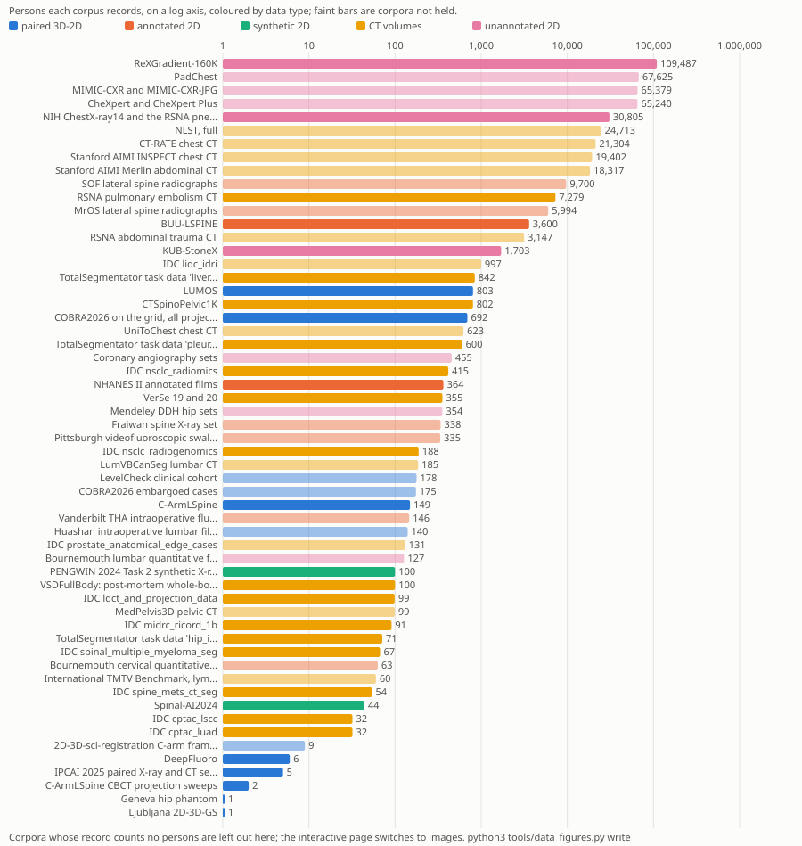
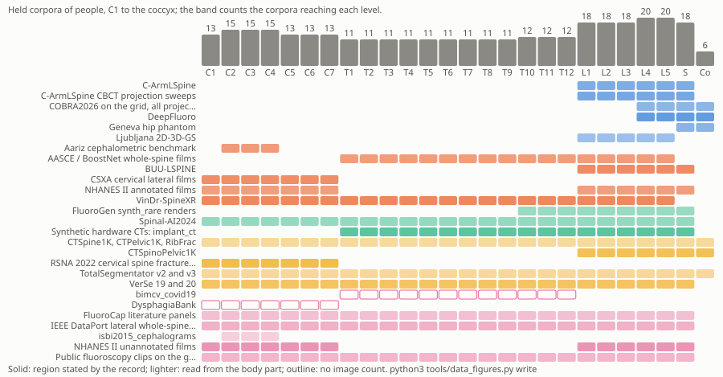
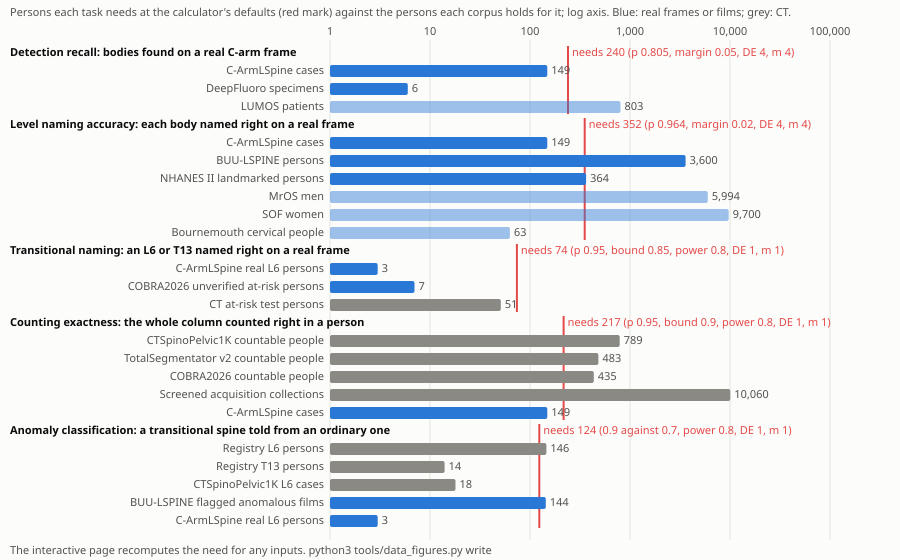
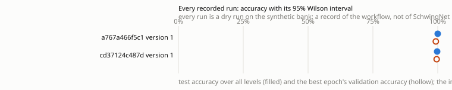

# 35 How the workflow is built: its plug points and the data it can take

Label: schwingnet-internal. This chapter is for the project's members until the provisional is filed: it says how the workflow is put together and what data it can take, names each training choice by the part it governs, and leaves how any model works, and which choices version 1 makes, to Part III.

This chapter is for whoever plans the next experiment and wants to know what the workflow will let them change without rewriting it. It settles five things. How a dataset enters: one pull request and one incremental run, into a catalog whose versions are never rewritten and whose split is decided by the person, not the frame. How a run is made and recorded so that a number can be reproduced from a commit, a catalog hash and a seed. Where a new training block, a new data type or a new task plugs in, with the exact commands. What data the project holds or wants, by type, by size and by stretch of the spine, and which of it has been tried. And how many persons each detection and classification task needs before a claim about it can be made, set beside the persons each corpus holds. The owner asked for this on 24 October 2026, for "the construction of the workflow, its plug and play for experimentation, which types of data have been, can be, or will be tried", with interactive figures of the amount of each data type, where it lies along the spine, and power for each task. What the stages compute is [chapter 12](12-detectors-the-architecture-and-the-version-1-training-plan.md) and the rest of Part III; the corpora one by one are chapters 4 to 9; how a run reaches the grid is [chapter 21](21-the-grid-how-a-run-starts-waits-and-finishes.md).

## The record this chapter reads

The construction is read from the code as merged and from the notes written beside it: [docs/research/experiment-framework.md](../../docs/research/experiment-framework.md) of 24 October (issue #207), the memory facts [the v1 flow](../../docs/memory/the-v1-flow.md), [training blocks](../../docs/memory/training-blocks.md), [the data catalog](../../docs/memory/the-data-catalog.md), [evaluation and W&B](../../docs/memory/evaluation-and-wandb.md), [latency and the recorded sweep](../../docs/memory/latency-and-the-recorded-sweep.md) and [training data licences](../../docs/memory/training-data-licences.md), and the tools themselves: [tools/flow.py](../../tools/flow.py), [tools/block_sweep.py](../../tools/block_sweep.py), [tools/catalog.py](../../tools/catalog.py), [tools/ingest.py](../../tools/ingest.py) and [tools/licences.py](../../tools/licences.py). The memory facts override an older artifact where the two disagree, and no artifact describes the workflow as it stands, since every piece of it was merged between 21 and 24 October.

The data is read from the 111 dataset records under [data/sources/](../../data/sources/), the 24 registry entries under [data/registry/](../../data/registry/) and the licence classes in [data/licences.json](../../data/licences.json), as they stand at this chapter's commit. The [SchwingNet Data Registry](../../artifacts/schwingnet-data-registry/) of 20 October is the same records rendered when they were 60; it is the canonical page of its cluster and still the easiest place to read one record whole, but its counts of records are a record, not a final value, since the inventory has nearly doubled since. The [State of the literature: datasets held, missing, size and power](../../artifacts/state-of-the-literature-datasets-held-missing-size-and-power-8hg1ay/) of 8 October holds the power analysis this chapter's calculator is checked against and the CT holdings by task; the [Fluoroscopy Data Atlas](../../artifacts/fluoroscopy-data-atlas/) of 17 October and [Research directions from the data holding](../../artifacts/research-directions-from-the-data-holding-kcyckb/) of 8 October hold the reading of each paired and annotated set. The [datasets contradictions page](../../artifacts/_synthesis/contradictions/datasets-holdings-and-licences.md) decides which count to carry where they disagree, and this chapter quotes both sides where it leaves them open.

Every figure here is drawn new by [tools/data_figures.py](../../tools/data_figures.py) from those committed files. The script reads one further file written for this chapter, [corpora-overlay.json](figures/35/corpora-overlay.json), which gives each corpus its data type, the stretch of the spine it shows, the persons and images its record counts, and whether it has been tried, each with the words of the record it was read from. The script refuses any count that neither the record nor the overlay's note gives, so the figures carry no number without a source. The counts are therefore Reported, as their records give them; the type, span and tried status are this chapter's reading and are Inferred. `python3 tools/data_figures.py write` redraws everything from the repository alone, on a runner, in seconds.

## The path a dataset takes, from a pull request to a catalog version

A new dataset enters the workflow as files in one pull request, and then as one run that reads nothing it has read before. The pull request carries three things. The record, `data/sources/<id>.json`, says what the dataset is, its level truth, how far the project reaches it (held, to get, gated, embargoed, does not exist, excluded), its licence line word for word, its link and its counts; the inventory page is rendered from these records, and the check fails when the two disagree. The registry entry, `data/registry/<source>.json`, says how the dataset enters the catalog: the identity level a split must not share (a patient, a study, or the source volume of a render), the rule that turns a file into a person key, the modality and device class, the regions of the spine, and the folder on the data root where its shards will live. And the licence entry: `python3 tools/licences.py propose --write` gives the new line a class by the strictest reading of its words (open, share-alike, non-commercial, agreement, no-derivatives or unknown), `python3 tools/licences.py render` rewrites data/LICENCES.md, and only the owner's reading may loosen a class. `bash scripts/check.sh` fails if any of the three is missing or disagrees with another, so the pull request cannot land half done.

The run is an ingest and a build, both on the grid on the owner's word, never on the login node. `python3 tools/ingest.py plan --bank <dir> --source <source> --kind train` reads a bank of frames in the builders' common format, checks it and prints the manifest it would write, writing nothing; `run` writes the shard. A shard is named by its content, so the same bank ingested twice writes nothing the second time, and a bank that grew is cut as a successor of the old shard with `--supersedes latest`, never as a sibling, so no frame is counted twice. The first ingest's measured lesson is in the tool's own notes: a second ingest of a grown bank without that flag once gave a catalog of 287 frames for 167 files. Bytes seen twice under one person count once and are reported; the same bytes under two persons are refused, since which person they are is not the tool's to decide; and a train shard holding a frozen test person is refused.

`python3 tools/catalog.py build --store <dir> --manifest <shard>/MANIFEST.json ...` then writes one new catalog version. A store is one directory: every version ever built, each a SQLite file named by its number and its content hash and made read-only the moment it is complete; an append-only log of versions with each one's parent, what it added and dropped and its counts; and a pointer to the latest. A build whose bytes equal the latest is dropped, so nothing is rewritten and an unchanged input makes no version. Measured on synthetic banks in the cloud container on 21 October, 20,000 frames built in about 6 seconds and 20 readers opened one version at once ([the data catalog](../../docs/memory/the-data-catalog.md)); the same speed on the grid's volume is not measured. This is what "one pull request and one incremental run" means: a new source adds a shard and a version, and no earlier shard, version or epoch is touched or read again.

The split is decided when the catalog is built, by the person and never the frame. A person on [data/splits/test-persons.json](../../data/splits/test-persons.json) is test whatever else holds: today the three real L6 persons of C-ArmLSpine and the two persons of the demo sweeps. Everyone else is validation where the first eight bytes of a hash of the person key and a fixed salt fall below a tenth of the hash space, and training otherwise ([data/splits/rule.json](../../data/splits/rule.json)). So a person's place never changes when a source is added, and no person can sit in two parts. `python3 tools/catalog.py split-check <dir>` checks exactly that over a version's person table and exits 1 before any training step can read it; [chapter 9](09-splits-leakage-and-licences.md) holds the leak checks that follow it.

## A run, from a clean tree to a ledger row

`python3 tools/flow.py run --catalog <catalog.sqlite> --out <runs folder> --mode local|slurm --epochs N --seed S [--block KEY=VALUE ...] [--recipe NAME] [--init <parent checkpoint>] [--slug NAME]` is the one command that turns a catalog into numbers, and it refuses to start from a tree with anything uncommitted, since its record names the commit. Before the first step it writes three files. RUN.json carries the run id, which is a hash of the commit, the catalog's sha256 and the run's configuration (CONFIGURATION.json beside it), so the same configuration run again finds its own folder: a finished run is reported and left, a trained one only evaluated, and a cut one resumed from train/last.pt (#252); the trainer and the evaluator stamp every number from it and type no fact of their own. PROVENANCE.json and PROVENANCE.md list each source of the catalog with its licence, its class and its frames in each part; with `--recipe` the run is refused if the catalog holds a source the recipe does not take, and `python3 tools/licences.py derive` cuts a catalog to a recipe first ([data/recipes/](../../data/recipes/)). And witness.json names the witness frames: the frozen list in data/witness/ once the first run on real frames has been recorded with `--freeze`, else the frames chosen from this catalog now.

The steps then run as processes, each timed as a job: the split check, training, evaluation. Training reads the train and validation parts only and draws the same witness frames at every epoch, from the untrained network on, so learning is seen and not trusted ([chapter 18](18-metrics-intervals-and-witness-frames.md) shows why, from the synthetic run whose witness frames fell from 85 of 93 to 38 of 93 while the training loss fell from 0.2775 to 0.0217). Evaluation reads the test part once, after training, and writes every number as correct out of n with its 95 percent Wilson interval, the persons behind it, and the run id, commit, clean-tree flag and catalog hash; the transitional stratum is always reported apart, never pooled. Each step's offline Weights and Biases files are pushed after it ends, and the last line says so, or says why not. `python3 tools/flow.py record --run <dir> --into docs/research/v1-demo/runs --activity "..." --verified "..."` copies the run's small files, never its checkpoint, into the repository with one ledger row, and the evaluation page and the run's report are rewritten from the recorded runs by the check. Two runs are recorded so far, both on the synthetic bank, both of the workflow and not of the spine ([docs/research/v1-demo/LEDGER.md](../../docs/research/v1-demo/LEDGER.md)).

## The training blocks and the sweep planner

Every part of training is a block chosen by name on the command line, `--block KEY=VALUE`, repeated; naming none gives version 1's training to the bit, and no block changes a run that names none. The parts as of #208 are fifteen: normalise, augment, optimiser, weight_decay, schedule, warmup_epochs, backbone_lr_scale, sampler, loss_weights, select, samples (with sources and per_person), architecture and denoise ([docs/research/experiment-framework.md](../../docs/research/experiment-framework.md), section 2). Which names each part takes and which one version 1 uses is printed by `python3 tools/block_sweep.py parts`, read from the code, and that command, not this page, is the record once a name is added; what each choice does to a model is Part III's. Two of the parts decide data rather than training. samples cuts which training crops a run sees, by source or by a cap of crops per person, and never cuts the validation part, so every run of a comparison scores the same crops. A licence recipe cuts the catalog before any of this, so a block can narrow what a run was given and can never widen it.

The sweep planner is the loop's centre, and it submits nothing. `python3 tools/block_sweep.py plan --catalog <catalog> --out <runs> --epochs N --seed S --hours H --base KEY=VALUE --vary KEY=V1/V2` prints the tools/flow.py command of every combination of the varied blocks, the number of runs and jobs, and the GPU-hours they would ask for; the owner reads the count and gives the word, as [docs/project.md](../../docs/project.md) requires of every grid job. It refuses a sweep in which one run would start from pretrained weights and another from nothing, since its rows would compare the start and not the block. `python3 tools/block_sweep.py ledger <runs folder>` finds every run under a folder by itself and tables the blocks that differ from version 1, the crops kept of those offered, the parent run, the best epoch, the validation accuracy with its Wilson interval, the balanced accuracy, the validation witness score and the latency headline where one was measured. It never reads evaluate/results.json: the next plan is chosen on the validation part, and the test part is read once, for the chosen run. The note's own next steps are a version 1 run on the real catalog on the owner's word, then one sweep per part, one block varied at a time, and then a planner worker that reads the ledger and proposes the next plan on its issue.

## Where a new piece plugs in

A new way of doing an existing part is three edits and no change to the trainer. Add the name to the part's tuple in [src/schwingnet/blocks.py](../../src/schwingnet/blocks.py); add one function under that name to the part's table in [tools/train_blocks.py](../../tools/train_blocks.py); and add the one entry the part keys by name where it has one (the head's parameter prefix for an architecture, a place in the augment order for an augment, a branch of the samples choice). tests/test_train_blocks.py fails when a table and its tuple disagree, so a name added on one side only is caught, and `python3 tools/block_sweep.py parts` lists the new name at once. A new part is a field on the blocks record whose default is version 1's choice, entered in the choices or the settings with its range; a test holds that every field is in one of the two. A run made with the new piece is then `python3 tools/flow.py run ... --block <part>=<name>`, and a sweep over it is `plan --vary <part>=<old>/<name>`.

A new data type is a new pair of record and registry entry, and the catalog already has the columns it needs. The catalog stores each frame's modality, device class, make, model, exposure, pixel size and view band as columns, so a new kind of image, a cine clip, a projection from a radiotherapy linac, a render, is a value in those columns and a query, not a new table, and the owner's one-domain hypothesis is measured per device and band rather than assumed. The registry entry's identity level is where the type's unit of independence is declared: a render is keyed by its source volume, so renders of one CT never sit on both sides of a split; a study-keyed source such as the chest-film collections is split by study where its record gives no patient. What the type needs beyond that is a bank in the builders' format, images with a meta file per frame naming its case, device, view and boxes with their levels, written by a builder outside this repository; a box with no trusted level is kept as a frame fact and dropped as a label. An unannotated type enters the same way with no boxes, and so can feed a screener or a self-supervised step without ever counting in a level score.

A new task is the least built of the three. The run record already names the stage it trains, and the stages declared are detector, encoder, head and level ([src/schwingnet/flow.py](../../src/schwingnet/flow.py)), but only the level stage has a trainer and an evaluator today ([tools/train.py](../../tools/train.py), [tools/evaluate.py](../../tools/evaluate.py)); every version 1 number is over truth boxes and says so. So a new task, a detector, a counting head, an anomaly classifier, plugs in as a stage value, its own trainer and evaluator that read the same catalog parts and write the same RUN.json, witness strips and Wilson-interval result rows, and its line in the ledger. That shape is a reading of the code, not a documented interface: no note yet says what a second stage must write, and the first one built will settle it. Each task's power, below, is what its evaluator will need its test part to hold.

## The data types

The owner named the types by how a corpus can be used: paired 3D-2D registration, annotated, completely unsupervised. This chapter sorts every corpus into five types by that use. Paired 3D-2D is a real 2D frame or projection with a CT or CBCT of the same body, so 3D labels can be carried onto the 2D image and a pose read. Annotated 2D is a real radiograph, fluoroscopy frame or cine with spine labels: boxes, landmarks, named levels or grades. Synthetic 2D is a render or generated image with labels exact by construction or inherited from its CT, and, kept with it, the project's own synthetic CTs. CT volumes are the 3D collections that are the raw material of the renders and of the CT counting priors, and that are never a 2D frame themselves. Unannotated 2D is real images with no spine labels, for self-supervised or unsupervised use, a screener's pool, or pseudo-labels.

*Figure 35.1. The amount of each data type, by corpus; persons or images, filtered by reach and licence class. Source: [record](figures/35/data-types.json).*

The 111 records and the two registry-only sources make 113 rows; three of them are left out of every sum, the anomaly-harvest umbrella, whose collections have records of their own, and the two COBRA vendors, which are parts of the COBRA total. Of the other 110, the table below counts the corpora by type and by whether they have been tried, with the persons their records count. A blank persons figure is common: 57 of the 110 records count no persons, only films, frames or volumes, so the persons are a floor.

| Type | Corpora | Tried | Can be tried with what is held | Will be tried once obtained | Not on the way | Persons recorded, tried | Persons recorded, to obtain |
| --- | --- | --- | --- | --- | --- | --- | --- |
| Paired 3D-2D | 11 | 5 | 2 | 3 | 1 | 850 | 978 |
| Annotated 2D | 19 | 5 | 1 | 10 | 3 | 3,964 | 16,430 |
| Synthetic 2D | 5 | 1 | 2 | 2 | 0 | 44 synthetic identities | 100 source CTs |
| CT volumes | 34 | 5 | 1 | 28 | 0 | 25,870 | 74,135 |
| Unannotated 2D | 41 | 3 | 4 | 33 | 1 | none counted | 341,175 |

Tried means the record's status names a bank, a run or a test of the reported stack (spine-program's 01_carm_level_detection) that used the corpus; the new workflow has tried none of them, since its only runs are on the synthetic bank. Can be tried means held on the grid and used by nothing written. Will be tried means public, gated or embargoed and not yet fetched. Not on the way is a set that does not exist publicly or was excluded for a stated reason.

### Paired 3D-2D

Five paired corpora have been tried and every one of them is lumbosacral or pelvic. C-ArmLSpine is the one human intraoperative set with a volume: 149 cases with 299 AP and lateral spot frames and a CBCT each, its level truth projected from the CBCT where two automatic labellers agreed on 814 of 910 bodies ([data/sources/carmlspine.json](../../data/sources/carmlspine.json)); other files give 148 cases or 120 distinct subjects, and the [concept ledger](../../artifacts/_synthesis/concepts.md) leaves the count differing, so 149 here is a record, not a final value. Its two CBCT sweeps of 301 projections each are the demo's recording. COBRA2026 holds 692 public cases and 375,618 kV projections around supine pelvic radiotherapy patients, with 175 more cases embargoed until 1 March 2032 (the counts agree across the pages, row 52 of the contradictions page, while its size on disk is a record, not a final value, row 0); only 145 Elekta cases were ever cut into a bank, of 24 frames each, for the sacrum detector, and the 225 Varian cases have had no frame looked at ([data/sources/cobra_total.json](../../data/sources/cobra_total.json)). Its projections come from radiotherapy linacs, not C-arms, which [docs/research/state-of-knowledge.md](../../docs/research/state-of-knowledge.md) (section 4) counts as another device class. DeepFluoro's six cadaver pelves and the Geneva hip phantom, the unseen-device test, complete what was tried. Ljubljana's one cadaver, 18 frames of L1 to L5 with a gold pose, is held and unbuilt under a no-derivatives licence, and the IPCAI 2025 set turned out to be five distal femurs, no spine.

Wanted are LUMOS, 803 living patients with 1,620 lumbar radiographs and 280 CTs, open to download, whose film-to-CT pairing is not stated, and the embargoed COBRA cases. The Balgrist ex-vivo set answered on 21 October that it cannot be shared. The paired sets that are request-only, the LevelCheck cohort of 178 patients and 398 intraoperative radiographs from cervical to lumbar, Huashan's 140 lumbar patients and NIT Warangal's 9, are held in spine-datasets' records and not in this repository's, so they appear in the state-of-knowledge note and not in the figures, as does the released cadaver torso of the language-promptable digital twin, which reaches T2 and has no record here ([docs/research/benchmarks-to-beat.md](../../docs/research/benchmarks-to-beat.md)); the LevelCheck cohort would be the first pair above the lumbar spine with more than one subject.

### Annotated 2D

The tried annotated corpora are plain films: BUU-LSPINE's lumbar films of 3,600 persons (one older reading gave 1,200, and the [datasets contradictions page](../../artifacts/_synthesis/contradictions/datasets-holdings-and-licences.md), row 14, refutes the disagreement and carries 3,600), CSXA's 4,963 lateral cervical films, the 543 landmarked NHANES II films of 364 persons, AASCE's whole-spine AP films (609 labelled and 98 challenge-test) and VinDr-SpineXR's 10,466 images, whose labels are lesion boxes and never levels. [Chapter 6](06-plain-film-corpora.md) is their chapter. The 1,000 Aariz cephalograms, held since the census, are the only annotated set held and in no bank. The ten to obtain are the large film cohorts with grades on named levels, MrOS's 5,994 men and SOF's about 9,700 women, the cine sets with named levels on every frame (Bournemouth's cervical set of 63 people, Maastricht's 112 recordings, Pittsburgh's swallow clips with corners on C2 and C4 only), Fraiwan's 338 subjects in three diagnostic classes, a scoliosis box set of unknown size, the VertXNet labels for the NHANES films already held, and two sets whose counts and spans are not recorded (SX-Stitch and TVGH). The row that matters most is empty by its own record: no public set of real cervical or thoracic C-arm frames with named levels exists ([data/sources/cervical_thoracic_intraop.json](../../data/sources/cervical_thoracic_intraop.json)).

### Synthetic 2D and CT volumes

The renders are made by the project from its CTs, so the CT corpora are where synthetic data comes from. The CTs tried are the render sources, CTSpinoPelvic1K's 802, VerSe's 374 series of 355 subjects and TotalSegmentator's 1,228 v2 and 1,935 v3 scans (1,939 in the manifest and 1,936 in the census, which the contradictions page leaves open, row 28), the transitional registry's CTSpine1K, CTPelvic1K and RibFrac, and the NLST pilot of 500. Spinal-AI2024's 20,000 generated films of 44 synthetic identities are the one external synthetic set that was trained on; FluoroGen's 12,929 rare-class renders, 1,763 of them L6 and 86 T13, are held and in no bank, with no reason written, and the project's synthetic hardware CTs are held in part, one of their three sets deleted and one unfinished, waiting on a rebuild ([data/sources/implant_ct_synthetic.json](../../data/sources/implant_ct_synthetic.json)). The 28 CT collections to obtain are mostly chest, abdominal and whole-body screening cohorts, chosen for their count of transitional spines rather than their labels; [chapter 7](07-ct-collections-their-labels-and-the-border-variants.md) holds why each was chosen and its expected yield.

### Unannotated 2D

The unannotated pool is by far the largest and the least used. To obtain are 33 sets, chiefly chest-film collections (ReXGradient's 109,487 patients, PadChest's 67,625, MIMIC-CXR's 65,379, CheXpert's 65,240, NIH ChestX-ray14's 30,805) in which the thoracic spine sits behind the heart, and endovascular, swallow and teaching videos in which a spine is in the background. Held and never used are the census's 726,614 images of public fluoroscopy clips and a cervical swallow corpus. Three were tried, and the record of each is negative or narrow: FluoroCap's 29,500 literature panels carry pseudo labels only and are out of training by directive D1 ([chapter 8](08-fluorocap-as-a-dataset.md)); the IEEE lateral 236 fed a pseudo-label arm that was refuted; and the 16,531 unannotated NHANES II films (17,073 TIFFs on disk, row 9 of the contradictions page; both a record, not a final value) fed a pseudo-label arm that the record says cut anomalous accuracy by 20 points ([data/sources/nhanes2_unannotated.json](../../data/sources/nhanes2_unannotated.json)). They remain the owner's chosen large unannotated set for the screener, by the owner's word of 21 October ([docs/memory/sample-index.md](../../docs/memory/sample-index.md)). No self-supervised use of any unannotated set has been tried.

## Where along the spine each corpus lies

*Figure 35.2. Where along the spine each held corpus lies, C1 to the coccyx, shaded by image count; the interactive figure takes every reach and type. Source: [record](figures/35/spine-coverage.json).*

The span of each corpus is the region its record states, or, for a CT collection that names only the body part it images, the stretch that part covers: a chest CT T1 to L1, an abdominal CT T10 to S1, a pelvic CT L4 to the coccyx, a whole-body CT C1 to the coccyx. The second kind is drawn lighter, since it is a reading and not the record's word. No record counts images by level, so the shade of a cell is the corpus's whole count spread over its span, and a cell with no count is an outline. The transitional classes, T13 and L6, have no column of their own; [chapter 7](07-ct-collections-their-labels-and-the-border-variants.md) and [chapter 14](14-transitional-anatomy-two-anchors-disagreement-and-abstention.md) hold them.

Read for real 2D data that is held, the strip says three things. Every held paired corpus lies at L1 or below: three reach L1 to L3, five reach L4 and five the sacrum, and none reaches T12 or above, so no 3D-to-2D pairing above the lumbar spine is held, and LUMOS, the one wanted, is lumbar too. The thoracic spine, T1 to T12, is covered by two held annotated corpora, AASCE's whole-spine films, a thoracic test set today whose 457 training films once fed level banks that were since deleted, and VinDr-SpineXR, which names no levels; so for naming a thoracic level on a real image the holding has one test set and no training set. The cervical spine is covered by CSXA, the landmarked NHANES films and VinDr, all plain films, with C2 to C4 also in the Aariz cephalograms; there is no cervical fluoroscopy with levels held, and the wanted cervical cine sets (Bournemouth, Maastricht, Pittsburgh) are the only route to one in the records. The CT corpora, by contrast, cover the whole column, with chest cohorts thickest over the thoracic spine, which is why the renders are where every level above L1 comes from today. The state-of-knowledge note reaches the same reading from the paired sets alone: five of its six stop at L1 or below, the sixth is one cadaver reaching T2, and no cervical pair exists anywhere the notes searched.

## What has been tried, what can be, what will be

Nineteen corpora have been tried, all by the reported stack, and the new workflow has tried none: its two recorded runs are on a synthetic bank built to test the plumbing ([docs/research/v1-demo/README.md](../../docs/research/v1-demo/README.md)). Ten are held and could be tried with no fetch, and nine of them name a question they could answer: Ljubljana's gold-pose frames, the FluoroGen rare-class renders, the synthetic hardware CTs, the RSNA cervical CTs as a C2 and C7 anchor, the Aariz cephalograms, the public fluoroscopy clips and the swallow corpus as an unannotated pool for a screener, and the BIMCV and ISBI 2015 sources, which have registry entries and no bank; the tenth, the IPCAI 2025 set, shows distal femurs and no spine. The Varian half of COBRA, 225 cases with no frame looked at, counts inside COBRA's row, which was tried through its Elekta half. Seventy-six will be tried once obtained, and every one of them waits on a fetch or an agreement that is the owner's word: no fetch runs without it (chapter 21). Five are not on the way.

For a planner, the order of what to try is not this chapter's; [chapter 28](28-the-ranked-experiment-backlog.md) ranks the experiments. What the figures add is which of those experiments can start on held data. Anything on lumbar real frames can; anything on thoracic or cervical real frames with levels needs a corpus that is not held, or must be a test on films; anything on the transitional classes on real frames has three persons.

## Power for each task

*Figure 35.3. Persons each task needs at the calculator's defaults against the persons each corpus holds for it; the interactive figure recomputes for any inputs. Source: [record](figures/35/power-calculator.json).*

The calculator asks one of three questions of each task, and states its formula with its answer. To estimate a proportion within a margin, it finds the smallest n whose 95 percent Wilson interval at the expected proportion p, (p + z^2/2n +/- z sqrt(p(1-p)/n + z^2/4n^2)) / (1 + z^2/n), has a half-width at most the margin. To clear a lower bound, it finds the smallest n at which the Wilson lower bound reaches the target with the stated power when the true proportion is p, by summing the binomial exactly; when no error is expected this is n / (n + z^2) at least the target. To detect a difference between two proportions, it uses the standard formula per arm, n = (z_a sqrt(2 pbar qbar) + z_b sqrt(p1 q1 + p2 q2))^2 / (p1 - p2)^2, with pbar their mean. Each n counts independent units. Frames or bodies scored several to a person are not independent, so the persons needed are ceil(n x DE / m), where m is the units scored per person and the design effect DE is 1 + (m - 1) times the intraclass correlation; the record measured a design effect of 3.84 to 4.47 for naming ([the size-and-power analysis](../../artifacts/state-of-the-literature-datasets-held-missing-size-and-power-8hg1ay/)). Since the design effect cannot pass m, a default of 4 over 4 bodies a person is an intraclass correlation of 1, each person counted once: the cautious end, since the record's line does not say over how many units a person its design effect was measured.

The calculator was checked in two ways. By hand, in its unit test ([tests/test_data_figures.py](../../tests/test_data_figures.py)): a 90 against an 80 percent rate at alpha 0.05 and power 0.80 needs 199 a arm, and an error-free Wilson lower bound of 90 or 85 percent needs 35 or 22 persons. And against the record: the size-and-power analysis of 8 October gives 22 to 74 carriers for an 85 percent variant-sensitivity bound at a true 95 to 99 percent, 347 at a true 90 percent, and 53 to 217 persons for paper 1's 90 percent exact-level bound, and the calculator gives 22, 74, 347, 53 and 217 for those inputs. The same formulas run in the page and in Python, and the two agree on every case above.

The five tasks, with their defaults and what the holding gives each:

| Task | Defaults | Persons needed | Most persons held on real images | Verdict |
| --- | --- | --- | --- | --- |
| Detection recall on real C-arm frames | p 0.805, margin 0.05, DE 4, m 4 | 240 | C-ArmLSpine, 149 cases | underpowered to plus or minus 5 points on one held C-arm set |
| Level naming accuracy | p 0.964, margin 0.02, DE 4, m 4 | 352 | C-ArmLSpine 149 on C-arm frames (a record, not a final value); BUU-LSPINE 3,600 on films | underpowered on C-arm frames, powered on lumbar films |
| Transitional naming | p 0.95, lower bound 0.85, power 0.8 | 74 carriers | 3 real L6 persons; 7 unverified at-risk COBRA persons | far short on real frames; 51 at-risk CT persons, also short |
| Counting exactness | p 0.95, lower bound 0.90, power 0.8 | 217 | no real frame with a whole-column count; CT countable people 435 to about 10,060 | powered only on CT |
| Anomaly classification | 0.90 against 0.70, power 0.8 | 124 over two arms | 3 real L6 persons; 144 flagged anomalous BUU films | possible on films if the flags hold; CT registry L6 146 and T13 14, mostly unverified |

The defaults are a planner's starting point, not a claim. The detection and naming proportions are the reported stack's measured figures on the held-out device, 231 of 287 bodies found at overlap 0.74 and 595 of 617 lateral bodies named, set down in [docs/research/state-of-knowledge.md](../../docs/research/state-of-knowledge.md) (rows 1 and 3); a planner who expects version 1 to differ types its own. The transitional and counting defaults use 95 percent, the low end of the 95 to 99 percent planning values that the size-and-power analysis says every powered statement so far assumed, while the record's own measured transitional figures are far lower: render L6 recall 56.1 to 72.4 percent, and 49.9 percent on anomalous film windows against 89.9 percent on ordinary ones. At a true L6 recall of 72.4 percent no number of carriers clears an 85 percent bound, and the calculator says so. The anomaly default of 90 against 70 percent is an illustration and is labelled one.

The persons beside each task are the persons a corpus holds, not the persons with the task's truth, and the two differ. C-ArmLSpine's 149 cases carry level truth from two automatic labellers and no human read, and its lumbar-only CBCT gives no whole-column count. The CT countable people are countable at the lumbosacral junction on CT, not on a frame. The registry's 146 L6 and 14 T13 persons are calls, most of them unverified by a reader. So each bar is an upper bound on what the task can use, and the verdicts above lean generous.

## The experiments panel: every run by its data input, its blocks and its outcome

A run leaves its record in six files, and the experiments panel, Figure 35.4, reads every such record under docs/research/: what the run was given (catalog, recipe, sources and bank), every block spelled out (version 1's choice where a run named none), epochs, seed and parent, the loss and validation accuracy of every epoch, every stratum's accuracy with its Wilson interval, the latency where measured, the model as its card gives it, the reproducibility fields down to the exact command, and the W&B link, or offline with why. It filters by data input and by block, draws the accuracies with intervals and the loss curves, and groups any measure by one block's value; with two runs that share every block it shows one group and says so.

Its last panel names a new combination from the recipes folder and the blocks module and shows the exact tools/flow.py command, refusing a choice in the trainer's words. Request this run opens a prefilled issue labelled experiment carrying the combination as lines; a workflow on main checks them against the recipes and the blocks module, answers with the command, the gate word and the owner's click, since no grid job runs without the owner's word and the number of jobs, and records them where the gate word reads them; the issue form, Run as me in the artifact edition and an `experiment:` line in the Ask box's answer reach the same issue. Framed to run scripts and nothing else, the figure loads nothing, inlines its data and hands its links and the combination it names to the page around it ([the note](../../docs/research/experiments-panel.md) has the messages); the check rebuilds it from the records.

*Figure 35.4. Every recorded run by its data input, its blocks and its outcome: accuracy with intervals, the loss curves, a view that groups accuracy by a block's value, and a panel that names a new combination's exact command and opens its request; both runs are dry runs on the synthetic bank. Source: [record](figures/35/experiments.json).*

## What the figures show at a glance

Thin by type: paired 3D-2D data of real people on a C-arm is one corpus, C-ArmLSpine, of 149 cases on one device, and every other paired set is a cadaver, a phantom, a femur or a radiotherapy linac. Thin by region: no held paired corpus and no held annotated fluoroscopy reaches above L1; the thoracic spine on real images is one test set of films with levels and one set with no levels; the cervical spine is plain films only. Thick: CT, which covers the whole column, and unannotated real images, of which the census holds three quarters of a million fluoroscopy images and the wanted chest cohorts several hundred thousand persons, none of it used for anything yet. Underpowered with what is held: transitional naming and anomaly classification on real frames (3 real carriers against 74 needed, and against 62 an arm), detection and naming to a tight margin on C-arm frames (149 against 240 and 352), and counting exactness on any real image. Powered: naming on lumbar films, and counting and the transitional count on CT.

## What we know

The workflow is built so that a dataset is one pull request of a record, a registry entry and a licence line, then one ingest and one build that touch nothing earlier; every catalog version is read-only and named by its hash; the split is by person, by a fixed hash and a frozen test list, and is checked before any step reads it. Every run is refused from a dirty tree, writes its record, its provenance and its witness list before its first step, and leaves one ledger row; every number carries its n, its Wilson interval, its persons and its stamp. Fifteen training parts are chosen by name, a new name is three edits the tests hold together, and the sweep planner prints commands and counts and submits nothing. Of 110 corpora, 11 are paired, 19 annotated, 5 synthetic, 34 CT and 41 unannotated; 19 were tried by the reported stack and none by the new workflow. Every held paired corpus lies at L1 or below. The calculator's formulas reproduce the record's power targets exactly. Both recorded runs are version 1 on the synthetic bank, and the panel reads them from their files.

## What we do not know

How the catalog, the ingest and the loader behave at the grid's scale, since every timing is from synthetic banks in a container. What a second stage must write, since only the level stage has a trainer and evaluator. How many persons stand behind the 57 records that count none, and which C-ArmLSpine count is right, 149, 148 or 120. What any task's proportion is on real frames under version 1, since version 1 has no real number; every default above comes from the reported stack or from planning values. The intraclass correlation of frames within a person on any real set other than the one the record measured. Whether the flagged BUU anomalies and the registry's CT calls survive a reader's read. And how far the regions read from a CT's body part match the vertebrae its volumes actually show, which the CT priors job would measure. What any block does on real frames, since no two recorded runs differ in one.

## What would change our mind

A version 1 run on the real catalog whose detection or naming proportion differs from the reported stack's would move every default and every verdict in the power table; the calculator takes the new figure at once. A paired or annotated real set above L1 obtained, the LevelCheck cohort or a cervical cine set, would end the thinnest finding of the spine figure. A reader's pass over the registry's L6 and T13 calls, or over the BUU flags, would turn the anomaly bars from upper bounds into counts, up or down. A measured intraclass correlation well below the record's would shrink the persons needed for detection and naming several fold. And a second stage built with an interface different from the level stage's would change where a new task plugs in. A run on the real catalog would turn the panel's dry-run notice off, a second differing in one block its first comparison on.

## Provenance

| Statement | Source | Grade |
| --- | --- | --- |
| A new dataset is a record, a registry entry and a licence line in one pull request, and the check fails when they disagree | [data/registry/README.md](../../data/registry/README.md); [docs/memory/training-data-licences.md](../../docs/memory/training-data-licences.md); [scripts/check.sh](../../scripts/check.sh) | Inferred |
| A shard is named by its content; a grown bank is cut as a successor with --supersedes; a second ingest without it once gave 287 frames for 167 files | [tools/ingest.py](../../tools/ingest.py) | Reported |
| Catalog versions are read-only SQLite files named by number and hash, with an append-only log; an unchanged build is dropped | [docs/memory/the-data-catalog.md](../../docs/memory/the-data-catalog.md); [tools/catalog.py](../../tools/catalog.py) | Inferred |
| 20,000 synthetic frames build in about 6 s and 20 readers open one version at once | [docs/memory/the-data-catalog.md](../../docs/memory/the-data-catalog.md) | Measured |
| The split: frozen test persons, validation below a tenth of the hash space, training otherwise; split-check exits 1 before training | [data/splits/rule.json](../../data/splits/rule.json); [data/splits/test-persons.json](../../data/splits/test-persons.json); [docs/memory/the-data-catalog.md](../../docs/memory/the-data-catalog.md) | Inferred |
| A run is refused from a dirty tree; RUN.json, PROVENANCE and witness.json are written before the first step; the run id hashes commit, catalog and start | [tools/flow.py](../../tools/flow.py); [docs/memory/the-v1-flow.md](../../docs/memory/the-v1-flow.md) | Inferred |
| Witness frames are drawn at every epoch from epoch 0; the test part is read once after training | [docs/memory/evaluation-and-wandb.md](../../docs/memory/evaluation-and-wandb.md) | Inferred |
| Two runs are recorded, both on a synthetic bank | [docs/research/v1-demo/LEDGER.md](../../docs/research/v1-demo/LEDGER.md) | Measured |
| Fifteen training parts are chosen by name; naming none is version 1's training | [docs/research/experiment-framework.md](../../docs/research/experiment-framework.md); [docs/memory/training-blocks.md](../../docs/memory/training-blocks.md) | Inferred |
| The sweep planner prints commands, runs and GPU-hours and submits nothing; the ledger never reads test results | [tools/block_sweep.py](../../tools/block_sweep.py); [docs/research/experiment-framework.md](../../docs/research/experiment-framework.md) | Inferred |
| A new block is a name in its tuple, a function in its table and the keyed entry, held together by tests | [docs/research/experiment-framework.md](../../docs/research/experiment-framework.md), section 1 | Inferred |
| Four stages are declared and only the level stage has a trainer and evaluator | [src/schwingnet/flow.py](../../src/schwingnet/flow.py); [tools/train.py](../../tools/train.py); [tools/evaluate.py](../../tools/evaluate.py) | Inferred |
| 111 records and 24 registry entries; the registry artifact rendered 60 | [data/sources/](../../data/sources/); [SchwingNet Data Registry](../../artifacts/schwingnet-data-registry/) ([claude.ai](https://claude.ai/artifact/L4pJez6yLFzaX8x5jiA3JL)) | Reported |
| Each corpus's type, span and tried status | [corpora-overlay.json](figures/35/corpora-overlay.json), read from each record | Inferred |
| The counts of corpora and persons by type and status | [corpora.json](figures/35/corpora.json), computed by [tools/data_figures.py](../../tools/data_figures.py) | Inferred |
| C-ArmLSpine: 149 cases, 299 spot frames, a CBCT each, two automatic labellers agreeing on 814 of 910 bodies; 148 and 120 elsewhere | [data/sources/carmlspine.json](../../data/sources/carmlspine.json); [concept ledger](../../artifacts/_synthesis/concepts.md); [datasets contradictions](../../artifacts/_synthesis/contradictions/datasets-holdings-and-licences.md), rows 2 and 5 | Reported |
| COBRA2026: 692 public cases, 375,618 projections, 175 embargoed to 2032; 145 Elekta cases banked; Varian unlooked; its size on disk a record, not a final value | [data/sources/cobra_total.json](../../data/sources/cobra_total.json); [data/sources/cobra_elekta.json](../../data/sources/cobra_elekta.json); [data/sources/cobra_varian.json](../../data/sources/cobra_varian.json) | Reported |
| BUU-LSPINE 3,600 persons; the reading of 1,200 refuted | [data/sources/buu_lspine.json](../../data/sources/buu_lspine.json); [datasets contradictions](../../artifacts/_synthesis/contradictions/datasets-holdings-and-licences.md), row 14 | Reported |
| TotalSegmentator v3 1,935, 1,939 or 1,936 scans | [data/sources/totalsegmentator.json](../../data/sources/totalsegmentator.json); [docs/research/data-manifest/MANIFEST.md](../../docs/research/data-manifest/MANIFEST.md) | Unverified |
| NHANES II: 16,531 unannotated films, 17,073 on disk; a pseudo-label arm cut anomalous accuracy 20 points; a record, not a final value | [data/sources/nhanes2_unannotated.json](../../data/sources/nhanes2_unannotated.json); [datasets contradictions](../../artifacts/_synthesis/contradictions/datasets-holdings-and-licences.md), row 9 | Reported |
| 726,614 images of public fluoroscopy clips held | [docs/research/data-manifest/MANIFEST.md](../../docs/research/data-manifest/MANIFEST.md) | Measured |
| No public set of real cervical or thoracic C-arm frames with named levels exists | [data/sources/cervical_thoracic_intraop.json](../../data/sources/cervical_thoracic_intraop.json) | Reported |
| Every held paired corpus lies at L1 or below; thoracic real images are AASCE and VinDr only | [Figure 35.2's record](figures/35/spine-coverage.json), from the records' regions | Inferred |
| Five of six paired sets stop at L1 or below; the cadaver reaches T2; no cervical pair exists | [docs/research/state-of-knowledge.md](../../docs/research/state-of-knowledge.md), section 4 | Reported |
| The LevelCheck cohort, Huashan and NIT Warangal are request-only paired sets | [docs/research/state-of-knowledge.md](../../docs/research/state-of-knowledge.md), section 4; [State of the literature](../../artifacts/state-of-the-literature-datasets-held-missing-size-and-power-8hg1ay/) ([claude.ai](https://claude.ai/artifact/8Hg1AyjzCf7VhCjPAQw8sY)) | Reported |
| Detection 231/287 = 80.5 % at 0.74; lateral naming 595/617 = 96.4 %; both the reported stack on a held-out device | [docs/research/state-of-knowledge.md](../../docs/research/state-of-knowledge.md), rows 1 and 3 | Reported |
| Design effect 3.84 to 4.47 measured for naming; planning values of 95 to 99 % assumed | [State of the literature](../../artifacts/state-of-the-literature-datasets-held-missing-size-and-power-8hg1ay/) ([claude.ai](https://claude.ai/artifact/8Hg1AyjzCf7VhCjPAQw8sY)) | Reported |
| Render L6 recall 56.1 to 72.4 %; 49.9 % on anomalous film windows against 89.9 % ordinary | [State of the literature](../../artifacts/state-of-the-literature-datasets-held-missing-size-and-power-8hg1ay/) ([claude.ai](https://claude.ai/artifact/8Hg1AyjzCf7VhCjPAQw8sY)) | Reported |
| 3 real L6 persons, 7 unverified at-risk COBRA persons, 51 at-risk CT test persons; CT countable people 789, 483, 435 and about 10,060; registry L6 146 and T13 14 | [State of the literature](../../artifacts/state-of-the-literature-datasets-held-missing-size-and-power-8hg1ay/) ([claude.ai](https://claude.ai/artifact/8Hg1AyjzCf7VhCjPAQw8sY)) | Reported |
| 144 BUU films flagged anomalous; C-ArmLSpine's lumbar-only CBCT gives no count | [Research directions from the data holding](../../artifacts/research-directions-from-the-data-holding-kcyckb/) ([claude.ai](https://claude.ai/artifact/KCyCkBtrHXGYQVM6LtpnK8)) | Reported |
| The calculator gives 199 a arm for 0.9 against 0.8, and 35 and 22 for error-free bounds of 90 and 85 % | [tests/test_data_figures.py](../../tests/test_data_figures.py) | Measured |
| The calculator reproduces the record's 22, 74, 347, 53 and 217 | [tests/test_data_figures.py](../../tests/test_data_figures.py); [State of the literature](../../artifacts/state-of-the-literature-datasets-held-missing-size-and-power-8hg1ay/) ([claude.ai](https://claude.ai/artifact/8Hg1AyjzCf7VhCjPAQw8sY)) | Measured |
| Persons needed at the defaults: 240, 352, 74, 217 and 124 | [corpora.json](figures/35/corpora.json), tasks; [tools/data_figures.py](../../tools/data_figures.py) | Inferred |
| The paired and annotated readings of each set | [Fluoroscopy Data Atlas](../../artifacts/fluoroscopy-data-atlas/) ([claude.ai](https://claude.ai/artifact/8YNXyLYbthsLjqEbFxQph2)) | Reported |
| No fetch, grid job or training runs without the owner's word and count | [docs/project.md](../../docs/project.md) | Reported |
| The experiments panel reads every recorded run under docs/research/, spells out version 1's blocks where a run names none, inlines its data and is rebuilt by the check | [tools/experiments_panel.py](../../tools/experiments_panel.py); [tests/test_experiments_panel.py](../../tests/test_experiments_panel.py); [scripts/check.sh](../../scripts/check.sh) | Measured |
| Both recorded runs are version 1 on the synthetic bank: 556/556 and 430/431 test crops, best validation epochs 2 and 4, neither online on W&B | [Figure 35.4's record](figures/35/experiments.json), from [docs/research/v1-demo/runs/](../../docs/research/v1-demo/runs/) | Measured |
| A requested combination is an issue labelled experiment that a workflow checks, answers and records for the gate word experiment; no such run has been queued, and the loop that fills the panel with runs on real frames is planned, not run | [.github/workflows/experiment.yml](../../.github/workflows/experiment.yml); [tests/test_experiment_request.py](../../tests/test_experiment_request.py); [docs/research/experiments-panel.md](../../docs/research/experiments-panel.md) | Measured |
